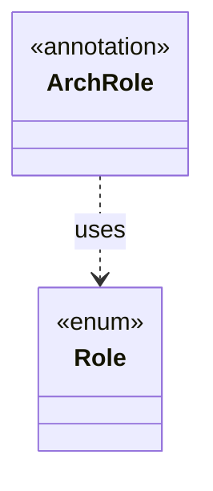

# `Role`

`io.github.tlaplus.hardening.common` · enum · other · [source](https://github.com/tlaplus/model-checker-hardening/blob/4df6a11e5b4bf93609393935c4cbeceec08cce0c/src/main/java/io/github/tlaplus/hardening/common/Role.java#L9) · module [common](../modules/common.md)

What a type does in its package, as the architecture atlas shows it (ADR 0022).

**Decisions:** [ADR 0022: Architecture atlas](https://github.com/tlaplus/model-checker-hardening/blob/4df6a11e5b4bf93609393935c4cbeceec08cce0c/docs/decisions/0022-architecture-atlas.md)

| Direction | Relation | Type | Summary |
|---|---|---|---|
| ← | uses | [ArchRole](io.github.tlaplus.hardening.common.ArchRole.md) | Declares the `Role` of a top-level type for the architecture atlas (ADR 0022). |
