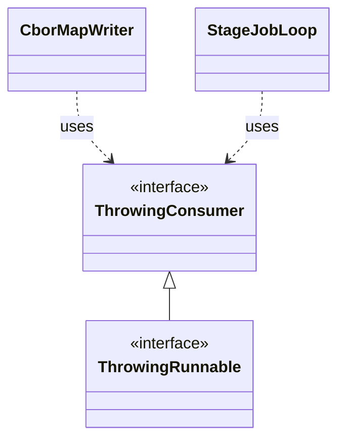

# `ThrowingConsumer`

`io.github.tlaplus.hardening.common` · interface · other · [source](https://github.com/tlaplus/model-checker-hardening/blob/4df6a11e5b4bf93609393935c4cbeceec08cce0c/src/main/java/io/github/tlaplus/hardening/common/ThrowingConsumer.java#L11) · module [common](../modules/common.md)

An operation on one value that may fail with a checked exception.

The diagram draws 3 of 6 relations; the table lists them all.

| Direction | Relation | Type | Summary |
|---|---|---|---|
| ← | extends | [ThrowingRunnable](io.github.tlaplus.hardening.common.ThrowingRunnable.md) | An operation that takes no value and may fail with a checked exception. |
| ← | uses | [CborMapWriter](io.github.tlaplus.hardening.corpus.CborMapWriter.md) | Collects the fields of one CBOR map so that its definite length is derived from what is written rather than maintained beside it. |
| ← | uses | [StageJobLoop](io.github.tlaplus.hardening.workflow.execution.StageJobLoop.md) | Claims queued items on behalf of one stage worker under the shared CPU budget. |
| ← | depends | [InventoryScan](io.github.tlaplus.hardening.corpus.InventoryScan.md) | The second pass of startup recovery: validates every entry of a corpus in which no transition is half-finished, and reports what it holds. |
| ← | depends | [AggregatorStage](io.github.tlaplus.hardening.workflow.aggregator.AggregatorStage.md) | Joins completed TLC and Apalache results with one in-process worker. |
| ← | depends | [ToolStage](io.github.tlaplus.hardening.workflow.tool.ToolStage.md) | One stage that runs an external tool over corpus entries: the parser, TLC, or Apalache. |
