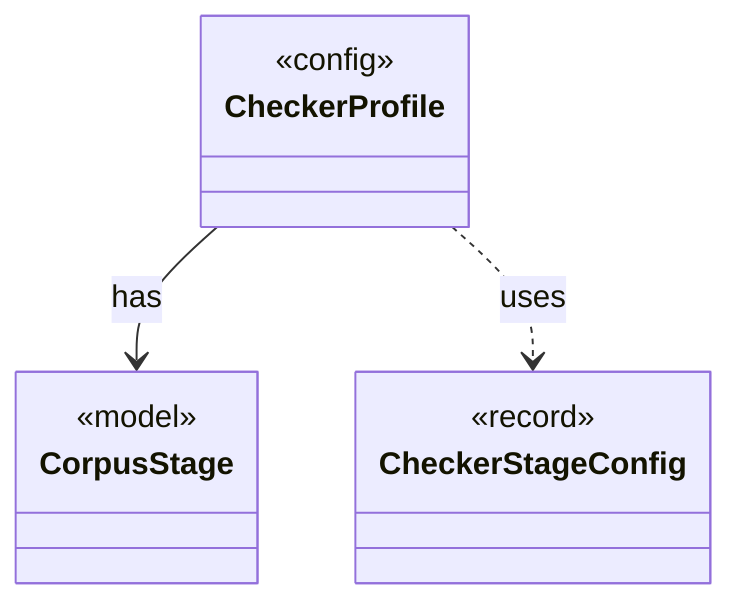

# `CheckerProfile`

`io.github.tlaplus.hardening.config` · enum · config · key · [source](https://github.com/tlaplus/model-checker-hardening/blob/4f182776ab66c4f93ff45cb83dfcd11e34fa32d1/src/main/java/io/github/tlaplus/hardening/config/CheckerProfile.java#L20) · module [config](../modules/config.md)

What differs between the configured model checkers: the defaults of their resource settings and the documentation of the settings whose meaning follows from the worker lifecycle.

The diagram draws 2 of 5 relations; the table lists them all.

| Direction | Relation | Type | Summary |
|---|---|---|---|
| → | has | [CorpusStage](io.github.tlaplus.hardening.corpus.CorpusStage.md) | One implemented stage of the fuzzing pipeline, and the corpus directories it owns. |
| → | uses | [CheckerStageConfig](io.github.tlaplus.hardening.config.CheckerStageConfig.md) | Capacity and resource limits for one model-checker stage. |
| ← | depends | [ConfigSchema](io.github.tlaplus.hardening.config.ConfigSchema.md) | The declaration of every key in `config.toml`: where it lives, what it means, how its value is read, and how it is written back. |
| ← | depends | [WorkflowConfig](io.github.tlaplus.hardening.config.WorkflowConfig.md) | Global and per-stage limits for the implemented fuzzing workflow. |
| ← | depends | [TlcWorkerMain](io.github.tlaplus.hardening.workflow.tlc.TlcWorkerMain.md) | One-shot TLC child process. |
