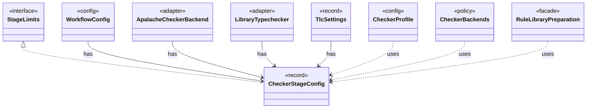

# `CheckerStageConfig`

`io.github.tlaplus.hardening.config` · record · other · [source](https://github.com/tlaplus/model-checker-hardening/blob/5b16596dd480095d323ac67ff0f85eb85227b4b5/src/main/java/io/github/tlaplus/hardening/config/CheckerStageConfig.java#L12) · module [config](../modules/config.md)

Capacity and resource limits for one model-checker stage.

The diagram draws 8 of 18 relations; the table lists them all.

| Direction | Relation | Type | Summary |
|---|---|---|---|
| → | implements | [StageLimits](io.github.tlaplus.hardening.config.StageLimits.md) | The limits every configured tool stage takes: its result capacity and a per-input time limit. |
| ← | has | [WorkflowConfig](io.github.tlaplus.hardening.config.WorkflowConfig.md) | Global and per-stage limits for the implemented fuzzing workflow. |
| ← | has | [ApalacheCheckerBackend](io.github.tlaplus.hardening.workflow.apalache.ApalacheCheckerBackend.md) | Adapts persistent Apalache tool workers to the shared tool stage. |
| ← | has | [LibraryTypechecker](io.github.tlaplus.hardening.workflow.library.LibraryTypechecker.md) | Finite, isolated Snowcat invocation producing a typed module rather than a checker verdict. |
| ← | has | [TlcSettings](io.github.tlaplus.hardening.workflow.tlc.TlcSettings.md) | What one TLC stage launches its JVMs with: the stage's limits and the TLC seeds of ` [seeds]` (ADR 0026), which every TLC stage shares. |
| ← | uses | [CheckerProfile](io.github.tlaplus.hardening.config.CheckerProfile.md) | What differs between the configured model checkers: the defaults of their resource settings and the documentation of the settings whose meaning follows from the worker lifecycle. |
| ← | uses | [CheckerBackends](io.github.tlaplus.hardening.workflow.CheckerBackends.md) | How each model-checker stage builds its backend for one invocation. |
| ← | uses | [RuleLibraryPreparation](io.github.tlaplus.hardening.workflow.library.RuleLibraryPreparation.md) | Loads a rule module once, before decoding (ADR 0017 §1, §6): the rewrites of a metamorphic run or the edge guards of graph inputs (ADR 0023 §6). |
| → | depends | [Preconditions](io.github.tlaplus.hardening.common.Preconditions.md) | Shared validation of method and constructor arguments. |
| ← | depends | [ConfigSchema](io.github.tlaplus.hardening.config.ConfigSchema.md) | The declaration of every key in `config.toml`: where it lives, what it means, how its value is read, and how it is written back. |
| ← | depends | [TomlConfig](io.github.tlaplus.hardening.config.TomlConfig.md) | Reads and writes the strict `config.toml` format used by a corpus. |
| ← | depends | [MetamorphicShrinker](io.github.tlaplus.hardening.workflow.MetamorphicShrinker.md) | Reduces a metamorphic counterexample for triage (ADR 0016 §8). |
| ← | depends | [OccupancyLimits](io.github.tlaplus.hardening.workflow.OccupancyLimits.md) | Checks an invocation and a recovered corpus against the configured capacity limits. |
| ← | depends | [StageGraph](io.github.tlaplus.hardening.workflow.StageGraph.md) | The stages that run one workflow invocation, wired to their queues, result capacities, and shared collaborators, and the order in which they start and stop. |
| ← | depends | [LibraryPreparation](io.github.tlaplus.hardening.workflow.library.LibraryPreparation.md) | Prepares custom libraries once before decoding; no importer/typechecker Maven dependency. |
| ← | depends | [SpecDecoders](io.github.tlaplus.hardening.workflow.spec.SpecDecoders.md) | Immutable registry of the decoders that turn stored payloads into checkable modules. |
| ← | depends | [TlcCheckerBackend](io.github.tlaplus.hardening.workflow.tlc.TlcCheckerBackend.md) | Adapts fresh isolated TLC invocations to the shared tool stage. |
| ← | depends | [TlcWorkerMain](io.github.tlaplus.hardening.workflow.tlc.TlcWorkerMain.md) | One-shot TLC child process. |
