# `ConfigSchema`

`io.github.tlaplus.hardening.config` · class · config · key · [source](https://github.com/tlaplus/model-checker-hardening/blob/4206d99417cbe58b5b339e189936abe305c56cca/src/main/java/io/github/tlaplus/hardening/config/ConfigSchema.java#L41) · module [config](../modules/config.md)

The declaration of every key in `config.toml`: where it lives, what it means, how its value is read, and how it is written back.

```mermaid
classDiagram
  class ConfigSchema {
    <<config>>
  }
  class ConfigTableBuilder
  class GeneratorLimitSchema
  class ConfigValueType {
    <<record>>
  }
  class FuzzTlaConfig {
    <<config>>
  }
  class InputStageConfig {
    <<record>>
  }
  class MetamorphicConfig {
    <<record>>
  }
  class MutatorConfig {
    <<record>>
  }
  class OperatorLibraryConfig {
    <<record>>
  }
  class ParserStageConfig {
    <<record>>
  }
  class PbtConfig {
    <<record>>
  }
  class QualityGateConfig {
    <<record>>
  }
  class WorkflowConfig {
    <<config>>
  }
  class CheckerSet {
    <<record>>
  }
  class CorpusStage {
    <<model>>
  }
  class ShallowPattern {
    <<enum>>
  }
  class ExpressionCategory {
    <<enum>>
  }
  class InputKind {
    <<model>>
  }
  class IrGenerationConfig {
    <<config>>
  }
  class ExpressionKind {
    <<interface>>
  }
  class RewriteLimits {
    <<record>>
  }
  class MutationOperator {
    <<model>>
  }
  ConfigTableBuilder --> ConfigSchema : has
  GeneratorLimitSchema --> ConfigSchema : has
  ConfigSchema ..> ConfigTableBuilder : uses
  ConfigSchema ..> ConfigValueType : uses
  ConfigSchema ..> FuzzTlaConfig : uses
  ConfigSchema ..> GeneratorLimitSchema : uses
  ConfigSchema ..> InputStageConfig : uses
  ConfigSchema ..> MetamorphicConfig : uses
  ConfigSchema ..> MutatorConfig : uses
  ConfigSchema ..> OperatorLibraryConfig : uses
  ConfigSchema ..> ParserStageConfig : uses
  ConfigSchema ..> PbtConfig : uses
  ConfigSchema ..> QualityGateConfig : uses
  ConfigSchema ..> WorkflowConfig : uses
  ConfigSchema ..> CheckerSet : uses
  ConfigSchema ..> CorpusStage : uses
  ConfigSchema ..> ShallowPattern : uses
  ConfigSchema ..> ExpressionCategory : uses
  ConfigSchema ..> InputKind : uses
  ConfigSchema ..> IrGenerationConfig : uses
  ConfigSchema ..> ExpressionKind : uses
  ConfigSchema ..> RewriteLimits : uses
  ConfigSchema ..> MutationOperator : uses
```

The diagram draws 23 of 28 relations; the table lists them all.

| Direction | Relation | Type | Summary |
|---|---|---|---|
| ← | has | [ConfigTableBuilder](io.github.tlaplus.hardening.config.ConfigTableBuilder.md) | Registers typed keys in document order, then snapshots them as an immutable schema table. |
| ← | has | [GeneratorLimitSchema](io.github.tlaplus.hardening.config.GeneratorLimitSchema.md) | Declares and assembles the expression and module limit keys in the generator table. |
| → | uses | [ConfigTableBuilder](io.github.tlaplus.hardening.config.ConfigTableBuilder.md) | Registers typed keys in document order, then snapshots them as an immutable schema table. |
| → | uses | [ConfigValueType](io.github.tlaplus.hardening.config.ConfigValueType.md) | How the value of one configuration key is read from TOML and written back as TOML syntax. |
| → | uses | [FuzzTlaConfig](io.github.tlaplus.hardening.config.FuzzTlaConfig.md) | Complete configuration of input generation and workflow execution. |
| → | uses | [GeneratorLimitSchema](io.github.tlaplus.hardening.config.GeneratorLimitSchema.md) | Declares and assembles the expression and module limit keys in the generator table. |
| → | uses | [InputStageConfig](io.github.tlaplus.hardening.config.InputStageConfig.md) | The input stage's occupancy limit and the known-defect databases its admission consults. |
| → | uses | [MetamorphicConfig](io.github.tlaplus.hardening.config.MetamorphicConfig.md) | The `[metamorphic]` table (ADR 0016 §7, ADR 0017 §1): what a `--how=mt` run reads besides the generator settings. |
| → | uses | [MutatorConfig](io.github.tlaplus.hardening.config.MutatorConfig.md) | Generations, the quality gate's selection, and the mutator's share and operators (ADR 0010). |
| → | uses | [OperatorLibraryConfig](io.github.tlaplus.hardening.config.OperatorLibraryConfig.md) | Source-only library settings. |
| → | uses | [ParserStageConfig](io.github.tlaplus.hardening.config.ParserStageConfig.md) | Capacity and timeout limits for the parser stage. |
| → | uses | [PbtConfig](io.github.tlaplus.hardening.config.PbtConfig.md) | Limits and collection-richness controls for property-based input generation. |
| → | uses | [QualityGateConfig](io.github.tlaplus.hardening.config.QualityGateConfig.md) | What the quality gate keeps of a settled generation (ADR 0010, ADR 0013). |
| → | uses | [WorkflowConfig](io.github.tlaplus.hardening.config.WorkflowConfig.md) | Global and per-stage limits for the implemented fuzzing workflow. |
| → | uses | [CheckerSet](io.github.tlaplus.hardening.corpus.CheckerSet.md) | The checker branches a corpus runs: a non-empty set of checking stages, in stage order. |
| → | uses | [CorpusStage](io.github.tlaplus.hardening.corpus.CorpusStage.md) | One implemented stage of the fuzzing pipeline, and the corpus directories it owns. |
| → | uses | [ShallowPattern](io.github.tlaplus.hardening.corpus.ShallowPattern.md) | A way in which a TLC run explored almost nothing, as the calibration table of ADR 0008 defines it. |
| → | uses | [ExpressionCategory](io.github.tlaplus.hardening.gen.ExpressionCategory.md) | A user-facing category assigned to generated expression forms. |
| → | uses | [InputKind](io.github.tlaplus.hardening.gen.InputKind.md) | What a generator payload decodes to. |
| → | uses | [IrGenerationConfig](io.github.tlaplus.hardening.gen.IrGenerationConfig.md) | Settings for generated TLA+ expressions and modules. |
| → | uses | [ExpressionKind](io.github.tlaplus.hardening.gen.engine.ExpressionKind.md) | A selectable expression form grouped by the component that constructs it. |
| → | uses | [RewriteLimits](io.github.tlaplus.hardening.gen.rewrite.RewriteLimits.md) | Bounds of one rewrite (ADR 0016 §2, §7). |
| → | uses | [MutationOperator](io.github.tlaplus.hardening.mutation.MutationOperator.md) | One byte-level edit of a generator input, as ADR 0010 defines it. |
| → | depends | [Preconditions](io.github.tlaplus.hardening.common.Preconditions.md) | Shared validation of method and constructor arguments. |
| → | depends | [CheckerProfile](io.github.tlaplus.hardening.config.CheckerProfile.md) | What differs between the configured model checkers: the defaults of their resource settings and the documentation of the settings whose meaning follows from the worker lifecycle. |
| → | depends | [CheckerStageConfig](io.github.tlaplus.hardening.config.CheckerStageConfig.md) | Capacity and resource limits for one model-checker stage. |
| → | depends | [ConfigException](io.github.tlaplus.hardening.config.ConfigException.md) | Reports invalid contents in a FuzzTLA configuration file. |
| ← | depends | [TomlConfig](io.github.tlaplus.hardening.config.TomlConfig.md) | Reads and writes the strict `config.toml` format used by a corpus. |
