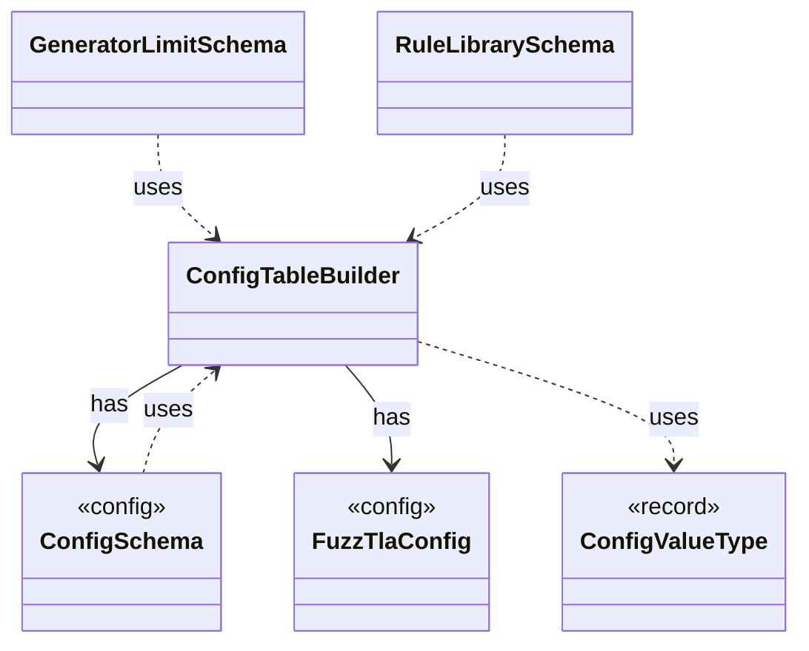

# `ConfigTableBuilder`

`io.github.tlaplus.hardening.config` · class · other · [source](https://github.com/tlaplus/model-checker-hardening/blob/4c5cb469fa5cdcada2cd5740bce130b825b35343/src/main/java/io/github/tlaplus/hardening/config/ConfigTableBuilder.java#L9) · module [config](../modules/config.md)

Registers typed keys in document order, then snapshots them as an immutable schema table.

| Direction | Relation | Type | Summary |
|---|---|---|---|
| → | has | [ConfigSchema](io.github.tlaplus.hardening.config.ConfigSchema.md) | The declaration of every key in `config.toml`: where it lives, what it means, how its value is read, and how it is written back. |
| → | has | [FuzzTlaConfig](io.github.tlaplus.hardening.config.FuzzTlaConfig.md) | Complete configuration of input generation and workflow execution. |
| → | uses | [ConfigValueType](io.github.tlaplus.hardening.config.ConfigValueType.md) | How the value of one configuration key is read from TOML and written back as TOML syntax. |
| ← | uses | [ConfigSchema](io.github.tlaplus.hardening.config.ConfigSchema.md) | The declaration of every key in `config.toml`: where it lives, what it means, how its value is read, and how it is written back. |
| ← | uses | [GeneratorLimitSchema](io.github.tlaplus.hardening.config.GeneratorLimitSchema.md) | Declares and assembles the expression and module limit keys in the generator table. |
| ← | uses | [RuleLibrarySchema](io.github.tlaplus.hardening.config.RuleLibrarySchema.md) | Declares and assembles the `rules` and `weights` keys of a table that names a rule module (ADR 0017 §1), so every such table reads them alike. |
