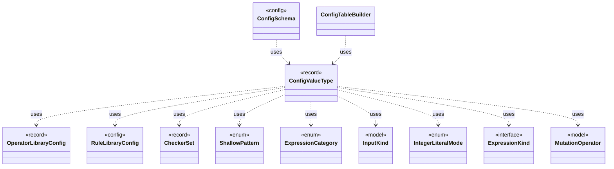

# `ConfigValueType`

`io.github.tlaplus.hardening.config` · record · other · [source](https://github.com/tlaplus/model-checker-hardening/blob/fd29bdb142d5d87538f91aeddca09d5ac3d7d0a7/src/main/java/io/github/tlaplus/hardening/config/ConfigValueType.java#L39) · module [config](../modules/config.md)

How the value of one configuration key is read from TOML and written back as TOML syntax.

The diagram draws 11 of 19 relations; the table lists them all.

| Direction | Relation | Type | Summary |
|---|---|---|---|
| → | uses | [OperatorLibraryConfig](io.github.tlaplus.hardening.config.OperatorLibraryConfig.md) | Source-only library settings. |
| → | uses | [RuleLibraryConfig](io.github.tlaplus.hardening.config.RuleLibraryConfig.md) | A rule module and its weights (ADR 0017 §1), as `[metamorphic]` configures the rewrites of `--how=mt` and `[graph]` the tautological edge guards of ADR 0023 §6. |
| → | uses | [CheckerSet](io.github.tlaplus.hardening.corpus.CheckerSet.md) | The checker branches a corpus runs: a non-empty set of checking stages, in stage order. |
| → | uses | [ShallowPattern](io.github.tlaplus.hardening.corpus.ShallowPattern.md) | A way in which a TLC run explored almost nothing, as the calibration table of ADR 0008 defines it. |
| → | uses | [ExpressionCategory](io.github.tlaplus.hardening.gen.ExpressionCategory.md) | A user-facing category assigned to generated expression forms. |
| → | uses | [InputKind](io.github.tlaplus.hardening.gen.InputKind.md) | What a generator payload decodes to. |
| → | uses | [IntegerLiteralMode](io.github.tlaplus.hardening.gen.IntegerLiteralMode.md) | How an integer literal decodes its value (ADR 0012). |
| → | uses | [ExpressionKind](io.github.tlaplus.hardening.gen.engine.ExpressionKind.md) | A selectable expression form grouped by the component that constructs it. |
| → | uses | [MutationOperator](io.github.tlaplus.hardening.mutation.MutationOperator.md) | One byte-level edit of a generator input, as ADR 0010 defines it. |
| ← | uses | [ConfigSchema](io.github.tlaplus.hardening.config.ConfigSchema.md) | The declaration of every key in `config.toml`: where it lives, what it means, how its value is read, and how it is written back. |
| ← | uses | [ConfigTableBuilder](io.github.tlaplus.hardening.config.ConfigTableBuilder.md) | Registers typed keys in document order, then snapshots them as an immutable schema table. |
| → | depends | [ConfigException](io.github.tlaplus.hardening.config.ConfigException.md) | Reports invalid contents in a FuzzTLA configuration file. |
| → | depends | [CorpusStage](io.github.tlaplus.hardening.corpus.CorpusStage.md) | One implemented stage of the fuzzing pipeline, and the corpus directories it owns. |
| → | depends | [CustomExpressionKind](io.github.tlaplus.hardening.gen.engine.CustomExpressionKind.md) | One configured operator kind; its type scheme comes from the immutable prepared library. |
| → | depends | [LibraryLinkage](io.github.tlaplus.hardening.gen.library.LibraryLinkage.md) | How a custom module's definitions reach the TLA+ source of the parser and TLC. |
| → | depends | [ModuleLink](io.github.tlaplus.hardening.gen.library.ModuleLink.md) | How one custom module is linked, and the module that its TLA+ source aliases instantiate: the module itself unless the linkage names a separate TLC module. |
| → | depends | [OperatorId](io.github.tlaplus.hardening.gen.library.OperatorId.md) | Case-sensitive identity of an exported operator, independent of its generated name. |
| ← | depends | [GeneratorLimitSchema](io.github.tlaplus.hardening.config.GeneratorLimitSchema.md) | Declares and assembles the expression and module limit keys in the generator table. |
| ← | depends | [RuleLibrarySchema](io.github.tlaplus.hardening.config.RuleLibrarySchema.md) | Declares and assembles the `rules` and `weights` keys of a table that names a rule module (ADR 0017 §1), so every such table reads them alike. |
