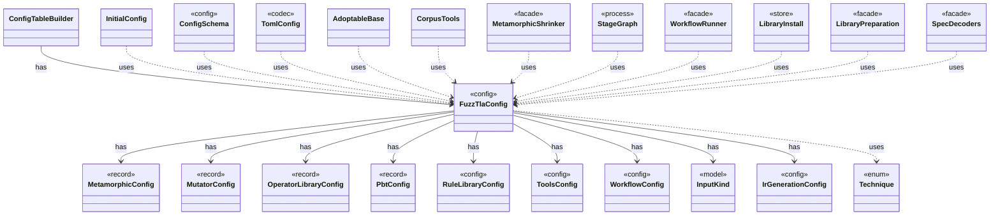

# `FuzzTlaConfig`

`io.github.tlaplus.hardening.config` · record · config · key · [source](https://github.com/tlaplus/model-checker-hardening/blob/6bbf8b66c375696d1798f7b7a061b81573a3f42a/src/main/java/io/github/tlaplus/hardening/config/FuzzTlaConfig.java#L26) · module [config](../modules/config.md)

Complete configuration of input generation and workflow execution.

The diagram draws 22 of 32 relations; the table lists them all.

| Direction | Relation | Type | Summary |
|---|---|---|---|
| → | has | [MetamorphicConfig](io.github.tlaplus.hardening.config.MetamorphicConfig.md) | The `[metamorphic]` table (ADR 0016 §7, ADR 0017 §1): what an `mt` corpus reads besides the generator settings. |
| → | has | [MutatorConfig](io.github.tlaplus.hardening.config.MutatorConfig.md) | Generations, the quality gate's selection, and the mutator's share and operators (ADR 0010). |
| → | has | [OperatorLibraryConfig](io.github.tlaplus.hardening.config.OperatorLibraryConfig.md) | Source-only library settings. |
| → | has | [PbtConfig](io.github.tlaplus.hardening.config.PbtConfig.md) | Limits and collection-richness controls for property-based input generation. |
| → | has | [RuleLibraryConfig](io.github.tlaplus.hardening.config.RuleLibraryConfig.md) | A rule module and its weights (ADR 0017 §1), as `[metamorphic]` configures the rewrites of `mt` corpora and `[graph]` the tautological edge guards of ADR 0023 §6. |
| → | has | [ToolsConfig](io.github.tlaplus.hardening.config.ToolsConfig.md) | The `[tools]` table (ADR 0025 §3): the tool JARs a corpus checks and types with. |
| → | has | [WorkflowConfig](io.github.tlaplus.hardening.config.WorkflowConfig.md) | Global and per-stage limits for the implemented fuzzing workflow. |
| → | has | [InputKind](io.github.tlaplus.hardening.gen.InputKind.md) | What a generator payload decodes to. |
| → | has | [IrGenerationConfig](io.github.tlaplus.hardening.gen.IrGenerationConfig.md) | Settings for generated TLA+ expressions and modules. |
| ← | has | [ConfigTableBuilder](io.github.tlaplus.hardening.config.ConfigTableBuilder.md) | Registers typed keys in document order, then snapshots them as an immutable schema table. |
| → | uses | [Technique](io.github.tlaplus.hardening.corpus.Technique.md) | The fuzzing technique a corpus runs: `[workflow] technique`, which `fuzztla init --how` sets (ADR 0025 §1), so every run and every replay decodes and judges its entries the same way. |
| ← | uses | [InitialConfig](io.github.tlaplus.hardening.cli.InitialConfig.md) | The configuration `fuzztla init` writes (ADR 0025 §1): the defaults, the shipped known-defect database, and the settings that follow from the technique. |
| ← | uses | [ConfigSchema](io.github.tlaplus.hardening.config.ConfigSchema.md) | The declaration of every key in `config.toml`: where it lives, what it means, how its value is read, and how it is written back. |
| ← | uses | [TomlConfig](io.github.tlaplus.hardening.config.TomlConfig.md) | Reads and writes the strict `config.toml` format used by a corpus. |
| ← | uses | [AdoptableBase](io.github.tlaplus.hardening.workflow.AdoptableBase.md) | The base corpus of a metamorphic run (ADR 0016 §6). |
| ← | uses | [CorpusTools](io.github.tlaplus.hardening.workflow.CorpusTools.md) | The tool JARs a corpus runs (ADR 0025 §3): those of its `[tools]` table, or the ones staged with FuzzTLA for a tool the table leaves out. |
| ← | uses | [MetamorphicShrinker](io.github.tlaplus.hardening.workflow.MetamorphicShrinker.md) | Reduces a metamorphic counterexample for triage (ADR 0016 §8). |
| ← | uses | [StageGraph](io.github.tlaplus.hardening.workflow.StageGraph.md) | The stages that run one workflow invocation, wired to their queues, result capacities, and shared collaborators, and the order in which they start and stop. |
| ← | uses | [WorkflowRunner](io.github.tlaplus.hardening.workflow.WorkflowRunner.md) | Runs generation, parsing, TLC, Apalache, conformance aggregation and the quality gate under one CPU budget. |
| ← | uses | [LibraryInstall](io.github.tlaplus.hardening.workflow.library.LibraryInstall.md) | Copies into a new corpus every file its configuration names (ADR 0025 §2, §3), so the corpus keeps the releases it was initialized with: the classpath of the operator library, of the rewrite rules and of the edge guards goes to `tla/`. |
| ← | uses | [LibraryPreparation](io.github.tlaplus.hardening.workflow.library.LibraryPreparation.md) | Prepares custom libraries once before decoding; no importer/typechecker Maven dependency. |
| ← | uses | [SpecDecoders](io.github.tlaplus.hardening.workflow.spec.SpecDecoders.md) | Immutable registry of the decoders that turn stored payloads into checkable modules. |
| → | depends | [InputStageConfig](io.github.tlaplus.hardening.config.InputStageConfig.md) | The input stage's occupancy limit and the known-defect databases its admission consults. |
| → | depends | [CustomExpressionKind](io.github.tlaplus.hardening.gen.engine.CustomExpressionKind.md) | One configured operator kind; its type scheme comes from the immutable prepared library. |
| → | depends | [ExpressionKind](io.github.tlaplus.hardening.gen.engine.ExpressionKind.md) | A selectable expression form grouped by the component that constructs it. |
| → | depends | [OperatorId](io.github.tlaplus.hardening.gen.library.OperatorId.md) | Case-sensitive identity of an exported operator, independent of its generated name. |
| ← | depends | [ExportDbCommand](io.github.tlaplus.hardening.cli.ExportDbCommand.md) | `fuzztla export-db`: exports a corpus with `CorpusExport` (ADR 0009). |
| ← | depends | [InitCommand](io.github.tlaplus.hardening.cli.InitCommand.md) | `fuzztla init`: writes the configuration of a new corpus, which names the technique every run follows (ADR 0025 §1), and copies its libraries and tool JARs into it (§2, §3). |
| ← | depends | [PrintCommand](io.github.tlaplus.hardening.cli.PrintCommand.md) | `fuzztla print`: decodes a payload or corpus envelope and renders it, with the known defects it matches. |
| ← | depends | [RunCommand](io.github.tlaplus.hardening.cli.RunCommand.md) | `fuzztla run`: reads a corpus configuration and runs `WorkflowRunner` with live progress output. |
| ← | depends | [ShrinkCommand](io.github.tlaplus.hardening.cli.ShrinkCommand.md) | `fuzztla shrink`: reduces a metamorphic counterexample with `MetamorphicShrinker` (ADR 0016). |
| ← | depends | [GenerationLoop](io.github.tlaplus.hardening.workflow.GenerationLoop.md) | Runs the generations of one workflow invocation over a single stage graph (ADR 0010). |
