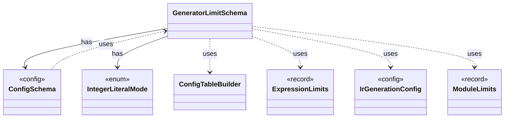

# `GeneratorLimitSchema`

`io.github.tlaplus.hardening.config` · class · other · [source](https://github.com/tlaplus/model-checker-hardening/blob/ad025d7ad6f7113910ce3a79cf6e18839b06eb5a/src/main/java/io/github/tlaplus/hardening/config/GeneratorLimitSchema.java#L14) · module [config](../modules/config.md)

Declares and assembles the expression and module limit keys in the generator table.

The diagram draws 7 of 13 relations; the table lists them all.

| Direction | Relation | Type | Summary |
|---|---|---|---|
| → | has | [ConfigSchema](io.github.tlaplus.hardening.config.ConfigSchema.md) | The declaration of every key in `config.toml`: where it lives, what it means, how its value is read, and how it is written back. |
| → | has | [IntegerLiteralMode](io.github.tlaplus.hardening.gen.IntegerLiteralMode.md) | How an integer literal decodes its value (ADR 0012). |
| → | uses | [ConfigTableBuilder](io.github.tlaplus.hardening.config.ConfigTableBuilder.md) | Registers typed keys in document order, then snapshots them as an immutable schema table. |
| → | uses | [ExpressionLimits](io.github.tlaplus.hardening.gen.ExpressionLimits.md) | Bounds on recursive construction and variable-size payloads within one expression. |
| → | uses | [IrGenerationConfig](io.github.tlaplus.hardening.gen.IrGenerationConfig.md) | Settings for generated TLA+ expressions and modules. |
| → | uses | [ModuleLimits](io.github.tlaplus.hardening.gen.ModuleLimits.md) | Declaration, action and exploration bounds on one module. |
| ← | uses | [ConfigSchema](io.github.tlaplus.hardening.config.ConfigSchema.md) | The declaration of every key in `config.toml`: where it lives, what it means, how its value is read, and how it is written back. |
| → | depends | [ConfigException](io.github.tlaplus.hardening.config.ConfigException.md) | Reports invalid contents in a FuzzTLA configuration file. |
| → | depends | [ConfigValueType](io.github.tlaplus.hardening.config.ConfigValueType.md) | How the value of one configuration key is read from TOML and written back as TOML syntax. |
| → | depends | [ActionLimits](io.github.tlaplus.hardening.gen.ActionLimits.md) | Bounds on action definitions and next-state disjuncts, independent of expression limits. |
| → | depends | [CollectionLimits](io.github.tlaplus.hardening.gen.CollectionLimits.md) | Sizes of generated collection values (ADR 0011). |
| → | depends | [IntegerLimits](io.github.tlaplus.hardening.gen.IntegerLimits.md) | Integer literals and the closed integer terminal. |
| ← | depends | [TomlConfig](io.github.tlaplus.hardening.config.TomlConfig.md) | Reads and writes the strict `config.toml` format used by a corpus. |
