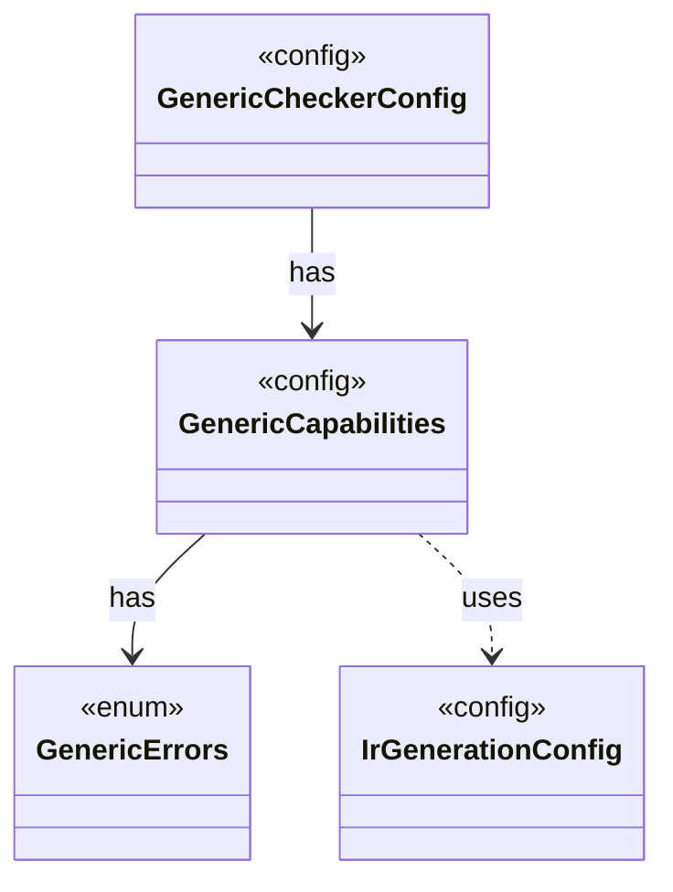

# `GenericCapabilities`

`io.github.tlaplus.hardening.config` · record · config · [source](https://github.com/tlaplus/model-checker-hardening/blob/ba2e1e4c25060fbc3e55fc04bbd3969141180293/src/main/java/io/github/tlaplus/hardening/config/GenericCapabilities.java#L22) · module [config](../modules/config.md)

What a generic checker supports of the reference checker's conventions (ADR 0033 §7, §8).

**Decisions:** [ADR 0033: A generic checker for TLC- and Apalache-compatible tools](https://github.com/tlaplus/model-checker-hardening/blob/ba2e1e4c25060fbc3e55fc04bbd3969141180293/docs/decisions/0033-generic-checker.md)

The diagram draws 3 of 9 relations; the table lists them all.

| Direction | Relation | Type | Summary |
|---|---|---|---|
| → | has | [GenericErrors](io.github.tlaplus.hardening.config.GenericErrors.md) | How much of a generic checker's exit status the aggregator compares (ADR 0033 §7). |
| ← | has | [GenericCheckerConfig](io.github.tlaplus.hardening.config.GenericCheckerConfig.md) | The `[generic]` table (ADR 0033 §1): a model checker that claims compatibility with TLC or Apalache, run as a native process for each input. |
| → | uses | [IrGenerationConfig](io.github.tlaplus.hardening.gen.IrGenerationConfig.md) | Settings for generated TLA+ expressions and modules. |
| → | depends | [ExpressionCategory](io.github.tlaplus.hardening.gen.ExpressionCategory.md) | A user-facing category assigned to generated expression forms. |
| → | depends | [ModuleLimits](io.github.tlaplus.hardening.gen.ModuleLimits.md) | Declaration, action and exploration bounds on one module. |
| ← | depends | [ConfigSchema](io.github.tlaplus.hardening.config.ConfigSchema.md) | The declaration of every key in `config.toml`: where it lives, what it means, how its value is read, and how it is written back. |
| ← | depends | [FuzzTlaConfig](io.github.tlaplus.hardening.config.FuzzTlaConfig.md) | Complete configuration of input generation and workflow execution. |
| ← | depends | [WorkflowRunner](io.github.tlaplus.hardening.workflow.WorkflowRunner.md) | Runs generation, parsing, TLC, Apalache, conformance aggregation and the quality gate under one CPU budget. |
| ← | depends | [GenericCheckerBackend](io.github.tlaplus.hardening.workflow.generic.GenericCheckerBackend.md) | Runs the generic checker of ADR 0033 as one native process per input, the lifecycle `ToolBackend` describes for TLC, but without a JVM. |
