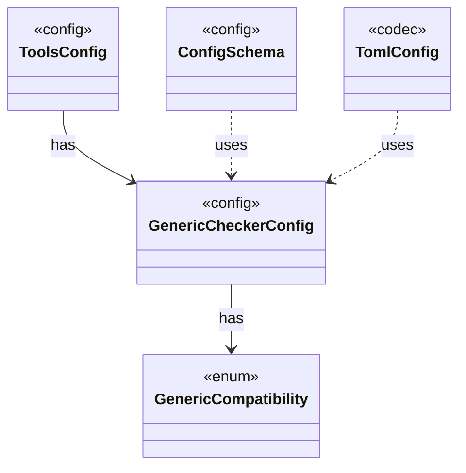

# `GenericCheckerConfig`

`io.github.tlaplus.hardening.config` · record · config · [source](https://github.com/tlaplus/model-checker-hardening/blob/e4ab65335fef2f7aa9e835e4805d8e294545cba2/src/main/java/io/github/tlaplus/hardening/config/GenericCheckerConfig.java#L19) · module [config](../modules/config.md)

The `[generic]` table (ADR 0033 §1): a model checker that claims compatibility with TLC or Apalache, run as a native process for each input.

**Decisions:** [ADR 0033: A generic checker for TLC- and Apalache-compatible tools](https://github.com/tlaplus/model-checker-hardening/blob/e4ab65335fef2f7aa9e835e4805d8e294545cba2/docs/decisions/0033-generic-checker.md)

The diagram draws 4 of 10 relations; the table lists them all.

| Direction | Relation | Type | Summary |
|---|---|---|---|
| → | has | [GenericCompatibility](io.github.tlaplus.hardening.config.GenericCompatibility.md) | The reference checker whose conventions a generic checker follows (ADR 0033 §2): the configuration file FuzzTLA writes for it and how its exit status becomes a verdict. |
| ← | has | [ToolsConfig](io.github.tlaplus.hardening.config.ToolsConfig.md) | The tools a corpus checks and types with: the JARs of the `[tools]` table (ADR 0025 §3), and the generic checker of the `[generic]` table (ADR 0033). |
| ← | uses | [ConfigSchema](io.github.tlaplus.hardening.config.ConfigSchema.md) | The declaration of every key in `config.toml`: where it lives, what it means, how its value is read, and how it is written back. |
| ← | uses | [TomlConfig](io.github.tlaplus.hardening.config.TomlConfig.md) | Reads and writes the strict `config.toml` format used by a corpus. |
| → | depends | [Preconditions](io.github.tlaplus.hardening.common.Preconditions.md) | Shared validation of method and constructor arguments. |
| → | depends | [GenericPlaceholder](io.github.tlaplus.hardening.config.GenericPlaceholder.md) | A placeholder in `[generic] arguments` (ADR 0033 §3), written `{name}`. |
| → | depends | [ToolsConfig](io.github.tlaplus.hardening.config.ToolsConfig.md) | The tools a corpus checks and types with: the JARs of the `[tools]` table (ADR 0025 §3), and the generic checker of the `[generic]` table (ADR 0033). |
| ← | depends | [InitCommand](io.github.tlaplus.hardening.cli.InitCommand.md) | `fuzztla init`: writes the configuration of a new corpus, which names the technique every run follows (ADR 0025 §1), and copies its libraries and tool JARs into it (§2, §3). |
| ← | depends | [CorpusTools](io.github.tlaplus.hardening.workflow.CorpusTools.md) | The tool JARs a corpus runs (ADR 0025 §3): those of its `[tools]` table, or the ones staged with FuzzTLA for a tool the table leaves out. |
| ← | depends | [LibraryInstall](io.github.tlaplus.hardening.workflow.library.LibraryInstall.md) | Copies into a new corpus every file its configuration names (ADR 0025 §2, §3), so the corpus keeps the releases it was initialized with: the classpath of the operator library, of the rewrite rules and of the edge guards goes to `tla/`. |
