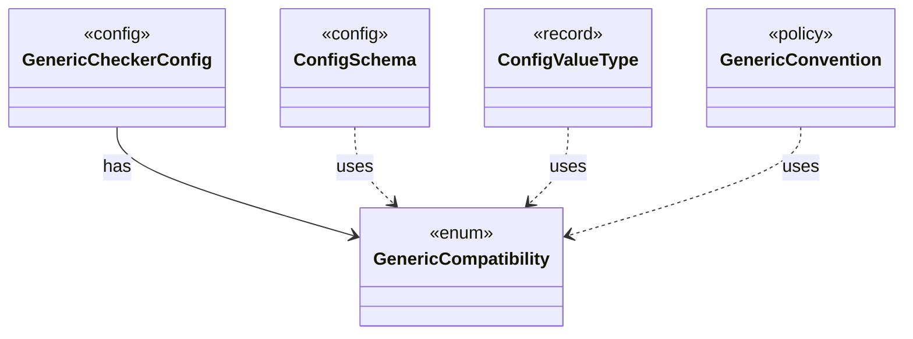

# `GenericCompatibility`

`io.github.tlaplus.hardening.config` · enum · other · [source](https://github.com/tlaplus/model-checker-hardening/blob/fa5b6c03c36b49df3e797d3e6300c7eb0fea3a6b/src/main/java/io/github/tlaplus/hardening/config/GenericCompatibility.java#L8) · module [config](../modules/config.md)

The reference checker whose conventions a generic checker follows (ADR 0033 §2): the configuration file FuzzTLA writes for it and how its exit status becomes a verdict.

**Decisions:** [ADR 0033: A generic checker for TLC- and Apalache-compatible tools](https://github.com/tlaplus/model-checker-hardening/blob/fa5b6c03c36b49df3e797d3e6300c7eb0fea3a6b/docs/decisions/0033-generic-checker.md)

The diagram draws 4 of 5 relations; the table lists them all.

| Direction | Relation | Type | Summary |
|---|---|---|---|
| ← | has | [GenericCheckerConfig](io.github.tlaplus.hardening.config.GenericCheckerConfig.md) | The `[generic]` table (ADR 0033 §1): a model checker that claims compatibility with TLC or Apalache, run as a native process for each input. |
| ← | uses | [ConfigSchema](io.github.tlaplus.hardening.config.ConfigSchema.md) | The declaration of every key in `config.toml`: where it lives, what it means, how its value is read, and how it is written back. |
| ← | uses | [ConfigValueType](io.github.tlaplus.hardening.config.ConfigValueType.md) | How the value of one configuration key is read from TOML and written back as TOML syntax. |
| ← | uses | [GenericConvention](io.github.tlaplus.hardening.workflow.generic.GenericConvention.md) | What a compatibility means to the generic checker (ADR 0033 §2): the configuration file written as `{config}`, and how an exit status becomes a verdict. |
| ← | depends | [GenericCheckerBackend](io.github.tlaplus.hardening.workflow.generic.GenericCheckerBackend.md) | Runs the generic checker of ADR 0033 as one native process per input, the lifecycle `ToolBackend` describes for TLC, but without a JVM. |
