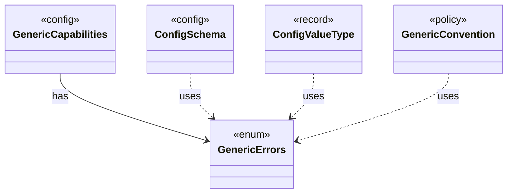

# `GenericErrors`

`io.github.tlaplus.hardening.config` · enum · other · [source](https://github.com/tlaplus/model-checker-hardening/blob/86f4053a56eb75f027c9ac8d2b7ff84a4acf6d75/src/main/java/io/github/tlaplus/hardening/config/GenericErrors.java#L8) · module [config](../modules/config.md)

How much of a generic checker's exit status the aggregator compares (ADR 0033 §7).

**Decisions:** [ADR 0033: A generic checker for TLC- and Apalache-compatible tools](https://github.com/tlaplus/model-checker-hardening/blob/86f4053a56eb75f027c9ac8d2b7ff84a4acf6d75/docs/decisions/0033-generic-checker.md)

The diagram draws 4 of 7 relations; the table lists them all.

| Direction | Relation | Type | Summary |
|---|---|---|---|
| ← | has | [GenericCapabilities](io.github.tlaplus.hardening.config.GenericCapabilities.md) | What a generic checker supports of the reference checker's conventions (ADR 0033 §7, §8). |
| ← | uses | [ConfigSchema](io.github.tlaplus.hardening.config.ConfigSchema.md) | The declaration of every key in `config.toml`: where it lives, what it means, how its value is read, and how it is written back. |
| ← | uses | [ConfigValueType](io.github.tlaplus.hardening.config.ConfigValueType.md) | How the value of one configuration key is read from TOML and written back as TOML syntax. |
| ← | uses | [GenericConvention](io.github.tlaplus.hardening.workflow.generic.GenericConvention.md) | What a compatibility means to the generic checker (ADR 0033 §2): the configuration file written as `{config}`, how an exit status becomes a verdict, and which exploration metrics the tool's output gives (§5). |
| ← | depends | [FuzzTlaConfig](io.github.tlaplus.hardening.config.FuzzTlaConfig.md) | Complete configuration of input generation and workflow execution. |
| ← | depends | [WorkflowRunner](io.github.tlaplus.hardening.workflow.WorkflowRunner.md) | Runs generation, parsing, TLC, Apalache, conformance aggregation and the quality gate under one CPU budget. |
| ← | depends | [GenericCheckerBackend](io.github.tlaplus.hardening.workflow.generic.GenericCheckerBackend.md) | Runs the generic checker of ADR 0033 as one native process per input, the lifecycle `ToolBackend` describes for TLC, but without a JVM. |
