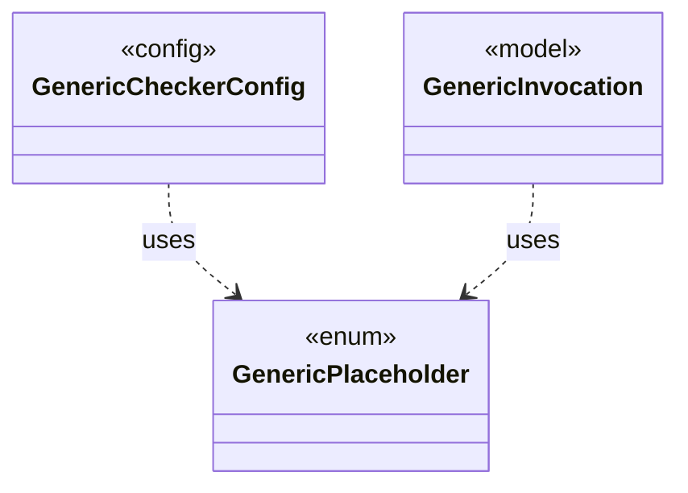

# `GenericPlaceholder`

`io.github.tlaplus.hardening.config` · enum · other · [source](https://github.com/tlaplus/model-checker-hardening/blob/ba2e1e4c25060fbc3e55fc04bbd3969141180293/src/main/java/io/github/tlaplus/hardening/config/GenericPlaceholder.java#L16) · module [config](../modules/config.md)

A placeholder in `[generic] arguments` (ADR 0033 §3), written `{name}`.

**Decisions:** [ADR 0033: A generic checker for TLC- and Apalache-compatible tools](https://github.com/tlaplus/model-checker-hardening/blob/ba2e1e4c25060fbc3e55fc04bbd3969141180293/docs/decisions/0033-generic-checker.md)

The diagram draws 2 of 3 relations; the table lists them all.

| Direction | Relation | Type | Summary |
|---|---|---|---|
| ← | uses | [GenericCheckerConfig](io.github.tlaplus.hardening.config.GenericCheckerConfig.md) | The `[generic]` table (ADR 0033 §1): a model checker that claims compatibility with TLC or Apalache, run as a native process for each input. |
| ← | uses | [GenericInvocation](io.github.tlaplus.hardening.workflow.generic.GenericInvocation.md) | The files and the command line of one generic checker invocation in its working directory (ADR 0033 §3, §4). |
| ← | depends | [GenericCheckerBackend](io.github.tlaplus.hardening.workflow.generic.GenericCheckerBackend.md) | Runs the generic checker of ADR 0033 as one native process per input, the lifecycle `ToolBackend` describes for TLC, but without a JVM. |
