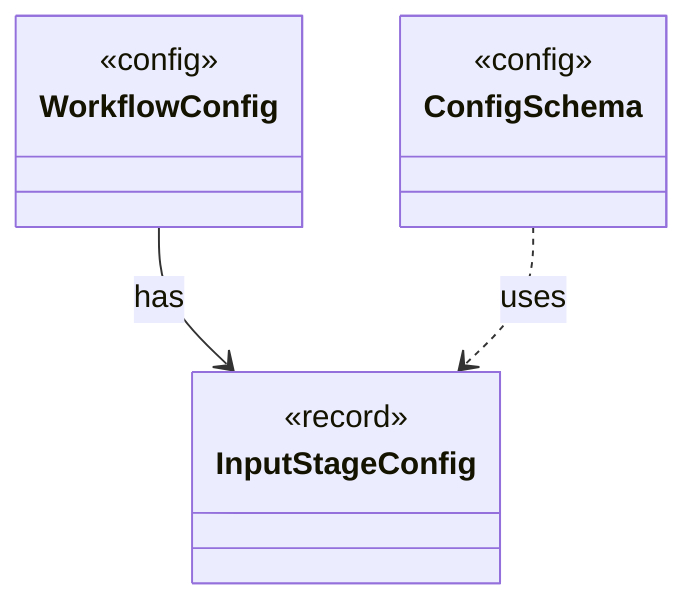

# `InputStageConfig`

`io.github.tlaplus.hardening.config` · record · other · [source](https://github.com/tlaplus/model-checker-hardening/blob/4206d99417cbe58b5b339e189936abe305c56cca/src/main/java/io/github/tlaplus/hardening/config/InputStageConfig.java#L15) · module [config](../modules/config.md)

The input stage's occupancy limit and the known-defect databases its admission consults.

The diagram draws 2 of 9 relations; the table lists them all.

| Direction | Relation | Type | Summary |
|---|---|---|---|
| ← | has | [WorkflowConfig](io.github.tlaplus.hardening.config.WorkflowConfig.md) | Global and per-stage limits for the implemented fuzzing workflow. |
| ← | uses | [ConfigSchema](io.github.tlaplus.hardening.config.ConfigSchema.md) | The declaration of every key in `config.toml`: where it lives, what it means, how its value is read, and how it is written back. |
| → | depends | [Preconditions](io.github.tlaplus.hardening.common.Preconditions.md) | Shared validation of method and constructor arguments. |
| → | depends | [ConfigPaths](io.github.tlaplus.hardening.config.ConfigPaths.md) | Resolution of the file paths a configuration file names. |
| ← | depends | [FuzzTlaConfig](io.github.tlaplus.hardening.config.FuzzTlaConfig.md) | Complete configuration of input generation and workflow execution. |
| ← | depends | [TomlConfig](io.github.tlaplus.hardening.config.TomlConfig.md) | Reads and writes the strict `config.toml` format used by a corpus. |
| ← | depends | [OccupancyLimits](io.github.tlaplus.hardening.workflow.OccupancyLimits.md) | Checks an invocation and a recovered corpus against the configured capacity limits. |
| ← | depends | [StageGraph](io.github.tlaplus.hardening.workflow.StageGraph.md) | The stages that run one workflow invocation, wired to their queues, result capacities, and shared collaborators, and the order in which they start and stop. |
| ← | depends | [WorkflowRunner](io.github.tlaplus.hardening.workflow.WorkflowRunner.md) | Runs generation, parsing, TLC, Apalache, conformance aggregation and the quality gate under one CPU budget. |
