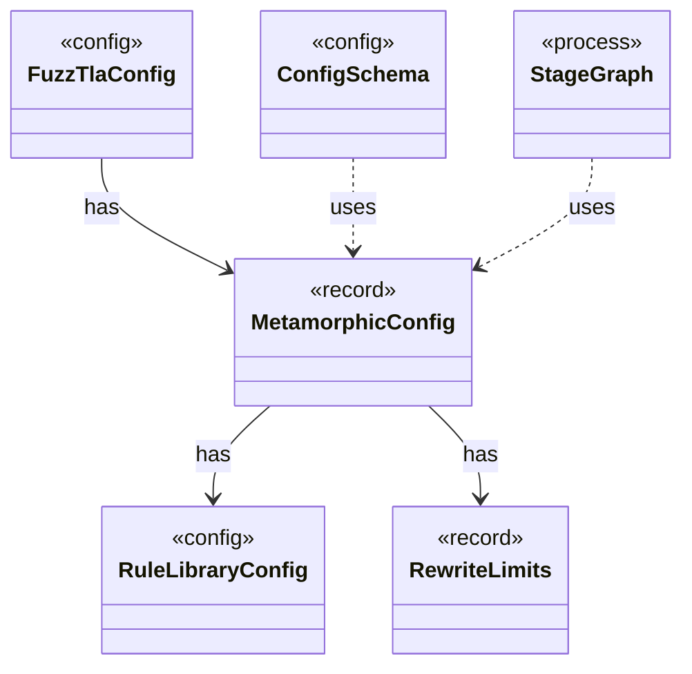

# `MetamorphicConfig`

`io.github.tlaplus.hardening.config` · record · other · [source](https://github.com/tlaplus/model-checker-hardening/blob/b96eff75a5bbf8a60b15ad020d6e84735c75a47c/src/main/java/io/github/tlaplus/hardening/config/MetamorphicConfig.java#L16) · module [config](../modules/config.md)

The `[metamorphic]` table (ADR 0016 §7, ADR 0017 §1): what an `mt` corpus reads besides the generator settings.

**Decisions:** [ADR 0016: Metamorphic testing](https://github.com/tlaplus/model-checker-hardening/blob/b96eff75a5bbf8a60b15ad020d6e84735c75a47c/docs/decisions/0016-metamorphic-testing.md), [ADR 0017: Rewrite rules as a TLA+ library](https://github.com/tlaplus/model-checker-hardening/blob/b96eff75a5bbf8a60b15ad020d6e84735c75a47c/docs/decisions/0017-rewrite-rule-library.md)

The diagram draws 5 of 10 relations; the table lists them all.

| Direction | Relation | Type | Summary |
|---|---|---|---|
| → | has | [RuleLibraryConfig](io.github.tlaplus.hardening.config.RuleLibraryConfig.md) | A rule module and its weights (ADR 0017 §1), as `[metamorphic]` configures the rewrites of `mt` corpora and `[graph]` the tautological edge guards of ADR 0023 §6. |
| → | has | [RewriteLimits](io.github.tlaplus.hardening.gen.rewrite.RewriteLimits.md) | Bounds of one rewrite (ADR 0016 §2, §7). |
| ← | has | [FuzzTlaConfig](io.github.tlaplus.hardening.config.FuzzTlaConfig.md) | Complete configuration of input generation and workflow execution. |
| ← | uses | [ConfigSchema](io.github.tlaplus.hardening.config.ConfigSchema.md) | The declaration of every key in `config.toml`: where it lives, what it means, how its value is read, and how it is written back. |
| ← | uses | [StageGraph](io.github.tlaplus.hardening.workflow.StageGraph.md) | The stages that run one workflow invocation, wired to their queues, result capacities, and shared collaborators, and the order in which they start and stop. |
| ← | depends | [InitialConfig](io.github.tlaplus.hardening.cli.InitialConfig.md) | The configuration `fuzztla init` writes (ADR 0025 §1): the defaults, the shipped known-defect database, and the settings that follow from the technique. |
| ← | depends | [TomlConfig](io.github.tlaplus.hardening.config.TomlConfig.md) | Reads and writes the strict `config.toml` format used by a corpus. |
| ← | depends | [GenerationLoop](io.github.tlaplus.hardening.workflow.GenerationLoop.md) | Runs the generations of one workflow invocation over a single stage graph (ADR 0010). |
| ← | depends | [WorkflowRunner](io.github.tlaplus.hardening.workflow.WorkflowRunner.md) | Runs generation, parsing, TLC, Apalache, conformance aggregation and the quality gate under one CPU budget. |
| ← | depends | [SpecDecoders](io.github.tlaplus.hardening.workflow.spec.SpecDecoders.md) | Immutable registry of the decoders that turn stored payloads into checkable modules. |
