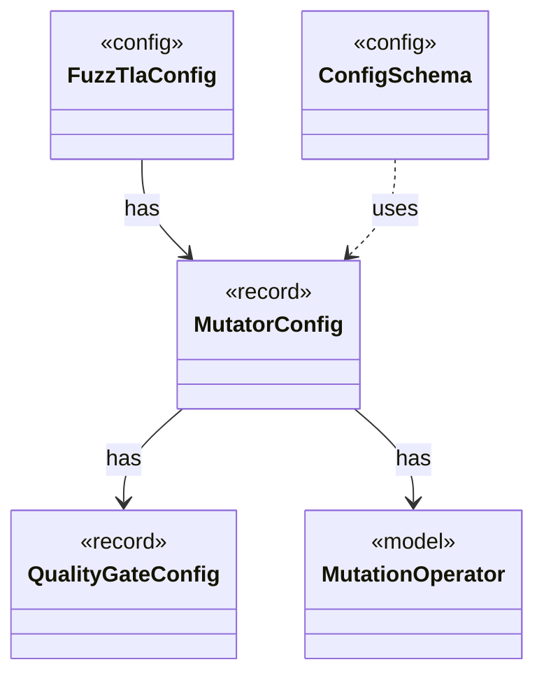

# `MutatorConfig`

`io.github.tlaplus.hardening.config` · record · other · [source](https://github.com/tlaplus/model-checker-hardening/blob/21262d9d0cc07b5ae4c47c4ee511217c9b88b561/src/main/java/io/github/tlaplus/hardening/config/MutatorConfig.java#L19) · module [config](../modules/config.md)

Generations, the quality gate's selection, and the mutator's share and operators (ADR 0010).

**Decisions:** [ADR 0010: Generational mutation](https://github.com/tlaplus/model-checker-hardening/blob/21262d9d0cc07b5ae4c47c4ee511217c9b88b561/docs/decisions/0010-mutation.md)

The diagram draws 4 of 8 relations; the table lists them all.

| Direction | Relation | Type | Summary |
|---|---|---|---|
| → | has | [QualityGateConfig](io.github.tlaplus.hardening.config.QualityGateConfig.md) | What the quality gate keeps of a settled generation (ADR 0010, ADR 0013). |
| → | has | [MutationOperator](io.github.tlaplus.hardening.mutation.MutationOperator.md) | One byte-level edit of a generator input, as ADR 0010 defines it. |
| ← | has | [FuzzTlaConfig](io.github.tlaplus.hardening.config.FuzzTlaConfig.md) | Complete configuration of input generation and workflow execution. |
| ← | uses | [ConfigSchema](io.github.tlaplus.hardening.config.ConfigSchema.md) | The declaration of every key in `config.toml`: where it lives, what it means, how its value is read, and how it is written back. |
| → | depends | [Preconditions](io.github.tlaplus.hardening.common.Preconditions.md) | Shared validation of method and constructor arguments. |
| ← | depends | [RunCommand](io.github.tlaplus.hardening.cli.RunCommand.md) | `fuzztla run`: reads a corpus configuration and runs `WorkflowRunner` with live progress output. |
| ← | depends | [TomlConfig](io.github.tlaplus.hardening.config.TomlConfig.md) | Reads and writes the strict `config.toml` format used by a corpus. |
| ← | depends | [GenerationLoop](io.github.tlaplus.hardening.workflow.GenerationLoop.md) | Runs the generations of one workflow invocation over a single stage graph (ADR 0010). |
