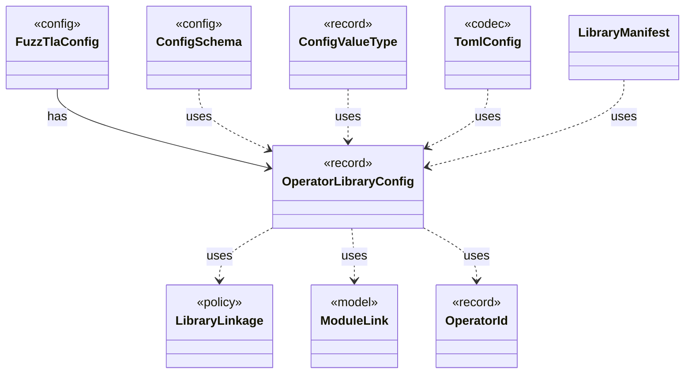

# `OperatorLibraryConfig`

`io.github.tlaplus.hardening.config` · record · other · [source](https://github.com/tlaplus/model-checker-hardening/blob/21262d9d0cc07b5ae4c47c4ee511217c9b88b561/src/main/java/io/github/tlaplus/hardening/config/OperatorLibraryConfig.java#L13) · module [config](../modules/config.md)

Source-only library settings.

The diagram draws 8 of 13 relations; the table lists them all.

| Direction | Relation | Type | Summary |
|---|---|---|---|
| ← | has | [FuzzTlaConfig](io.github.tlaplus.hardening.config.FuzzTlaConfig.md) | Complete configuration of input generation and workflow execution. |
| → | uses | [LibraryLinkage](io.github.tlaplus.hardening.gen.library.LibraryLinkage.md) | How a custom module's definitions reach the TLA+ source of the parser and TLC. |
| → | uses | [ModuleLink](io.github.tlaplus.hardening.gen.library.ModuleLink.md) | How one custom module is linked, and the module that its TLA+ source aliases instantiate: the module itself unless the linkage names a separate TLC module. |
| → | uses | [OperatorId](io.github.tlaplus.hardening.gen.library.OperatorId.md) | Case-sensitive identity of an exported operator, independent of its generated name. |
| ← | uses | [ConfigSchema](io.github.tlaplus.hardening.config.ConfigSchema.md) | The declaration of every key in `config.toml`: where it lives, what it means, how its value is read, and how it is written back. |
| ← | uses | [ConfigValueType](io.github.tlaplus.hardening.config.ConfigValueType.md) | How the value of one configuration key is read from TOML and written back as TOML syntax. |
| ← | uses | [TomlConfig](io.github.tlaplus.hardening.config.TomlConfig.md) | Reads and writes the strict `config.toml` format used by a corpus. |
| ← | uses | [LibraryManifest](io.github.tlaplus.hardening.workflow.library.LibraryManifest.md) | The identity of a custom operator library's source snapshot, which a metamorphic run compares with its base corpus's (ADR 0016 §6, ADR 0025 §5). |
| → | depends | [ConfigPaths](io.github.tlaplus.hardening.config.ConfigPaths.md) | Resolution of the file paths a configuration file names. |
| ← | depends | [InitCommand](io.github.tlaplus.hardening.cli.InitCommand.md) | `fuzztla init`: writes the configuration of a new corpus, which names the technique every run follows (ADR 0025 §1), and copies its libraries and tool JARs into it (§2, §3). |
| ← | depends | [CorpusTools](io.github.tlaplus.hardening.workflow.CorpusTools.md) | The tool JARs a corpus runs (ADR 0025 §3): those of its `[tools]` table, or the ones staged with FuzzTLA for a tool the table leaves out. |
| ← | depends | [LibraryInstall](io.github.tlaplus.hardening.workflow.library.LibraryInstall.md) | Copies into a new corpus every file its configuration names (ADR 0025 §2, §3), so the corpus keeps the releases it was initialized with: the classpath of the operator library, of the rewrite rules and of the edge guards goes to `tla/`. |
| ← | depends | [LibraryPreparation](io.github.tlaplus.hardening.workflow.library.LibraryPreparation.md) | Prepares custom libraries once before decoding; no importer/typechecker Maven dependency. |
