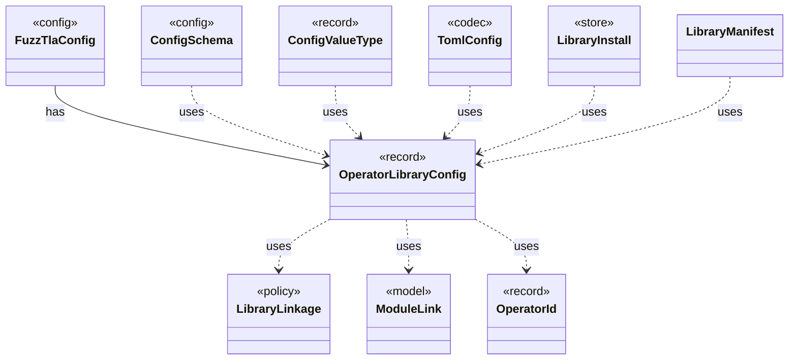

# `OperatorLibraryConfig`

`io.github.tlaplus.hardening.config` · record · other · [source](https://github.com/tlaplus/model-checker-hardening/blob/6bd7d927f1cffd7642029a3d925dff47091ddde9/src/main/java/io/github/tlaplus/hardening/config/OperatorLibraryConfig.java#L13) · module [config](../modules/config.md)

Source-only library settings.

The diagram draws 9 of 14 relations; the table lists them all.

| Direction | Relation | Type | Summary |
|---|---|---|---|
| ← | has | [FuzzTlaConfig](io.github.tlaplus.hardening.config.FuzzTlaConfig.md) | Complete configuration of input generation and workflow execution. |
| → | uses | [LibraryLinkage](io.github.tlaplus.hardening.gen.library.LibraryLinkage.md) | How a custom module's definitions reach the TLA+ source of the parser and TLC. |
| → | uses | [ModuleLink](io.github.tlaplus.hardening.gen.library.ModuleLink.md) | How one custom module is linked, and the module that its TLA+ source aliases instantiate: the module itself unless the linkage names a separate TLC module. |
| → | uses | [OperatorId](io.github.tlaplus.hardening.gen.library.OperatorId.md) | Case-sensitive identity of an exported operator, independent of its generated name. |
| ← | uses | [ConfigSchema](io.github.tlaplus.hardening.config.ConfigSchema.md) | The declaration of every key in `config.toml`: where it lives, what it means, how its value is read, and how it is written back. |
| ← | uses | [ConfigValueType](io.github.tlaplus.hardening.config.ConfigValueType.md) | How the value of one configuration key is read from TOML and written back as TOML syntax. |
| ← | uses | [TomlConfig](io.github.tlaplus.hardening.config.TomlConfig.md) | Reads and writes the strict `config.toml` format used by a corpus. |
| ← | uses | [LibraryInstall](io.github.tlaplus.hardening.workflow.library.LibraryInstall.md) | Copies a library's classpath into a corpus, so that the corpus keeps the release it was initialized with. |
| ← | uses | [LibraryManifest](io.github.tlaplus.hardening.workflow.library.LibraryManifest.md) | Replay policy for external source snapshots. |
| → | depends | [ConfigPaths](io.github.tlaplus.hardening.config.ConfigPaths.md) | Resolution of the file paths a configuration file names. |
| ← | depends | [InitCommand](io.github.tlaplus.hardening.cli.InitCommand.md) | `fuzztla init`: writes the default configuration of a new corpus and installs its libraries. |
| ← | depends | [MetamorphicShrinker](io.github.tlaplus.hardening.workflow.MetamorphicShrinker.md) | Reduces a metamorphic counterexample for triage (ADR 0016 §8). |
| ← | depends | [StageGraph](io.github.tlaplus.hardening.workflow.StageGraph.md) | The stages that run one workflow invocation, wired to their queues, result capacities, and shared collaborators, and the order in which they start and stop. |
| ← | depends | [LibraryPreparation](io.github.tlaplus.hardening.workflow.library.LibraryPreparation.md) | Prepares custom libraries once before decoding; no importer/typechecker Maven dependency. |
