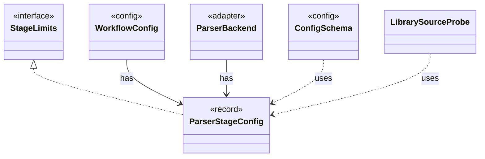

# `ParserStageConfig`

`io.github.tlaplus.hardening.config` · record · other · [source](https://github.com/tlaplus/model-checker-hardening/blob/4f182776ab66c4f93ff45cb83dfcd11e34fa32d1/src/main/java/io/github/tlaplus/hardening/config/ParserStageConfig.java#L6) · module [config](../modules/config.md)

Capacity and timeout limits for the parser stage.

The diagram draws 5 of 9 relations; the table lists them all.

| Direction | Relation | Type | Summary |
|---|---|---|---|
| → | implements | [StageLimits](io.github.tlaplus.hardening.config.StageLimits.md) | The limits every configured tool stage takes: its result capacity and a per-input time limit. |
| ← | has | [WorkflowConfig](io.github.tlaplus.hardening.config.WorkflowConfig.md) | Global and per-stage limits for the implemented fuzzing workflow. |
| ← | has | [ParserBackend](io.github.tlaplus.hardening.workflow.parser.ParserBackend.md) | Runs SANY in persistent isolated JVMs, one per stage worker, each replaced after a crash. |
| ← | uses | [ConfigSchema](io.github.tlaplus.hardening.config.ConfigSchema.md) | The declaration of every key in `config.toml`: where it lives, what it means, how its value is read, and how it is written back. |
| ← | uses | [LibrarySourceProbe](io.github.tlaplus.hardening.workflow.library.LibrarySourceProbe.md) | Parses every source alias of a prepared library once, with the classpath the parser and TLC workers receive (ADR 0015). |
| → | depends | [Preconditions](io.github.tlaplus.hardening.common.Preconditions.md) | Shared validation of method and constructor arguments. |
| ← | depends | [TomlConfig](io.github.tlaplus.hardening.config.TomlConfig.md) | Reads and writes the strict `config.toml` format used by a corpus. |
| ← | depends | [StageGraph](io.github.tlaplus.hardening.workflow.StageGraph.md) | The stages that run one workflow invocation, wired to their queues, result capacities, and shared collaborators, and the order in which they start and stop. |
| ← | depends | [LibraryPreparation](io.github.tlaplus.hardening.workflow.library.LibraryPreparation.md) | Prepares custom libraries once before decoding; no importer/typechecker Maven dependency. |
