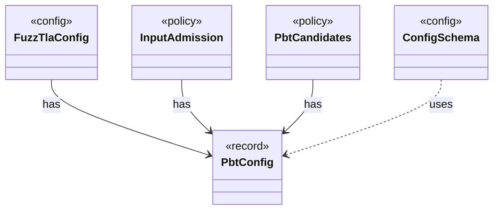

# `PbtConfig`

`io.github.tlaplus.hardening.config` · record · other · [source](https://github.com/tlaplus/model-checker-hardening/blob/a304ba37155136c3ba79e4f2fb414cbb47d01606/src/main/java/io/github/tlaplus/hardening/config/PbtConfig.java#L6) · module [config](../modules/config.md)

Limits and collection-richness controls for property-based input generation.

The diagram draws 4 of 9 relations; the table lists them all.

| Direction | Relation | Type | Summary |
|---|---|---|---|
| ← | has | [FuzzTlaConfig](io.github.tlaplus.hardening.config.FuzzTlaConfig.md) | Complete configuration of input generation and workflow execution. |
| ← | has | [InputAdmission](io.github.tlaplus.hardening.workflow.input.InputAdmission.md) | Decides whether a decoded candidate enters `00-inputs`, and where a known defect goes. |
| ← | has | [PbtCandidates](io.github.tlaplus.hardening.workflow.input.PbtCandidates.md) | Property-based candidates (ADR 0002): a target draws one richness cohort, and every candidate for it is a uniformly random byte array of a length from `InputLengthSampler`. |
| ← | uses | [ConfigSchema](io.github.tlaplus.hardening.config.ConfigSchema.md) | The declaration of every key in `config.toml`: where it lives, what it means, how its value is read, and how it is written back. |
| → | depends | [Preconditions](io.github.tlaplus.hardening.common.Preconditions.md) | Shared validation of method and constructor arguments. |
| ← | depends | [TomlConfig](io.github.tlaplus.hardening.config.TomlConfig.md) | Reads and writes the strict `config.toml` format used by a corpus. |
| ← | depends | [GenerationLoop](io.github.tlaplus.hardening.workflow.GenerationLoop.md) | Runs the generations of one workflow invocation over a single stage graph (ADR 0010). |
| ← | depends | [StageGraph](io.github.tlaplus.hardening.workflow.StageGraph.md) | The stages that run one workflow invocation, wired to their queues, result capacities, and shared collaborators, and the order in which they start and stop. |
| ← | depends | [InputStage](io.github.tlaplus.hardening.workflow.input.InputStage.md) | Concurrent input stage: admits reserved target ranges from adjacent generations. |
