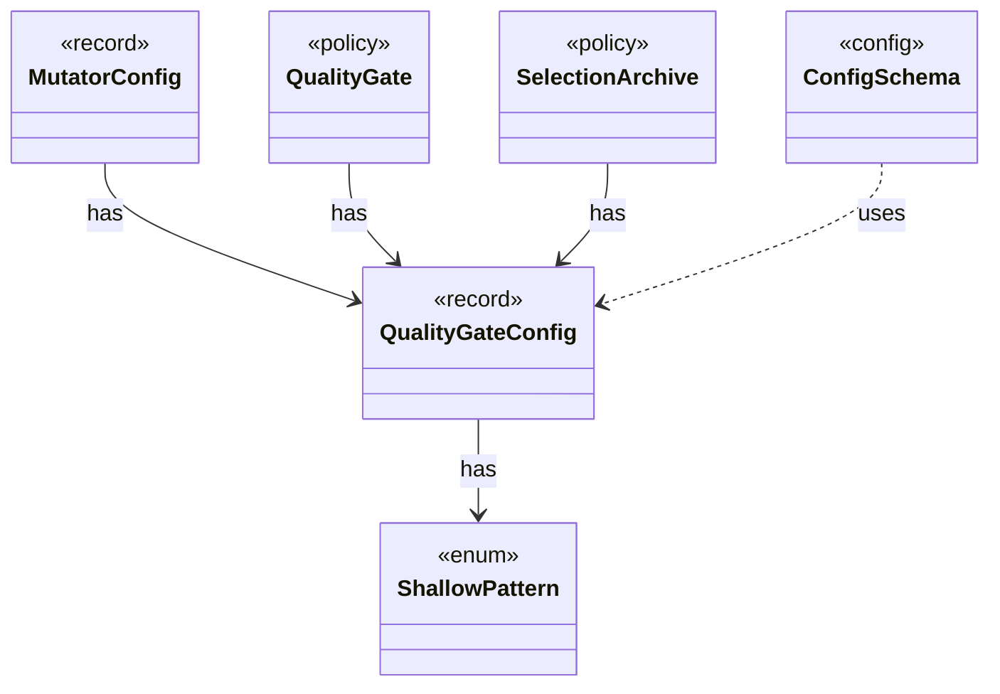

# `QualityGateConfig`

`io.github.tlaplus.hardening.config` · record · other · [source](https://github.com/tlaplus/model-checker-hardening/blob/3b201567990514c2a43b90dca521dbe32af37023/src/main/java/io/github/tlaplus/hardening/config/QualityGateConfig.java#L20) · module [config](../modules/config.md)

What the quality gate keeps of a settled generation (ADR 0010, ADR 0013).

**Decisions:** [ADR 0010: Generational mutation](https://github.com/tlaplus/model-checker-hardening/blob/3b201567990514c2a43b90dca521dbe32af37023/docs/decisions/0010-mutation.md), [ADR 0013: Behaviour archive and operator-edge coverage](https://github.com/tlaplus/model-checker-hardening/blob/3b201567990514c2a43b90dca521dbe32af37023/docs/decisions/0013-behaviour-archive-and-operator-coverage.md)

The diagram draws 5 of 8 relations; the table lists them all.

| Direction | Relation | Type | Summary |
|---|---|---|---|
| → | has | [ShallowPattern](io.github.tlaplus.hardening.corpus.ShallowPattern.md) | A way in which a TLC run explored almost nothing, as the calibration table of ADR 0008 defines it. |
| ← | has | [MutatorConfig](io.github.tlaplus.hardening.config.MutatorConfig.md) | Generations, the quality gate's selection, and the mutator's share and operators (ADR 0010). |
| ← | has | [QualityGate](io.github.tlaplus.hardening.workflow.quality.QualityGate.md) | Selects the parents of the next generation from one settled generation (ADR 0010, ADR 0013). |
| ← | has | [SelectionArchive](io.github.tlaplus.hardening.workflow.quality.SelectionArchive.md) | The behaviour cells and coverage features of the entries the gate has kept (ADR 0013), and the rule that decides whether one more entry is kept. |
| ← | uses | [ConfigSchema](io.github.tlaplus.hardening.config.ConfigSchema.md) | The declaration of every key in `config.toml`: where it lives, what it means, how its value is read, and how it is written back. |
| → | depends | [Preconditions](io.github.tlaplus.hardening.common.Preconditions.md) | Shared validation of method and constructor arguments. |
| ← | depends | [TomlConfig](io.github.tlaplus.hardening.config.TomlConfig.md) | Reads and writes the strict `config.toml` format used by a corpus. |
| ← | depends | [GenerationLoop](io.github.tlaplus.hardening.workflow.GenerationLoop.md) | Runs the generations of one workflow invocation over a single stage graph (ADR 0010). |
