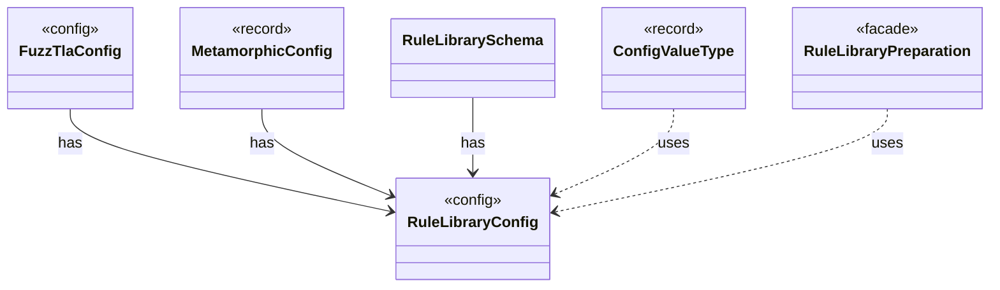

# `RuleLibraryConfig`

`io.github.tlaplus.hardening.config` · record · config · [source](https://github.com/tlaplus/model-checker-hardening/blob/e180a3892e661e5d7ba7636c4f24a6fca66ded14/src/main/java/io/github/tlaplus/hardening/config/RuleLibraryConfig.java#L19) · module [config](../modules/config.md)

A rule module and its weights (ADR 0017 §1), as `[metamorphic]` configures the rewrites of `--how=mt` and `[graph]` the tautological edge guards of ADR 0023 §6.

**Decisions:** [ADR 0017: Rewrite rules as a TLA+ library](https://github.com/tlaplus/model-checker-hardening/blob/e180a3892e661e5d7ba7636c4f24a6fca66ded14/docs/decisions/0017-rewrite-rule-library.md), [ADR 0023: Graph-based testing](https://github.com/tlaplus/model-checker-hardening/blob/e180a3892e661e5d7ba7636c4f24a6fca66ded14/docs/decisions/0023-graph-based-testing.md)

The diagram draws 5 of 9 relations; the table lists them all.

| Direction | Relation | Type | Summary |
|---|---|---|---|
| ← | has | [FuzzTlaConfig](io.github.tlaplus.hardening.config.FuzzTlaConfig.md) | Complete configuration of input generation and workflow execution. |
| ← | has | [MetamorphicConfig](io.github.tlaplus.hardening.config.MetamorphicConfig.md) | The `[metamorphic]` table (ADR 0016 §7, ADR 0017 §1): what a `--how=mt` run reads besides the generator settings. |
| ← | has | [RuleLibrarySchema](io.github.tlaplus.hardening.config.RuleLibrarySchema.md) | Declares and assembles the `rules` and `weights` keys of a table that names a rule module (ADR 0017 §1), so every such table reads them alike. |
| ← | uses | [ConfigValueType](io.github.tlaplus.hardening.config.ConfigValueType.md) | How the value of one configuration key is read from TOML and written back as TOML syntax. |
| ← | uses | [RuleLibraryPreparation](io.github.tlaplus.hardening.workflow.library.RuleLibraryPreparation.md) | Loads a rule module once, before decoding (ADR 0017 §1, §6): the rewrites of a metamorphic run or the edge guards of graph inputs (ADR 0023 §6). |
| → | depends | [ConfigPaths](io.github.tlaplus.hardening.config.ConfigPaths.md) | Resolution of the file paths a configuration file names. |
| ← | depends | [ConfigSchema](io.github.tlaplus.hardening.config.ConfigSchema.md) | The declaration of every key in `config.toml`: where it lives, what it means, how its value is read, and how it is written back. |
| ← | depends | [TomlConfig](io.github.tlaplus.hardening.config.TomlConfig.md) | Reads and writes the strict `config.toml` format used by a corpus. |
| ← | depends | [SpecDecoders](io.github.tlaplus.hardening.workflow.spec.SpecDecoders.md) | Immutable registry of the decoders that turn stored payloads into checkable modules. |
