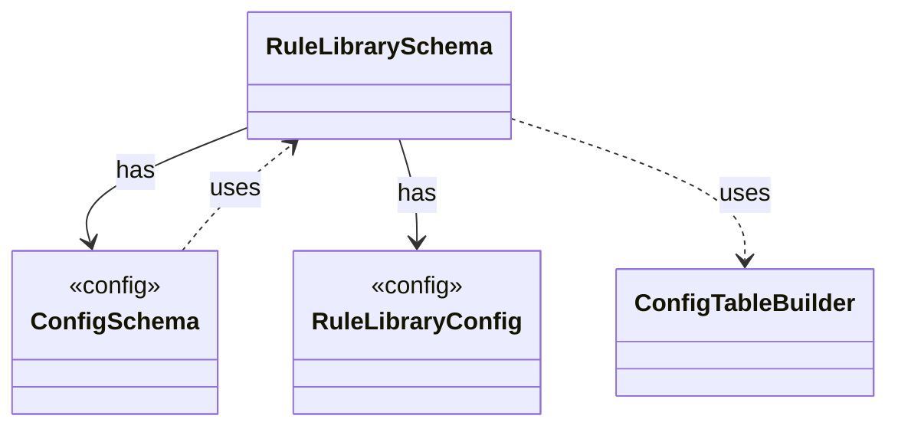

# `RuleLibrarySchema`

`io.github.tlaplus.hardening.config` · class · other · [source](https://github.com/tlaplus/model-checker-hardening/blob/5b16596dd480095d323ac67ff0f85eb85227b4b5/src/main/java/io/github/tlaplus/hardening/config/RuleLibrarySchema.java#L12) · module [config](../modules/config.md)

Declares and assembles the `rules` and `weights` keys of a table that names a rule module (ADR 0017 §1), so every such table reads them alike.

**Decisions:** [ADR 0017: Rewrite rules as a TLA+ library](https://github.com/tlaplus/model-checker-hardening/blob/5b16596dd480095d323ac67ff0f85eb85227b4b5/docs/decisions/0017-rewrite-rule-library.md)

The diagram draws 4 of 7 relations; the table lists them all.

| Direction | Relation | Type | Summary |
|---|---|---|---|
| → | has | [ConfigSchema](io.github.tlaplus.hardening.config.ConfigSchema.md) | The declaration of every key in `config.toml`: where it lives, what it means, how its value is read, and how it is written back. |
| → | has | [RuleLibraryConfig](io.github.tlaplus.hardening.config.RuleLibraryConfig.md) | A rule module and its weights (ADR 0017 §1), as `[metamorphic]` configures the rewrites of `mt` corpora and `[graph]` the tautological edge guards of ADR 0023 §6. |
| → | uses | [ConfigTableBuilder](io.github.tlaplus.hardening.config.ConfigTableBuilder.md) | Registers typed keys in document order, then snapshots them as an immutable schema table. |
| ← | uses | [ConfigSchema](io.github.tlaplus.hardening.config.ConfigSchema.md) | The declaration of every key in `config.toml`: where it lives, what it means, how its value is read, and how it is written back. |
| → | depends | [ConfigException](io.github.tlaplus.hardening.config.ConfigException.md) | Reports invalid contents in a FuzzTLA configuration file. |
| → | depends | [ConfigValueType](io.github.tlaplus.hardening.config.ConfigValueType.md) | How the value of one configuration key is read from TOML and written back as TOML syntax. |
| ← | depends | [TomlConfig](io.github.tlaplus.hardening.config.TomlConfig.md) | Reads and writes the strict `config.toml` format used by a corpus. |
