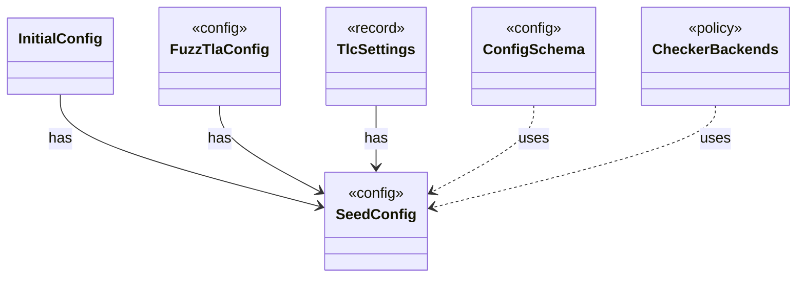

# `SeedConfig`

`io.github.tlaplus.hardening.config` · record · config · [source](https://github.com/tlaplus/model-checker-hardening/blob/5b16596dd480095d323ac67ff0f85eb85227b4b5/src/main/java/io/github/tlaplus/hardening/config/SeedConfig.java#L17) · module [config](../modules/config.md)

The `[seeds]` table (ADR 0026): every random seed a run uses.

**Decisions:** [ADR 0026: Reproducible runs: seeds chosen at `init`, `run --continue`](https://github.com/tlaplus/model-checker-hardening/blob/5b16596dd480095d323ac67ff0f85eb85227b4b5/docs/decisions/0026-reproducible-runs.md)

The diagram draws 5 of 13 relations; the table lists them all.

| Direction | Relation | Type | Summary |
|---|---|---|---|
| ← | has | [InitialConfig](io.github.tlaplus.hardening.cli.InitialConfig.md) | The configuration `fuzztla init` writes (ADR 0025 §1): the defaults, the shipped known-defect database, the settings that follow from the technique, and fresh seeds (ADR 0026). |
| ← | has | [FuzzTlaConfig](io.github.tlaplus.hardening.config.FuzzTlaConfig.md) | Complete configuration of input generation and workflow execution. |
| ← | has | [TlcSettings](io.github.tlaplus.hardening.workflow.tlc.TlcSettings.md) | What one TLC stage launches its JVMs with: the stage's limits and the TLC seeds of ` [seeds]` (ADR 0026), which every TLC stage shares. |
| ← | uses | [ConfigSchema](io.github.tlaplus.hardening.config.ConfigSchema.md) | The declaration of every key in `config.toml`: where it lives, what it means, how its value is read, and how it is written back. |
| ← | uses | [CheckerBackends](io.github.tlaplus.hardening.workflow.CheckerBackends.md) | How each model-checker stage builds its backend for one invocation. |
| → | depends | [Preconditions](io.github.tlaplus.hardening.common.Preconditions.md) | Shared validation of method and constructor arguments. |
| ← | depends | [InitCommand](io.github.tlaplus.hardening.cli.InitCommand.md) | `fuzztla init`: writes the configuration of a new corpus, which names the technique every run follows (ADR 0025 §1), and copies its libraries and tool JARs into it (§2, §3). |
| ← | depends | [RunCommand](io.github.tlaplus.hardening.cli.RunCommand.md) | `fuzztla run`: reads a corpus configuration and runs `WorkflowRunner` with live progress output. |
| ← | depends | [TomlConfig](io.github.tlaplus.hardening.config.TomlConfig.md) | Reads and writes the strict `config.toml` format used by a corpus. |
| ← | depends | [MetamorphicShrinker](io.github.tlaplus.hardening.workflow.MetamorphicShrinker.md) | Reduces a metamorphic counterexample for triage (ADR 0016 §8). |
| ← | depends | [StageGraph](io.github.tlaplus.hardening.workflow.StageGraph.md) | The stages that run one workflow invocation, wired to their queues, result capacities, and shared collaborators, and the order in which they start and stop. |
| ← | depends | [WorkflowRunner](io.github.tlaplus.hardening.workflow.WorkflowRunner.md) | Runs generation, parsing, TLC, Apalache, conformance aggregation and the quality gate under one CPU budget. |
| ← | depends | [TlcCheckerBackend](io.github.tlaplus.hardening.workflow.tlc.TlcCheckerBackend.md) | Adapts fresh isolated TLC invocations to the shared tool stage. |
