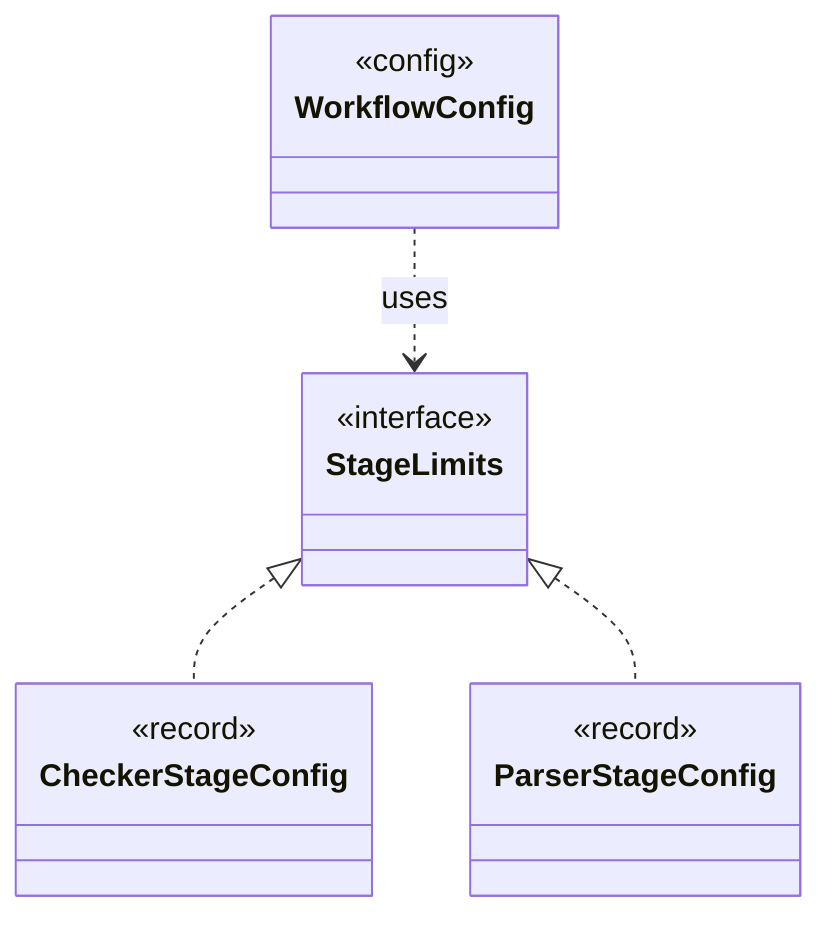

# `StageLimits`

`io.github.tlaplus.hardening.config` · interface · other · [source](https://github.com/tlaplus/model-checker-hardening/blob/b96eff75a5bbf8a60b15ad020d6e84735c75a47c/src/main/java/io/github/tlaplus/hardening/config/StageLimits.java#L6) · module [config](../modules/config.md)

The limits every configured tool stage takes: its result capacity and a per-input time limit.

| Direction | Relation | Type | Summary |
|---|---|---|---|
| ← | implements | [CheckerStageConfig](io.github.tlaplus.hardening.config.CheckerStageConfig.md) | Capacity and resource limits for one model-checker stage. |
| ← | implements | [ParserStageConfig](io.github.tlaplus.hardening.config.ParserStageConfig.md) | Capacity and timeout limits for the parser stage. |
| ← | uses | [WorkflowConfig](io.github.tlaplus.hardening.config.WorkflowConfig.md) | Global and per-stage limits for the implemented fuzzing workflow. |
