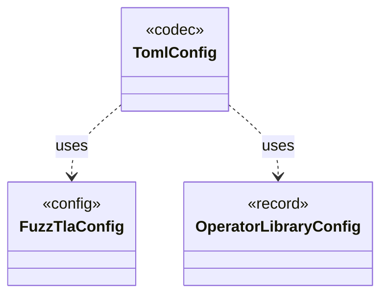

# `TomlConfig`

`io.github.tlaplus.hardening.config` · class · codec · key · [source](https://github.com/tlaplus/model-checker-hardening/blob/918f7db91890f302587d25c76dc7ac189db3d023/src/main/java/io/github/tlaplus/hardening/config/TomlConfig.java#L31) · module [config](../modules/config.md)

Reads and writes the strict `config.toml` format used by a corpus.

The diagram draws 2 of 30 relations; the table lists them all.

| Direction | Relation | Type | Summary |
|---|---|---|---|
| → | uses | [FuzzTlaConfig](io.github.tlaplus.hardening.config.FuzzTlaConfig.md) | Complete configuration of input generation and workflow execution. |
| → | uses | [OperatorLibraryConfig](io.github.tlaplus.hardening.config.OperatorLibraryConfig.md) | Source-only library settings. |
| → | depends | [CheckerStageConfig](io.github.tlaplus.hardening.config.CheckerStageConfig.md) | Capacity and resource limits for one model-checker stage. |
| → | depends | [ConfigException](io.github.tlaplus.hardening.config.ConfigException.md) | Reports invalid contents in a FuzzTLA configuration file. |
| → | depends | [ConfigSchema](io.github.tlaplus.hardening.config.ConfigSchema.md) | The declaration of every key in `config.toml`: where it lives, what it means, how its value is read, and how it is written back. |
| → | depends | [GeneratorLimitSchema](io.github.tlaplus.hardening.config.GeneratorLimitSchema.md) | Declares and assembles the expression and module limit keys in the generator table. |
| → | depends | [InputStageConfig](io.github.tlaplus.hardening.config.InputStageConfig.md) | The input stage's occupancy limit and the known-defect databases its admission consults. |
| → | depends | [MetamorphicConfig](io.github.tlaplus.hardening.config.MetamorphicConfig.md) | The `[metamorphic]` table (ADR 0016 §7, ADR 0017 §1): what a `--how=mt` run reads besides the generator settings. |
| → | depends | [MutatorConfig](io.github.tlaplus.hardening.config.MutatorConfig.md) | Generations, the quality gate's selection, and the mutator's share and operators (ADR 0010). |
| → | depends | [ParserStageConfig](io.github.tlaplus.hardening.config.ParserStageConfig.md) | Capacity and timeout limits for the parser stage. |
| → | depends | [PbtConfig](io.github.tlaplus.hardening.config.PbtConfig.md) | Limits and collection-richness controls for property-based input generation. |
| → | depends | [QualityGateConfig](io.github.tlaplus.hardening.config.QualityGateConfig.md) | What the quality gate keeps of a settled generation (ADR 0010, ADR 0013). |
| → | depends | [RuleLibraryConfig](io.github.tlaplus.hardening.config.RuleLibraryConfig.md) | A rule module and its weights (ADR 0017 §1), as `[metamorphic]` configures the rewrites of `--how=mt` and `[graph]` the tautological edge guards of ADR 0023 §6. |
| → | depends | [RuleLibrarySchema](io.github.tlaplus.hardening.config.RuleLibrarySchema.md) | Declares and assembles the `rules` and `weights` keys of a table that names a rule module (ADR 0017 §1), so every such table reads them alike. |
| → | depends | [WorkflowConfig](io.github.tlaplus.hardening.config.WorkflowConfig.md) | Global and per-stage limits for the implemented fuzzing workflow. |
| → | depends | [CheckerSet](io.github.tlaplus.hardening.corpus.CheckerSet.md) | The checker branches a corpus runs: a non-empty set of checking stages, in stage order. |
| → | depends | [CorpusStage](io.github.tlaplus.hardening.corpus.CorpusStage.md) | One implemented stage of the fuzzing pipeline, and the corpus directories it owns. |
| → | depends | [ExpressionLimits](io.github.tlaplus.hardening.gen.ExpressionLimits.md) | Bounds on recursive construction and variable-size payloads within one expression. |
| → | depends | [GraphLimits](io.github.tlaplus.hardening.gen.GraphLimits.md) | Bounds on the control graph of one graph input (ADR 0023 §3). |
| → | depends | [InputKind](io.github.tlaplus.hardening.gen.InputKind.md) | What a generator payload decodes to. |
| → | depends | [IrGenerationConfig](io.github.tlaplus.hardening.gen.IrGenerationConfig.md) | Settings for generated TLA+ expressions and modules. |
| → | depends | [ModuleLimits](io.github.tlaplus.hardening.gen.ModuleLimits.md) | Declaration, action and exploration bounds on one module. |
| → | depends | [OperatorLibrary](io.github.tlaplus.hardening.gen.library.OperatorLibrary.md) | Immutable prepared library. |
| → | depends | [RewriteLimits](io.github.tlaplus.hardening.gen.rewrite.RewriteLimits.md) | Bounds of one rewrite (ADR 0016 §2, §7). |
| ← | depends | [ExportDbCommand](io.github.tlaplus.hardening.cli.ExportDbCommand.md) | `fuzztla export-db`: exports a corpus with `CorpusExport` (ADR 0009). |
| ← | depends | [InitCommand](io.github.tlaplus.hardening.cli.InitCommand.md) | `fuzztla init`: writes the default configuration of a new corpus and installs its libraries. |
| ← | depends | [PrintCommand](io.github.tlaplus.hardening.cli.PrintCommand.md) | `fuzztla print`: decodes a payload or corpus envelope and renders it, with the known defects it matches. |
| ← | depends | [RunCommand](io.github.tlaplus.hardening.cli.RunCommand.md) | `fuzztla run`: reads a corpus configuration and runs `WorkflowRunner` with live progress output. |
| ← | depends | [ShrinkCommand](io.github.tlaplus.hardening.cli.ShrinkCommand.md) | `fuzztla shrink`: reduces a metamorphic counterexample with `MetamorphicShrinker` (ADR 0016). |
| ← | depends | [AdoptableBase](io.github.tlaplus.hardening.workflow.AdoptableBase.md) | The base corpus of a metamorphic run (ADR 0016 §6). |
