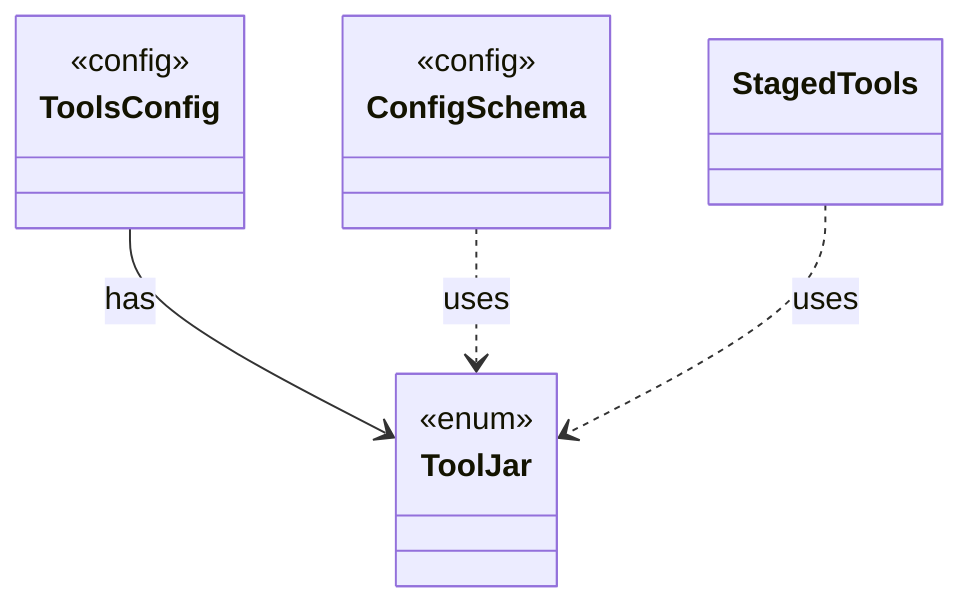

# `ToolJar`

`io.github.tlaplus.hardening.config` · enum · other · [source](https://github.com/tlaplus/model-checker-hardening/blob/21262d9d0cc07b5ae4c47c4ee511217c9b88b561/src/main/java/io/github/tlaplus/hardening/config/ToolJar.java#L8) · module [config](../modules/config.md)

A checker distribution that a corpus copies into its `tools/` directory, so its entries keep being checked, and its libraries typed, with the release they were admitted under (ADR 0025 §3).

**Decisions:** [ADR 0025: Self-contained corpora, chosen at `init`](https://github.com/tlaplus/model-checker-hardening/blob/21262d9d0cc07b5ae4c47c4ee511217c9b88b561/docs/decisions/0025-self-contained-corpora.md)

The diagram draws 3 of 6 relations; the table lists them all.

| Direction | Relation | Type | Summary |
|---|---|---|---|
| ← | has | [ToolsConfig](io.github.tlaplus.hardening.config.ToolsConfig.md) | The `[tools]` table (ADR 0025 §3): the tool JARs a corpus checks and types with. |
| ← | uses | [ConfigSchema](io.github.tlaplus.hardening.config.ConfigSchema.md) | The declaration of every key in `config.toml`: where it lives, what it means, how its value is read, and how it is written back. |
| ← | uses | [StagedTools](io.github.tlaplus.hardening.workflow.StagedTools.md) | Locates the tool JARs the build stages beside FuzzTLA's own JAR, or beside its classes when it runs from the build directory. |
| ← | depends | [ProjectDirectory](io.github.tlaplus.hardening.cli.ProjectDirectory.md) | Locates the FuzzTLA project directory that ships the signature databases and scripts. |
| ← | depends | [CorpusTools](io.github.tlaplus.hardening.workflow.CorpusTools.md) | The tool JARs a corpus runs (ADR 0025 §3): those of its `[tools]` table, or the ones staged with FuzzTLA for a tool the table leaves out. |
| ← | depends | [LibraryInstall](io.github.tlaplus.hardening.workflow.library.LibraryInstall.md) | Copies into a new corpus every file its configuration names (ADR 0025 §2, §3), so the corpus keeps the releases it was initialized with: the classpath of the operator library, of the rewrite rules and of the edge guards goes to `tla/`. |
