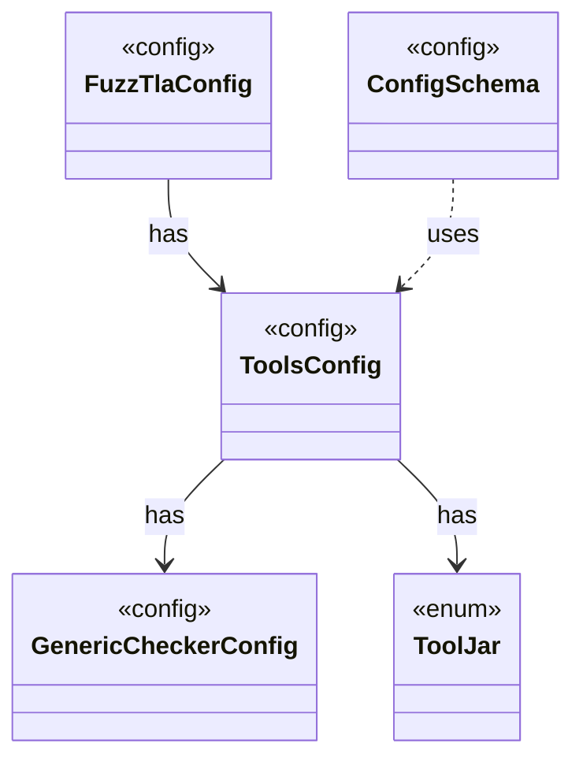

# `ToolsConfig`

`io.github.tlaplus.hardening.config` · record · config · [source](https://github.com/tlaplus/model-checker-hardening/blob/6fa04b06239faa249744652fc9a20140aed0d561/src/main/java/io/github/tlaplus/hardening/config/ToolsConfig.java#L19) · module [config](../modules/config.md)

The tools a corpus checks and types with: the JARs of the `[tools]` table (ADR 0025 §3), and the generic checker of the `[generic]` table (ADR 0033).

**Decisions:** [ADR 0025: Self-contained corpora, chosen at `init`](https://github.com/tlaplus/model-checker-hardening/blob/6fa04b06239faa249744652fc9a20140aed0d561/docs/decisions/0025-self-contained-corpora.md), [ADR 0033: A generic checker for TLC- and Apalache-compatible tools](https://github.com/tlaplus/model-checker-hardening/blob/6fa04b06239faa249744652fc9a20140aed0d561/docs/decisions/0033-generic-checker.md)

The diagram draws 4 of 12 relations; the table lists them all.

| Direction | Relation | Type | Summary |
|---|---|---|---|
| → | has | [GenericCheckerConfig](io.github.tlaplus.hardening.config.GenericCheckerConfig.md) | The `[generic]` table (ADR 0033 §1): a model checker that claims compatibility with TLC or Apalache, run as a native process for each input. |
| → | has | [ToolJar](io.github.tlaplus.hardening.config.ToolJar.md) | A checker distribution that a corpus copies into its `tools/` directory, so its entries keep being checked, and its libraries typed, with the release they were admitted under (ADR 0025 §3). |
| ← | has | [FuzzTlaConfig](io.github.tlaplus.hardening.config.FuzzTlaConfig.md) | Complete configuration of input generation and workflow execution. |
| ← | uses | [ConfigSchema](io.github.tlaplus.hardening.config.ConfigSchema.md) | The declaration of every key in `config.toml`: where it lives, what it means, how its value is read, and how it is written back. |
| ← | depends | [InitCommand](io.github.tlaplus.hardening.cli.InitCommand.md) | `fuzztla init`: writes the configuration of a new corpus, which names the technique every run follows (ADR 0025 §1), and copies its libraries and tool JARs into it (§2, §3). |
| ← | depends | [ToolOverride](io.github.tlaplus.hardening.cli.ToolOverride.md) | One `--tool TOOL=FILE` of `fuzztla init`: the JAR a new corpus copies into ` tools/` in place of the staged one (ADR 0032 §2). |
| ← | depends | [GenericCheckerConfig](io.github.tlaplus.hardening.config.GenericCheckerConfig.md) | The `[generic]` table (ADR 0033 §1): a model checker that claims compatibility with TLC or Apalache, run as a native process for each input. |
| ← | depends | [TomlConfig](io.github.tlaplus.hardening.config.TomlConfig.md) | Reads and writes the strict `config.toml` format used by a corpus. |
| ← | depends | [CheckerBackends](io.github.tlaplus.hardening.workflow.CheckerBackends.md) | How each model-checker stage builds its backend for one invocation. |
| ← | depends | [CorpusTools](io.github.tlaplus.hardening.workflow.CorpusTools.md) | The tool JARs a corpus runs (ADR 0025 §3): those of its `[tools]` table, or the ones staged with FuzzTLA for a tool the table leaves out. |
| ← | depends | [WorkflowRunner](io.github.tlaplus.hardening.workflow.WorkflowRunner.md) | Runs generation, parsing, TLC, Apalache, conformance aggregation and the quality gate under one CPU budget. |
| ← | depends | [LibraryInstall](io.github.tlaplus.hardening.workflow.library.LibraryInstall.md) | Copies into a new corpus every file its configuration names (ADR 0025 §2, §3), so the corpus keeps the releases it was initialized with: the classpath of the operator library, of the rewrite rules and of the edge guards goes to `tla/`. |
