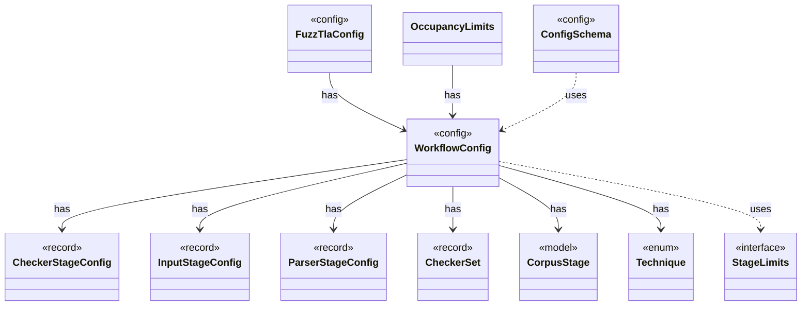

# `WorkflowConfig`

`io.github.tlaplus.hardening.config` · record · config · key · [source](https://github.com/tlaplus/model-checker-hardening/blob/4df6a11e5b4bf93609393935c4cbeceec08cce0c/src/main/java/io/github/tlaplus/hardening/config/WorkflowConfig.java#L25) · module [config](../modules/config.md)

Global and per-stage limits for the implemented fuzzing workflow.

The diagram draws 10 of 25 relations; the table lists them all.

| Direction | Relation | Type | Summary |
|---|---|---|---|
| → | has | [CheckerStageConfig](io.github.tlaplus.hardening.config.CheckerStageConfig.md) | Capacity and resource limits for one model-checker stage. |
| → | has | [InputStageConfig](io.github.tlaplus.hardening.config.InputStageConfig.md) | The input stage's occupancy limit and the known-defect databases its admission consults. |
| → | has | [ParserStageConfig](io.github.tlaplus.hardening.config.ParserStageConfig.md) | Capacity and timeout limits for the parser stage. |
| → | has | [CheckerSet](io.github.tlaplus.hardening.corpus.CheckerSet.md) | The checker branches a corpus runs: a non-empty set of checking stages, in stage order. |
| → | has | [CorpusStage](io.github.tlaplus.hardening.corpus.CorpusStage.md) | One implemented stage of the fuzzing pipeline, and the corpus directories it owns. |
| → | has | [Technique](io.github.tlaplus.hardening.corpus.Technique.md) | The fuzzing technique a corpus runs: `[workflow] technique`, which `fuzztla init --how` sets (ADR 0025 §1), so every run and every replay decodes and judges its entries the same way. |
| ← | has | [FuzzTlaConfig](io.github.tlaplus.hardening.config.FuzzTlaConfig.md) | Complete configuration of input generation and workflow execution. |
| ← | has | [OccupancyLimits](io.github.tlaplus.hardening.workflow.OccupancyLimits.md) | Checks an invocation and a recovered corpus against the configured capacity limits. |
| → | uses | [StageLimits](io.github.tlaplus.hardening.config.StageLimits.md) | The limits every configured tool stage takes: its result capacity and a per-input time limit. |
| ← | uses | [ConfigSchema](io.github.tlaplus.hardening.config.ConfigSchema.md) | The declaration of every key in `config.toml`: where it lives, what it means, how its value is read, and how it is written back. |
| → | depends | [EnumMaps](io.github.tlaplus.hardening.common.EnumMaps.md) | Validated immutable copies of maps keyed by an enum, iterated in declaration order. |
| → | depends | [Preconditions](io.github.tlaplus.hardening.common.Preconditions.md) | Shared validation of method and constructor arguments. |
| → | depends | [CheckerProfile](io.github.tlaplus.hardening.config.CheckerProfile.md) | What differs between the configured model checkers: the defaults of their resource settings and the documentation of the settings whose meaning follows from the worker lifecycle. |
| ← | depends | [ExportDbCommand](io.github.tlaplus.hardening.cli.ExportDbCommand.md) | `fuzztla export-db`: exports a corpus with `CorpusExport` (ADR 0009). |
| ← | depends | [InitialConfig](io.github.tlaplus.hardening.cli.InitialConfig.md) | The configuration `fuzztla init` writes (ADR 0025 §1): the defaults, the shipped known-defect database, and the settings that follow from the technique. |
| ← | depends | [RunCommand](io.github.tlaplus.hardening.cli.RunCommand.md) | `fuzztla run`: reads a corpus configuration and runs `WorkflowRunner` with live progress output. |
| ← | depends | [TomlConfig](io.github.tlaplus.hardening.config.TomlConfig.md) | Reads and writes the strict `config.toml` format used by a corpus. |
| ← | depends | [AdoptableBase](io.github.tlaplus.hardening.workflow.AdoptableBase.md) | The base corpus of a metamorphic run (ADR 0016 §6). |
| ← | depends | [CorpusReplay](io.github.tlaplus.hardening.workflow.CorpusReplay.md) | Decodes a corpus's entries as they were admitted: with the decoders of the configured technique, and the libraries, rules and tools the corpus holds (ADR 0025). |
| ← | depends | [GenerationLoop](io.github.tlaplus.hardening.workflow.GenerationLoop.md) | Runs the generations of one workflow invocation over a single stage graph (ADR 0010). |
| ← | depends | [MetamorphicShrinker](io.github.tlaplus.hardening.workflow.MetamorphicShrinker.md) | Reduces a metamorphic counterexample for triage (ADR 0016 §8). |
| ← | depends | [StageGraph](io.github.tlaplus.hardening.workflow.StageGraph.md) | The stages that run one workflow invocation, wired to their queues, result capacities, and shared collaborators, and the order in which they start and stop. |
| ← | depends | [WorkflowRunner](io.github.tlaplus.hardening.workflow.WorkflowRunner.md) | Runs generation, parsing, TLC, Apalache, conformance aggregation and the quality gate under one CPU budget. |
| ← | depends | [LibraryPreparation](io.github.tlaplus.hardening.workflow.library.LibraryPreparation.md) | Prepares custom libraries once before decoding; no importer/typechecker Maven dependency. |
| ← | depends | [SpecDecoders](io.github.tlaplus.hardening.workflow.spec.SpecDecoders.md) | Immutable registry of the decoders that turn stored payloads into checkable modules. |
