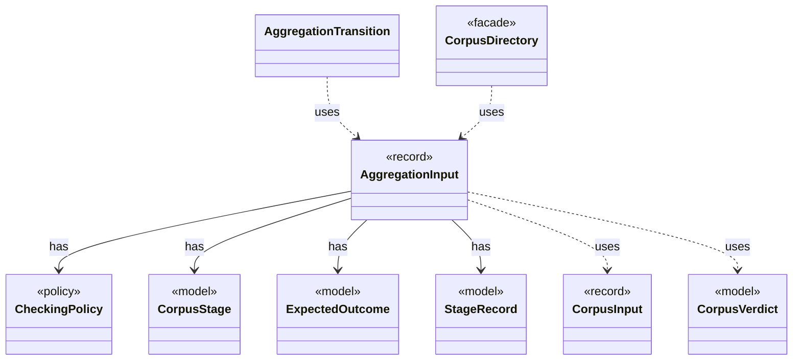

# `AggregationInput`

`io.github.tlaplus.hardening.corpus` · record · other · [source](https://github.com/tlaplus/model-checker-hardening/blob/918f7db91890f302587d25c76dc7ac189db3d023/src/main/java/io/github/tlaplus/hardening/corpus/AggregationInput.java#L15) · module [corpus](../modules/corpus.md)

A logical corpus entry whose non-crash checker results are ready for aggregation.

**Decisions:** [ADR 0019: State-count agreement of completed searches](https://github.com/tlaplus/model-checker-hardening/blob/918f7db91890f302587d25c76dc7ac189db3d023/docs/decisions/0019-state-count-agreement.md)

The diagram draws 8 of 14 relations; the table lists them all.

| Direction | Relation | Type | Summary |
|---|---|---|---|
| → | has | [CheckingPolicy](io.github.tlaplus.hardening.corpus.CheckingPolicy.md) | Which checkers a workflow run feeds and how the aggregator judges their verdicts. |
| → | has | [CorpusStage](io.github.tlaplus.hardening.corpus.CorpusStage.md) | One implemented stage of the fuzzing pipeline, and the corpus directories it owns. |
| → | has | [ExpectedOutcome](io.github.tlaplus.hardening.corpus.ExpectedOutcome.md) | The checker verdict an input predicts, independently of any checker (ADR 0023 §4): a graph input predicts a counterexample of known length when its target is reachable within the step bound, and a pass otherwise. |
| → | has | [StageRecord](io.github.tlaplus.hardening.corpus.StageRecord.md) | What a stage records about one input: its verdict, when it worked on the input, its failure classification when it classifies failures, and what it explored when it measures exploration. |
| → | uses | [CorpusInput](io.github.tlaplus.hardening.corpus.CorpusInput.md) | The required fields of one encoded corpus input. |
| → | uses | [CorpusVerdict](io.github.tlaplus.hardening.corpus.CorpusVerdict.md) | A verdict supported by the implemented corpus stages. |
| ← | uses | [AggregationTransition](io.github.tlaplus.hardening.corpus.AggregationTransition.md) | Joins the checker copies of one logical input into one durable aggregator result. |
| ← | uses | [CorpusDirectory](io.github.tlaplus.hardening.corpus.CorpusDirectory.md) | Owns the on-disk layout and integrity checks for one FuzzTLA corpus. |
| → | depends | [Preconditions](io.github.tlaplus.hardening.common.Preconditions.md) | Shared validation of method and constructor arguments. |
| → | depends | [CheckerSet](io.github.tlaplus.hardening.corpus.CheckerSet.md) | The checker branches a corpus runs: a non-empty set of checking stages, in stage order. |
| → | depends | [ExpectedOutcomes](io.github.tlaplus.hardening.corpus.ExpectedOutcomes.md) | Predicts the outcome of one stored input, typically by replaying it through the generator (ADR 0023 §5). |
| → | depends | [Oracle](io.github.tlaplus.hardening.corpus.Oracle.md) | How the aggregator judges the checker results of one entry (fuzzing-workflows.md §1.3, ADR 0016 §4, ADR 0019, ADR 0023 §5). |
| ← | depends | [AggregationRecovery](io.github.tlaplus.hardening.corpus.AggregationRecovery.md) | Recovers aggregate commits and inventories the aggregator's result directories. |
| ← | depends | [AggregatorStage](io.github.tlaplus.hardening.workflow.aggregator.AggregatorStage.md) | Joins completed TLC and Apalache results with one in-process worker. |
