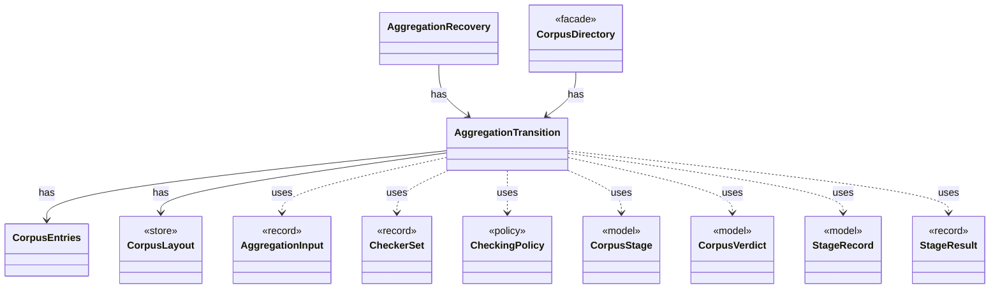

# `AggregationTransition`

`io.github.tlaplus.hardening.corpus` · class · other · [source](https://github.com/tlaplus/model-checker-hardening/blob/4206d99417cbe58b5b339e189936abe305c56cca/src/main/java/io/github/tlaplus/hardening/corpus/AggregationTransition.java#L19) · module [corpus](../modules/corpus.md)

Joins the checker copies of one logical input into one durable aggregator result.

The diagram draws 11 of 18 relations; the table lists them all.

| Direction | Relation | Type | Summary |
|---|---|---|---|
| → | has | [CorpusEntries](io.github.tlaplus.hardening.corpus.CorpusEntries.md) | Reads corpus entries and states what makes one valid: a decodable CBOR envelope holding an expression, a name that matches its payload digest, a payload the caller's validator accepts, and stage metadata consistent with the directory the entry sits in. |
| → | has | [CorpusLayout](io.github.tlaplus.hardening.corpus.CorpusLayout.md) | Where one corpus keeps its files, how an entry is named, and how a file is written into it. |
| ← | has | [AggregationRecovery](io.github.tlaplus.hardening.corpus.AggregationRecovery.md) | Recovers aggregate commits and inventories the aggregator's result directories. |
| ← | has | [CorpusDirectory](io.github.tlaplus.hardening.corpus.CorpusDirectory.md) | Owns the on-disk layout and integrity checks for one FuzzTLA corpus. |
| → | uses | [AggregationInput](io.github.tlaplus.hardening.corpus.AggregationInput.md) | A logical corpus entry whose non-crash checker results are ready for aggregation. |
| → | uses | [CheckerSet](io.github.tlaplus.hardening.corpus.CheckerSet.md) | The checker branches a corpus runs: a non-empty set of checking stages, in stage order. |
| → | uses | [CheckingPolicy](io.github.tlaplus.hardening.corpus.CheckingPolicy.md) | Which checkers a workflow run feeds and how the aggregator judges their verdicts. |
| → | uses | [CorpusStage](io.github.tlaplus.hardening.corpus.CorpusStage.md) | One implemented stage of the fuzzing pipeline, and the corpus directories it owns. |
| → | uses | [CorpusVerdict](io.github.tlaplus.hardening.corpus.CorpusVerdict.md) | A verdict supported by the implemented corpus stages. |
| → | uses | [StageRecord](io.github.tlaplus.hardening.corpus.StageRecord.md) | What a stage records about one input: its verdict, when it worked on the input, its failure classification when it classifies failures, and what it explored when it measures exploration. |
| → | uses | [StageResult](io.github.tlaplus.hardening.corpus.StageResult.md) | What one stage decided about one input, and the tool output kept for triage. |
| → | depends | [Diagnostics](io.github.tlaplus.hardening.common.Diagnostics.md) | Human-readable diagnostic formatting for failures. |
| → | depends | [CorpusEnvelope](io.github.tlaplus.hardening.corpus.CorpusEnvelope.md) | Supported fields decoded from one corpus input envelope. |
| → | depends | [CorpusEnvelopeCodec](io.github.tlaplus.hardening.corpus.CorpusEnvelopeCodec.md) | Reads and rewrites the `stages` metadata of a corpus envelope. |
| → | depends | [CorpusException](io.github.tlaplus.hardening.corpus.CorpusException.md) | Reports an invalid corpus layout or corpus entry. |
| → | depends | [CorpusFormatException](io.github.tlaplus.hardening.corpus.CorpusFormatException.md) | Reports stored corpus data that does not follow the documented CBOR format. |
| → | depends | [CorpusPath](io.github.tlaplus.hardening.corpus.CorpusPath.md) | A fixed path in the on-disk corpus layout. |
| → | depends | [StageMetadata](io.github.tlaplus.hardening.corpus.StageMetadata.md) | Metadata recorded when one workflow stage finishes processing an input. |
