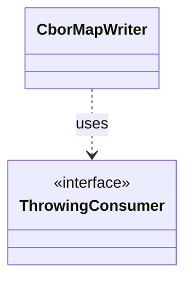

# `CborMapWriter`

`io.github.tlaplus.hardening.corpus` · class · other · [source](https://github.com/tlaplus/model-checker-hardening/blob/4c5cb469fa5cdcada2cd5740bce130b825b35343/src/main/java/io/github/tlaplus/hardening/corpus/CborMapWriter.java#L27) · module [corpus](../modules/corpus.md)

Collects the fields of one CBOR map so that its definite length is derived from what is written rather than maintained beside it.

The diagram draws 1 of 6 relations; the table lists them all.

| Direction | Relation | Type | Summary |
|---|---|---|---|
| → | uses | [ThrowingConsumer](io.github.tlaplus.hardening.common.ThrowingConsumer.md) | An operation on one value that may fail with a checked exception. |
| → | depends | [CborReader](io.github.tlaplus.hardening.corpus.CborReader.md) | Reads one CBOR document of a corpus, checking its shape as it goes. |
| → | depends | [CorpusCbor](io.github.tlaplus.hardening.corpus.CorpusCbor.md) | The Jackson wiring shared by every codec of the corpus CBOR formats. |
| ← | depends | [CorpusEnvelopeCodec](io.github.tlaplus.hardening.corpus.CorpusEnvelopeCodec.md) | Reads and rewrites the `stages` metadata of a corpus envelope. |
| ← | depends | [CorpusInputCodec](io.github.tlaplus.hardening.corpus.CorpusInputCodec.md) | Encodes and decodes an input's kind, generator payload, and admission metadata. |
| ← | depends | [CorpusRunStatisticsCodec](io.github.tlaplus.hardening.corpus.CorpusRunStatisticsCodec.md) | Encodes and decodes the aggregate workflow-statistics CBOR document. |
