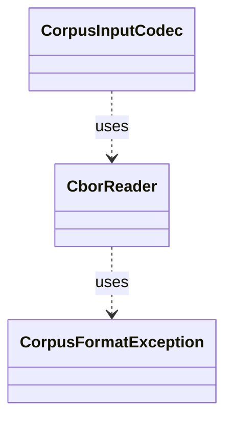

# `CborReader`

`io.github.tlaplus.hardening.corpus` · class · other · [source](https://github.com/tlaplus/model-checker-hardening/blob/a304ba37155136c3ba79e4f2fb414cbb47d01606/src/main/java/io/github/tlaplus/hardening/corpus/CborReader.java#L30) · module [corpus](../modules/corpus.md)

Reads one CBOR document of a corpus, checking its shape as it goes.

The diagram draws 2 of 7 relations; the table lists them all.

| Direction | Relation | Type | Summary |
|---|---|---|---|
| → | uses | [CorpusFormatException](io.github.tlaplus.hardening.corpus.CorpusFormatException.md) | Reports stored corpus data that does not follow the documented CBOR format. |
| ← | uses | [CorpusInputCodec](io.github.tlaplus.hardening.corpus.CorpusInputCodec.md) | Encodes and decodes an input's kind, generator payload, and admission metadata. |
| → | depends | [Diagnostics](io.github.tlaplus.hardening.common.Diagnostics.md) | Human-readable diagnostic formatting for failures. |
| → | depends | [CorpusCbor](io.github.tlaplus.hardening.corpus.CorpusCbor.md) | The Jackson wiring shared by every codec of the corpus CBOR formats. |
| ← | depends | [CborMapWriter](io.github.tlaplus.hardening.corpus.CborMapWriter.md) | Collects the fields of one CBOR map so that its definite length is derived from what is written rather than maintained beside it. |
| ← | depends | [CorpusEnvelopeCodec](io.github.tlaplus.hardening.corpus.CorpusEnvelopeCodec.md) | Reads and rewrites the `stages` metadata of a corpus envelope. |
| ← | depends | [CorpusRunStatisticsCodec](io.github.tlaplus.hardening.corpus.CorpusRunStatisticsCodec.md) | Encodes and decodes the aggregate workflow-statistics CBOR document. |
