# `CheckerSet`

`io.github.tlaplus.hardening.corpus` · record · other · [source](https://github.com/tlaplus/model-checker-hardening/blob/47a7fcfd71d20c6a404ebf5a8a3e7d9a0e250e9b/src/main/java/io/github/tlaplus/hardening/corpus/CheckerSet.java#L14) · module [corpus](../modules/corpus.md)

The checker branches a corpus runs: a non-empty set of checking stages, in stage order.

**Decisions:** [ADR 0016: Metamorphic testing](https://github.com/tlaplus/model-checker-hardening/blob/47a7fcfd71d20c6a404ebf5a8a3e7d9a0e250e9b/docs/decisions/0016-metamorphic-testing.md)

```mermaid
classDiagram
  class CheckerSet {
    <<record>>
  }
  class CorpusStage {
    <<model>>
  }
  class WorkflowConfig {
    <<config>>
  }
  class CheckingPolicy {
    <<policy>>
  }
  class InventoryScan
  class TransitionRecovery
  class GenerationProgress {
    <<model>>
  }
  class OccupancyLimits
  class ConfigSchema {
    <<config>>
  }
  class ConfigValueType {
    <<record>>
  }
  class AggregationTransition
  class EntryProgress {
    <<record>>
  }
  class StageTransition {
    <<store>>
  }
  class CorpusRecords
  class StageGraph {
    <<process>>
  }
  CorpusStage <|.. CheckerSet
  WorkflowConfig --> CheckerSet : has
  CheckingPolicy --> CheckerSet : has
  InventoryScan --> CheckerSet : has
  TransitionRecovery --> CheckerSet : has
  GenerationProgress --> CheckerSet : has
  OccupancyLimits --> CheckerSet : has
  ConfigSchema ..> CheckerSet : uses
  ConfigValueType ..> CheckerSet : uses
  AggregationTransition ..> CheckerSet : uses
  EntryProgress ..> CheckerSet : uses
  StageTransition ..> CheckerSet : uses
  CorpusRecords ..> CheckerSet : uses
  StageGraph ..> CheckerSet : uses
```

The diagram draws 14 of 21 relations; the table lists them all.

| Direction | Relation | Type | Summary |
|---|---|---|---|
| → | implements | [CorpusStage](io.github.tlaplus.hardening.corpus.CorpusStage.md) | One implemented stage of the fuzzing pipeline, and the corpus directories it owns. |
| ← | has | [WorkflowConfig](io.github.tlaplus.hardening.config.WorkflowConfig.md) | Global and per-stage limits for the implemented fuzzing workflow. |
| ← | has | [CheckingPolicy](io.github.tlaplus.hardening.corpus.CheckingPolicy.md) | Which checkers a workflow run feeds and how the aggregator judges their verdicts. |
| ← | has | [InventoryScan](io.github.tlaplus.hardening.corpus.InventoryScan.md) | The second pass of startup recovery: validates every entry of a corpus in which no transition is half-finished, and reports what it holds. |
| ← | has | [TransitionRecovery](io.github.tlaplus.hardening.corpus.TransitionRecovery.md) | The first pass of startup recovery: finishes the durable transitions an interrupted run left behind. |
| ← | has | [GenerationProgress](io.github.tlaplus.hardening.workflow.GenerationProgress.md) | Where every generation of a run stands, tracked from stage events instead of a corpus rescan (ADR 0010). |
| ← | has | [OccupancyLimits](io.github.tlaplus.hardening.workflow.OccupancyLimits.md) | Checks an invocation and a recovered corpus against the configured capacity limits. |
| ← | uses | [ConfigSchema](io.github.tlaplus.hardening.config.ConfigSchema.md) | The declaration of every key in `config.toml`: where it lives, what it means, how its value is read, and how it is written back. |
| ← | uses | [ConfigValueType](io.github.tlaplus.hardening.config.ConfigValueType.md) | How the value of one configuration key is read from TOML and written back as TOML syntax. |
| ← | uses | [AggregationTransition](io.github.tlaplus.hardening.corpus.AggregationTransition.md) | Joins the checker copies of one logical input into one durable aggregator result. |
| ← | uses | [EntryProgress](io.github.tlaplus.hardening.corpus.EntryProgress.md) | How far one logical entry has moved through the pipeline, and the single definition of the two questions generation scheduling asks of it (ADR 0010). |
| ← | uses | [StageTransition](io.github.tlaplus.hardening.corpus.StageTransition.md) | Moves one entry from a stage's input directory to the directory its verdict names. |
| ← | uses | [CorpusRecords](io.github.tlaplus.hardening.workflow.CorpusRecords.md) | The corpus records a run repeats on every later run (ADR 0016 §1, §5, ADR 0017 §6): the technique, the checker set and the rewrite rules. |
| ← | uses | [StageGraph](io.github.tlaplus.hardening.workflow.StageGraph.md) | The stages that run one workflow invocation, wired to their queues, result capacities, and shared collaborators, and the order in which they start and stop. |
| → | depends | [Preconditions](io.github.tlaplus.hardening.common.Preconditions.md) | Shared validation of method and constructor arguments. |
| ← | depends | [TomlConfig](io.github.tlaplus.hardening.config.TomlConfig.md) | Reads and writes the strict `config.toml` format used by a corpus. |
| ← | depends | [AggregationInput](io.github.tlaplus.hardening.corpus.AggregationInput.md) | A logical corpus entry whose non-crash checker results are ready for aggregation. |
| ← | depends | [AggregationRecovery](io.github.tlaplus.hardening.corpus.AggregationRecovery.md) | Recovers aggregate commits and inventories the aggregator's result directories. |
| ← | depends | [CorpusDirectory](io.github.tlaplus.hardening.corpus.CorpusDirectory.md) | Owns the on-disk layout and integrity checks for one FuzzTLA corpus. |
| ← | depends | [MetamorphicShrinker](io.github.tlaplus.hardening.workflow.MetamorphicShrinker.md) | Reduces a metamorphic counterexample for triage (ADR 0016 §8). |
| ← | depends | [WorkflowRunner](io.github.tlaplus.hardening.workflow.WorkflowRunner.md) | Runs generation, parsing, TLC, Apalache, conformance aggregation and the quality gate under one CPU budget. |
