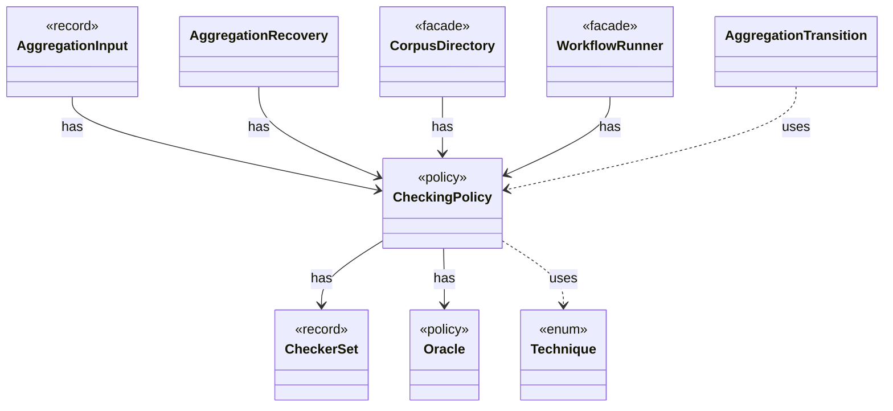

# `CheckingPolicy`

`io.github.tlaplus.hardening.corpus` · record · policy · key · [source](https://github.com/tlaplus/model-checker-hardening/blob/4f182776ab66c4f93ff45cb83dfcd11e34fa32d1/src/main/java/io/github/tlaplus/hardening/corpus/CheckingPolicy.java#L13) · module [corpus](../modules/corpus.md)

Which checkers a workflow run feeds and how the aggregator judges their verdicts.

| Direction | Relation | Type | Summary |
|---|---|---|---|
| → | has | [CheckerSet](io.github.tlaplus.hardening.corpus.CheckerSet.md) | The checker branches a corpus runs: a non-empty set of checking stages, in stage order. |
| → | has | [Oracle](io.github.tlaplus.hardening.corpus.Oracle.md) | How the aggregator judges the checker results of one entry (fuzzing-workflows.md §1.3, ADR 0016 §4, ADR 0019). |
| ← | has | [AggregationInput](io.github.tlaplus.hardening.corpus.AggregationInput.md) | A logical corpus entry whose non-crash checker results are ready for aggregation. |
| ← | has | [AggregationRecovery](io.github.tlaplus.hardening.corpus.AggregationRecovery.md) | Recovers aggregate commits and inventories the aggregator's result directories. |
| ← | has | [CorpusDirectory](io.github.tlaplus.hardening.corpus.CorpusDirectory.md) | Owns the on-disk layout and integrity checks for one FuzzTLA corpus. |
| ← | has | [WorkflowRunner](io.github.tlaplus.hardening.workflow.WorkflowRunner.md) | Runs generation, parsing, TLC, Apalache, conformance aggregation and the quality gate under one CPU budget. |
| → | uses | [Technique](io.github.tlaplus.hardening.corpus.Technique.md) | The fuzzing technique a corpus runs (`fuzztla run --how`). |
| ← | uses | [AggregationTransition](io.github.tlaplus.hardening.corpus.AggregationTransition.md) | Joins the checker copies of one logical input into one durable aggregator result. |
