# `CorpusDirectory`

`io.github.tlaplus.hardening.corpus` · class · facade · key · [source](https://github.com/tlaplus/model-checker-hardening/blob/918f7db91890f302587d25c76dc7ac189db3d023/src/main/java/io/github/tlaplus/hardening/corpus/CorpusDirectory.java#L77) · module [corpus](../modules/corpus.md)

Owns the on-disk layout and integrity checks for one FuzzTLA corpus.

```mermaid
classDiagram
  class CorpusDirectory {
    <<facade>>
  }
  class AggregationTransition
  class CheckingPolicy {
    <<policy>>
  }
  class CorpusEntryStore {
    <<store>>
  }
  class CorpusLayout {
    <<store>>
  }
  class StageTransition {
    <<store>>
  }
  class RunStatisticsOnExit
  class StageEnvironment {
    <<model>>
  }
  class KnownDefectQuarantine
  class QualityGate {
    <<policy>>
  }
  class GeneratedInputPreparation
  class AggregationInput {
    <<record>>
  }
  class CorpusEntryValidator {
    <<interface>>
  }
  class CorpusInput {
    <<record>>
  }
  class CorpusInventory {
    <<record>>
  }
  class CorpusLock
  class CorpusPath {
    <<enum>>
  }
  class CorpusRecord {
    <<enum>>
  }
  class CorpusRunStatistics {
    <<record>>
  }
  class CorpusStage {
    <<model>>
  }
  class CorpusVerdict {
    <<model>>
  }
  class GenerationMetadata {
    <<record>>
  }
  class GeneratorCrashRecording {
    <<interface>>
  }
  class StageResult {
    <<record>>
  }
  class StageScratch
  class StageScratchSet
  class StoreResult {
    <<enum>>
  }
  class StoredEntry {
    <<record>>
  }
  class InputKind {
    <<model>>
  }
  class RunOutput
  CorpusDirectory --> AggregationTransition : has
  CorpusDirectory --> CheckingPolicy : has
  CorpusDirectory --> CorpusEntryStore : has
  CorpusDirectory --> CorpusLayout : has
  CorpusDirectory --> StageTransition : has
  RunStatisticsOnExit --> CorpusDirectory : has
  StageEnvironment --> CorpusDirectory : has
  KnownDefectQuarantine --> CorpusDirectory : has
  QualityGate --> CorpusDirectory : has
  GeneratedInputPreparation --> CorpusDirectory : has
  CorpusDirectory ..> AggregationInput : uses
  CorpusDirectory ..> CorpusEntryValidator : uses
  CorpusDirectory ..> CorpusInput : uses
  CorpusDirectory ..> CorpusInventory : uses
  CorpusDirectory ..> CorpusLock : uses
  CorpusDirectory ..> CorpusPath : uses
  CorpusDirectory ..> CorpusRecord : uses
  CorpusDirectory ..> CorpusRunStatistics : uses
  CorpusDirectory ..> CorpusStage : uses
  CorpusDirectory ..> CorpusVerdict : uses
  CorpusDirectory ..> GenerationMetadata : uses
  CorpusDirectory ..> GeneratorCrashRecording : uses
  CorpusDirectory ..> StageResult : uses
  CorpusDirectory ..> StageScratch : uses
  CorpusDirectory ..> StageScratchSet : uses
  CorpusDirectory ..> StoreResult : uses
  CorpusDirectory ..> StoredEntry : uses
  CorpusDirectory ..> InputKind : uses
  RunOutput ..> CorpusDirectory : uses
  StageScratchSet ..> CorpusDirectory : uses
```

The diagram draws 30 of 60 relations; the table lists them all.

| Direction | Relation | Type | Summary |
|---|---|---|---|
| → | has | [AggregationTransition](io.github.tlaplus.hardening.corpus.AggregationTransition.md) | Joins the checker copies of one logical input into one durable aggregator result. |
| → | has | [CheckingPolicy](io.github.tlaplus.hardening.corpus.CheckingPolicy.md) | Which checkers a workflow run feeds and how the aggregator judges their verdicts. |
| → | has | [CorpusEntryStore](io.github.tlaplus.hardening.corpus.CorpusEntryStore.md) | Admits generated payloads to the input stage and preserves the ones that broke the generator. |
| → | has | [CorpusLayout](io.github.tlaplus.hardening.corpus.CorpusLayout.md) | Where one corpus keeps its files, how an entry is named, and how a file is written into it. |
| → | has | [StageTransition](io.github.tlaplus.hardening.corpus.StageTransition.md) | Moves one entry from a stage's input directory to the directory its verdict names. |
| ← | has | [RunStatisticsOnExit](io.github.tlaplus.hardening.workflow.RunStatisticsOnExit.md) | Stops the invocation clock and saves its aggregate while the corpus lock is still held. |
| ← | has | [StageEnvironment](io.github.tlaplus.hardening.workflow.execution.StageEnvironment.md) | The collaborators every stage of one workflow invocation shares: the corpus it reads and writes, the decoder each stored input kind is regenerated through, the CPU budget it competes for, and the stop state it observes and reports to. |
| ← | has | [KnownDefectQuarantine](io.github.tlaplus.hardening.workflow.input.KnownDefectQuarantine.md) | Keeps at most a fixed number of quarantined candidates per primary known-defect signature in `00-known-defects`; past the cap, a match is counted by the caller and discarded here. |
| ← | has | [QualityGate](io.github.tlaplus.hardening.workflow.quality.QualityGate.md) | Selects the parents of the next generation from one settled generation (ADR 0010, ADR 0013). |
| ← | has | [GeneratedInputPreparation](io.github.tlaplus.hardening.workflow.spec.GeneratedInputPreparation.md) | Regenerates and renders one tool input while preserving generator-crash artifacts. |
| → | uses | [AggregationInput](io.github.tlaplus.hardening.corpus.AggregationInput.md) | A logical corpus entry whose non-crash checker results are ready for aggregation. |
| → | uses | [CorpusEntryValidator](io.github.tlaplus.hardening.corpus.CorpusEntryValidator.md) | Checks that a stored input is still one this FuzzTLA build can use. |
| → | uses | [CorpusInput](io.github.tlaplus.hardening.corpus.CorpusInput.md) | The required fields of one encoded corpus input. |
| → | uses | [CorpusInventory](io.github.tlaplus.hardening.corpus.CorpusInventory.md) | Immutable startup inventory used to seed stage queues and capacities. |
| → | uses | [CorpusLock](io.github.tlaplus.hardening.corpus.CorpusLock.md) | An exclusive corpus lock and its backing file channel, released together. |
| → | uses | [CorpusPath](io.github.tlaplus.hardening.corpus.CorpusPath.md) | A fixed path in the on-disk corpus layout. |
| → | uses | [CorpusRecord](io.github.tlaplus.hardening.corpus.CorpusRecord.md) | A small corpus file that pins how the corpus's entries replay. |
| → | uses | [CorpusRunStatistics](io.github.tlaplus.hardening.corpus.CorpusRunStatistics.md) | Durable cumulative statistics that cannot be recovered cheaply from corpus entries. |
| → | uses | [CorpusStage](io.github.tlaplus.hardening.corpus.CorpusStage.md) | One implemented stage of the fuzzing pipeline, and the corpus directories it owns. |
| → | uses | [CorpusVerdict](io.github.tlaplus.hardening.corpus.CorpusVerdict.md) | A verdict supported by the implemented corpus stages. |
| → | uses | [GenerationMetadata](io.github.tlaplus.hardening.corpus.GenerationMetadata.md) | Admission-time facts about one corpus input: the generation that admitted it, its PBT cohort and collection-richness score, and, for a mutant, the parent and operators it was derived from. |
| → | uses | [GeneratorCrashRecording](io.github.tlaplus.hardening.corpus.GeneratorCrashRecording.md) | Result of trying to preserve a payload that crashed its generator. |
| → | uses | [StageResult](io.github.tlaplus.hardening.corpus.StageResult.md) | What one stage decided about one input, and the tool output kept for triage. |
| → | uses | [StageScratch](io.github.tlaplus.hardening.corpus.StageScratch.md) | Corpus-owned transient storage for one stage during one workflow invocation. |
| → | uses | [StageScratchSet](io.github.tlaplus.hardening.corpus.StageScratchSet.md) | The transient scratch directories of every stage that needs one, created and removed together. |
| → | uses | [StoreResult](io.github.tlaplus.hardening.corpus.StoreResult.md) | Result of attempting to add an input to a corpus. |
| → | uses | [StoredEntry](io.github.tlaplus.hardening.corpus.StoredEntry.md) | An entry file in one of the corpus's entry directories, listed but not read. |
| → | uses | [InputKind](io.github.tlaplus.hardening.gen.InputKind.md) | What a generator payload decodes to. |
| ← | uses | [RunOutput](io.github.tlaplus.hardening.cli.RunOutput.md) | The output of one run: the command's configured writer and an optional live display in front of it. |
| ← | uses | [StageScratchSet](io.github.tlaplus.hardening.corpus.StageScratchSet.md) | The transient scratch directories of every stage that needs one, created and removed together. |
| ← | uses | [CorpusReplay](io.github.tlaplus.hardening.workflow.CorpusReplay.md) | Decodes a corpus's entries as they were admitted: with the decoders of the technique the corpus records, and only while the libraries they load match the corpus's manifests. |
| ← | uses | [MetamorphicShrinker](io.github.tlaplus.hardening.workflow.MetamorphicShrinker.md) | Reduces a metamorphic counterexample for triage (ADR 0016 §8). |
| ← | uses | [ReplayRecord](io.github.tlaplus.hardening.workflow.ReplayRecord.md) | Replay policy for one corpus record: a run may proceed only when the record says what the run would write. |
| ← | uses | [StageGraph](io.github.tlaplus.hardening.workflow.StageGraph.md) | The stages that run one workflow invocation, wired to their queues, result capacities, and shared collaborators, and the order in which they start and stop. |
| ← | uses | [WorkflowRunner](io.github.tlaplus.hardening.workflow.WorkflowRunner.md) | Runs generation, parsing, TLC, Apalache, conformance aggregation and the quality gate under one CPU budget. |
| ← | uses | [CheckerRouting](io.github.tlaplus.hardening.workflow.checker.CheckerRouting.md) | Routes a model checker's results. |
| ← | uses | [ParentPool](io.github.tlaplus.hardening.workflow.input.ParentPool.md) | The entries of `04quality-pass` that a generation mutates or adopts: those of the kind the run generates, read once when the generation starts. |
| ← | uses | [LibraryManifest](io.github.tlaplus.hardening.workflow.library.LibraryManifest.md) | Replay policy for external source snapshots. |
| ← | uses | [ParserRouting](io.github.tlaplus.hardening.workflow.parser.ParserRouting.md) | Routes parser results. |
| ← | uses | [StageRouting](io.github.tlaplus.hardening.workflow.tool.StageRouting.md) | Where a `ToolStage` takes its inputs from, how it bounds its result directories, and where a recorded result goes next. |
| → | depends | [Diagnostics](io.github.tlaplus.hardening.common.Diagnostics.md) | Human-readable diagnostic formatting for failures. |
| → | depends | [AggregationRecovery](io.github.tlaplus.hardening.corpus.AggregationRecovery.md) | Recovers aggregate commits and inventories the aggregator's result directories. |
| → | depends | [CheckerSet](io.github.tlaplus.hardening.corpus.CheckerSet.md) | The checker branches a corpus runs: a non-empty set of checking stages, in stage order. |
| → | depends | [CorpusEntries](io.github.tlaplus.hardening.corpus.CorpusEntries.md) | Reads corpus entries and states what makes one valid: a decodable CBOR envelope holding an expression, a name that matches its payload digest, a payload the caller's validator accepts, and stage metadata consistent with the directory the entry sits in. |
| → | depends | [CorpusException](io.github.tlaplus.hardening.corpus.CorpusException.md) | Reports an invalid corpus layout or corpus entry. |
| → | depends | [CorpusFormatException](io.github.tlaplus.hardening.corpus.CorpusFormatException.md) | Reports stored corpus data that does not follow the documented CBOR format. |
| → | depends | [CorpusRunStatisticsCodec](io.github.tlaplus.hardening.corpus.CorpusRunStatisticsCodec.md) | Encodes and decodes the aggregate workflow-statistics CBOR document. |
| → | depends | [InventoryScan](io.github.tlaplus.hardening.corpus.InventoryScan.md) | The second pass of startup recovery: validates every entry of a corpus in which no transition is half-finished, and reports what it holds. |
| → | depends | [TransitionRecovery](io.github.tlaplus.hardening.corpus.TransitionRecovery.md) | The first pass of startup recovery: finishes the durable transitions an interrupted run left behind. |
| ← | depends | [ExportDbCommand](io.github.tlaplus.hardening.cli.ExportDbCommand.md) | `fuzztla export-db`: exports a corpus with `CorpusExport` (ADR 0009). |
| ← | depends | [InitCommand](io.github.tlaplus.hardening.cli.InitCommand.md) | `fuzztla init`: writes the default configuration of a new corpus and installs its libraries. |
| ← | depends | [PrintCommand](io.github.tlaplus.hardening.cli.PrintCommand.md) | `fuzztla print`: decodes a payload or corpus envelope and renders it, with the known defects it matches. |
| ← | depends | [RunCommand](io.github.tlaplus.hardening.cli.RunCommand.md) | `fuzztla run`: reads a corpus configuration and runs `WorkflowRunner` with live progress output. |
| ← | depends | [ShrinkCommand](io.github.tlaplus.hardening.cli.ShrinkCommand.md) | `fuzztla shrink`: reduces a metamorphic counterexample with `MetamorphicShrinker` (ADR 0016). |
| ← | depends | [CorpusExport](io.github.tlaplus.hardening.database.CorpusExport.md) | Exports a corpus to a new SQLite database, as ADR 0009 defines it. |
| ← | depends | [AdoptableBase](io.github.tlaplus.hardening.workflow.AdoptableBase.md) | The base corpus of a metamorphic run (ADR 0016 §6). |
| ← | depends | [GenerationLoop](io.github.tlaplus.hardening.workflow.GenerationLoop.md) | Runs the generations of one workflow invocation over a single stage graph (ADR 0010). |
| ← | depends | [AggregatorStage](io.github.tlaplus.hardening.workflow.aggregator.AggregatorStage.md) | Joins completed TLC and Apalache results with one in-process worker. |
| ← | depends | [InputStage](io.github.tlaplus.hardening.workflow.input.InputStage.md) | Concurrent input stage: admits reserved target ranges from adjacent generations. |
| ← | depends | [ToolStage](io.github.tlaplus.hardening.workflow.tool.ToolStage.md) | One stage that runs an external tool over corpus entries: the parser, TLC, or Apalache. |
