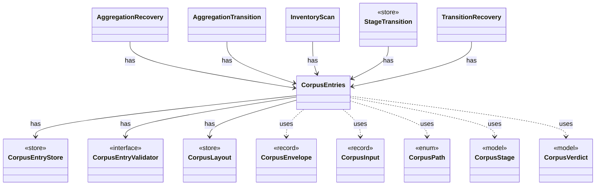

# `CorpusEntries`

`io.github.tlaplus.hardening.corpus` · class · other · [source](https://github.com/tlaplus/model-checker-hardening/blob/6bd7d927f1cffd7642029a3d925dff47091ddde9/src/main/java/io/github/tlaplus/hardening/corpus/CorpusEntries.java#L24) · module [corpus](../modules/corpus.md)

Reads corpus entries and states what makes one valid: a decodable CBOR envelope holding an expression, a name that matches its payload digest, a payload the caller's validator accepts, and stage metadata consistent with the directory the entry sits in.

The diagram draws 13 of 21 relations; the table lists them all.

| Direction | Relation | Type | Summary |
|---|---|---|---|
| → | has | [CorpusEntryStore](io.github.tlaplus.hardening.corpus.CorpusEntryStore.md) | Admits generated payloads to the input stage and preserves the ones that broke the generator. |
| → | has | [CorpusEntryValidator](io.github.tlaplus.hardening.corpus.CorpusEntryValidator.md) | Checks that a stored input is still one this FuzzTLA build can use. |
| → | has | [CorpusLayout](io.github.tlaplus.hardening.corpus.CorpusLayout.md) | Where one corpus keeps its files, how an entry is named, and how a file is written into it. |
| ← | has | [AggregationRecovery](io.github.tlaplus.hardening.corpus.AggregationRecovery.md) | Recovers aggregate commits and inventories the aggregator's result directories. |
| ← | has | [AggregationTransition](io.github.tlaplus.hardening.corpus.AggregationTransition.md) | Joins the checker copies of one logical input into one durable aggregator result. |
| ← | has | [InventoryScan](io.github.tlaplus.hardening.corpus.InventoryScan.md) | The second pass of startup recovery: validates every entry of a corpus in which no transition is half-finished, and reports what it holds. |
| ← | has | [StageTransition](io.github.tlaplus.hardening.corpus.StageTransition.md) | Moves one entry from a stage's input directory to the directory its verdict names. |
| ← | has | [TransitionRecovery](io.github.tlaplus.hardening.corpus.TransitionRecovery.md) | The first pass of startup recovery: finishes the durable transitions an interrupted run left behind. |
| → | uses | [CorpusEnvelope](io.github.tlaplus.hardening.corpus.CorpusEnvelope.md) | Supported fields decoded from one corpus input envelope. |
| → | uses | [CorpusInput](io.github.tlaplus.hardening.corpus.CorpusInput.md) | The required fields of one encoded corpus input. |
| → | uses | [CorpusPath](io.github.tlaplus.hardening.corpus.CorpusPath.md) | A fixed path in the on-disk corpus layout. |
| → | uses | [CorpusStage](io.github.tlaplus.hardening.corpus.CorpusStage.md) | One implemented stage of the fuzzing pipeline, and the corpus directories it owns. |
| → | uses | [CorpusVerdict](io.github.tlaplus.hardening.corpus.CorpusVerdict.md) | A verdict supported by the implemented corpus stages. |
| → | depends | [Diagnostics](io.github.tlaplus.hardening.common.Diagnostics.md) | Human-readable diagnostic formatting for failures. |
| → | depends | [CorpusEnvelopeCodec](io.github.tlaplus.hardening.corpus.CorpusEnvelopeCodec.md) | Reads and rewrites the `stages` metadata of a corpus envelope. |
| → | depends | [CorpusException](io.github.tlaplus.hardening.corpus.CorpusException.md) | Reports an invalid corpus layout or corpus entry. |
| → | depends | [CorpusFormatException](io.github.tlaplus.hardening.corpus.CorpusFormatException.md) | Reports stored corpus data that does not follow the documented CBOR format. |
| → | depends | [StageMetadata](io.github.tlaplus.hardening.corpus.StageMetadata.md) | Metadata recorded when one workflow stage finishes processing an input. |
| → | depends | [InputKind](io.github.tlaplus.hardening.gen.InputKind.md) | What a generator payload decodes to. |
| ← | depends | [CorpusDirectory](io.github.tlaplus.hardening.corpus.CorpusDirectory.md) | Owns the on-disk layout and integrity checks for one FuzzTLA corpus. |
| ← | depends | [CorpusEntryStore](io.github.tlaplus.hardening.corpus.CorpusEntryStore.md) | Admits generated payloads to the input stage and preserves the ones that broke the generator. |
