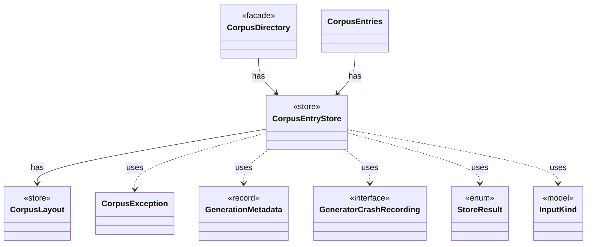

# `CorpusEntryStore`

`io.github.tlaplus.hardening.corpus` · class · store · key · [source](https://github.com/tlaplus/model-checker-hardening/blob/5b16596dd480095d323ac67ff0f85eb85227b4b5/src/main/java/io/github/tlaplus/hardening/corpus/CorpusEntryStore.java#L28) · module [corpus](../modules/corpus.md)

Admits generated payloads to the input stage and preserves the ones that broke the generator.

The diagram draws 8 of 16 relations; the table lists them all.

| Direction | Relation | Type | Summary |
|---|---|---|---|
| → | has | [CorpusLayout](io.github.tlaplus.hardening.corpus.CorpusLayout.md) | Where one corpus keeps its files, how an entry is named, and how a file is written into it. |
| ← | has | [CorpusDirectory](io.github.tlaplus.hardening.corpus.CorpusDirectory.md) | Owns the on-disk layout and integrity checks for one FuzzTLA corpus. |
| ← | has | [CorpusEntries](io.github.tlaplus.hardening.corpus.CorpusEntries.md) | Reads corpus entries and states what makes one valid: a decodable CBOR envelope holding an expression, a name that matches its payload digest, a payload the caller's validator accepts, and stage metadata consistent with the directory the entry sits in. |
| → | uses | [CorpusException](io.github.tlaplus.hardening.corpus.CorpusException.md) | Reports an invalid corpus layout or corpus entry. |
| → | uses | [GenerationMetadata](io.github.tlaplus.hardening.corpus.GenerationMetadata.md) | Admission-time facts about one corpus input: the generation that admitted it, its PBT cohort and collection-richness score, and, for a mutant, the parent and operators it was derived from. |
| → | uses | [GeneratorCrashRecording](io.github.tlaplus.hardening.corpus.GeneratorCrashRecording.md) | Result of trying to preserve a payload that crashed its generator. |
| → | uses | [StoreResult](io.github.tlaplus.hardening.corpus.StoreResult.md) | Result of attempting to add an input to a corpus. |
| → | uses | [InputKind](io.github.tlaplus.hardening.gen.InputKind.md) | What a generator payload decodes to. |
| → | depends | [Diagnostics](io.github.tlaplus.hardening.common.Diagnostics.md) | Human-readable diagnostic formatting for failures. |
| → | depends | [CorpusEntries](io.github.tlaplus.hardening.corpus.CorpusEntries.md) | Reads corpus entries and states what makes one valid: a decodable CBOR envelope holding an expression, a name that matches its payload digest, a payload the caller's validator accepts, and stage metadata consistent with the directory the entry sits in. |
| → | depends | [CorpusEnvelope](io.github.tlaplus.hardening.corpus.CorpusEnvelope.md) | Supported fields decoded from one corpus input envelope. |
| → | depends | [CorpusEnvelopeCodec](io.github.tlaplus.hardening.corpus.CorpusEnvelopeCodec.md) | Reads and rewrites the `stages` metadata of a corpus envelope. |
| → | depends | [CorpusFormatException](io.github.tlaplus.hardening.corpus.CorpusFormatException.md) | Reports stored corpus data that does not follow the documented CBOR format. |
| → | depends | [CorpusInput](io.github.tlaplus.hardening.corpus.CorpusInput.md) | The required fields of one encoded corpus input. |
| → | depends | [CorpusInputCodec](io.github.tlaplus.hardening.corpus.CorpusInputCodec.md) | Encodes and decodes an input's kind, generator payload, and admission metadata. |
| → | depends | [CorpusPath](io.github.tlaplus.hardening.corpus.CorpusPath.md) | A fixed path in the on-disk corpus layout. |
