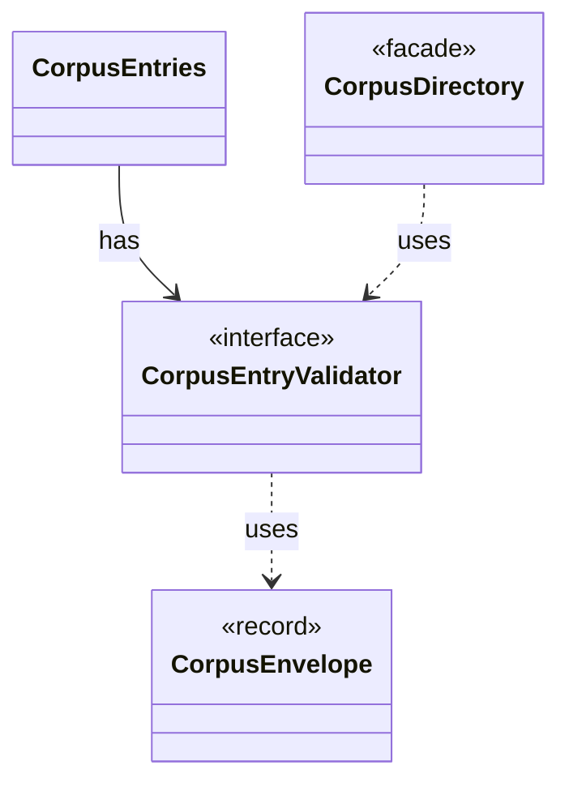

# `CorpusEntryValidator`

`io.github.tlaplus.hardening.corpus` · interface · other · [source](https://github.com/tlaplus/model-checker-hardening/blob/6bbf8b66c375696d1798f7b7a061b81573a3f42a/src/main/java/io/github/tlaplus/hardening/corpus/CorpusEntryValidator.java#L14) · module [corpus](../modules/corpus.md)

Checks that a stored input is still one this FuzzTLA build can use.

The diagram draws 3 of 5 relations; the table lists them all.

| Direction | Relation | Type | Summary |
|---|---|---|---|
| ← | has | [CorpusEntries](io.github.tlaplus.hardening.corpus.CorpusEntries.md) | Reads corpus entries and states what makes one valid: a decodable CBOR envelope holding an expression, a name that matches its payload digest, a payload the caller's validator accepts, and stage metadata consistent with the directory the entry sits in. |
| → | uses | [CorpusEnvelope](io.github.tlaplus.hardening.corpus.CorpusEnvelope.md) | Supported fields decoded from one corpus input envelope. |
| ← | uses | [CorpusDirectory](io.github.tlaplus.hardening.corpus.CorpusDirectory.md) | Owns the on-disk layout and integrity checks for one FuzzTLA corpus. |
| → | depends | [CorpusException](io.github.tlaplus.hardening.corpus.CorpusException.md) | Reports an invalid corpus layout or corpus entry. |
| ← | depends | [WorkflowRunner](io.github.tlaplus.hardening.workflow.WorkflowRunner.md) | Runs generation, parsing, TLC, Apalache, conformance aggregation and the quality gate under one CPU budget. |
