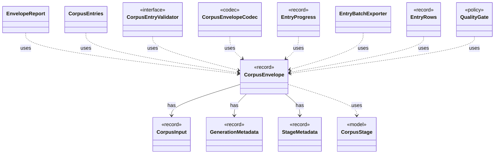

# `CorpusEnvelope`

`io.github.tlaplus.hardening.corpus` · record · other · [source](https://github.com/tlaplus/model-checker-hardening/blob/af09a9e32eb710979ef0c76f29507ce1ffe85a15/src/main/java/io/github/tlaplus/hardening/corpus/CorpusEnvelope.java#L8) · module [corpus](../modules/corpus.md)

Supported fields decoded from one corpus input envelope.

The diagram draws 12 of 20 relations; the table lists them all.

| Direction | Relation | Type | Summary |
|---|---|---|---|
| → | has | [CorpusInput](io.github.tlaplus.hardening.corpus.CorpusInput.md) | The required fields of one encoded corpus input. |
| → | has | [GenerationMetadata](io.github.tlaplus.hardening.corpus.GenerationMetadata.md) | Admission-time facts about one corpus input: the generation that admitted it, its PBT cohort and collection-richness score, and, for a mutant, the parent and operators it was derived from. |
| → | has | [StageMetadata](io.github.tlaplus.hardening.corpus.StageMetadata.md) | Metadata recorded when one workflow stage finishes processing an input. |
| → | uses | [CorpusStage](io.github.tlaplus.hardening.corpus.CorpusStage.md) | One implemented stage of the fuzzing pipeline, and the corpus directories it owns. |
| ← | uses | [EnvelopeReport](io.github.tlaplus.hardening.cli.EnvelopeReport.md) | Renders a decoded corpus envelope and its expression as plain text. |
| ← | uses | [CorpusEntries](io.github.tlaplus.hardening.corpus.CorpusEntries.md) | Reads corpus entries and states what makes one valid: a decodable CBOR envelope holding an expression, a name that matches its payload digest, a payload the caller's validator accepts, and stage metadata consistent with the directory the entry sits in. |
| ← | uses | [CorpusEntryValidator](io.github.tlaplus.hardening.corpus.CorpusEntryValidator.md) | Checks that a stored input is still one this FuzzTLA build can use. |
| ← | uses | [CorpusEnvelopeCodec](io.github.tlaplus.hardening.corpus.CorpusEnvelopeCodec.md) | Reads and rewrites the `stages` metadata of a corpus envelope. |
| ← | uses | [EntryProgress](io.github.tlaplus.hardening.corpus.EntryProgress.md) | How far one logical entry has moved through the pipeline, and the single definition of the two questions generation scheduling asks of it (ADR 0010). |
| ← | uses | [EntryBatchExporter](io.github.tlaplus.hardening.database.EntryBatchExporter.md) | Exports listed entry files in chunks. |
| ← | uses | [EntryRows](io.github.tlaplus.hardening.database.EntryRows.md) | The rows that one decoded corpus entry contributes: its `entry` row, followed by the rows that reference it: one `knownDefect` row per signature, one `mutationOperator` row per operator, one `stage` row per stage record, one `expr` row per expression construct of its replayed input and one `exprEdge` row per edge between constructs. |
| ← | uses | [QualityGate](io.github.tlaplus.hardening.workflow.quality.QualityGate.md) | Selects the parents of the next generation from one settled generation (ADR 0010, ADR 0013). |
| ← | depends | [PrintCommand](io.github.tlaplus.hardening.cli.PrintCommand.md) | `fuzztla print`: decodes a payload or corpus envelope and renders it, with the known defects it matches. |
| ← | depends | [AggregationRecovery](io.github.tlaplus.hardening.corpus.AggregationRecovery.md) | Recovers aggregate commits and inventories the aggregator's result directories. |
| ← | depends | [AggregationTransition](io.github.tlaplus.hardening.corpus.AggregationTransition.md) | Joins the checker copies of one logical input into one durable aggregator result. |
| ← | depends | [CorpusEntryStore](io.github.tlaplus.hardening.corpus.CorpusEntryStore.md) | Admits generated payloads to the input stage and preserves the ones that broke the generator. |
| ← | depends | [InventoryScan](io.github.tlaplus.hardening.corpus.InventoryScan.md) | The second pass of startup recovery: validates every entry of a corpus in which no transition is half-finished, and reports what it holds. |
| ← | depends | [TransitionRecovery](io.github.tlaplus.hardening.corpus.TransitionRecovery.md) | The first pass of startup recovery: finishes the durable transitions an interrupted run left behind. |
| ← | depends | [WorkflowRunner](io.github.tlaplus.hardening.workflow.WorkflowRunner.md) | Runs generation, parsing, TLC, Apalache, conformance aggregation and the quality gate under one CPU budget. |
| ← | depends | [ParentPool](io.github.tlaplus.hardening.workflow.input.ParentPool.md) | The entries of `04quality-pass` that a generation mutates or adopts: those of the kind the run generates, read once when the generation starts. |
