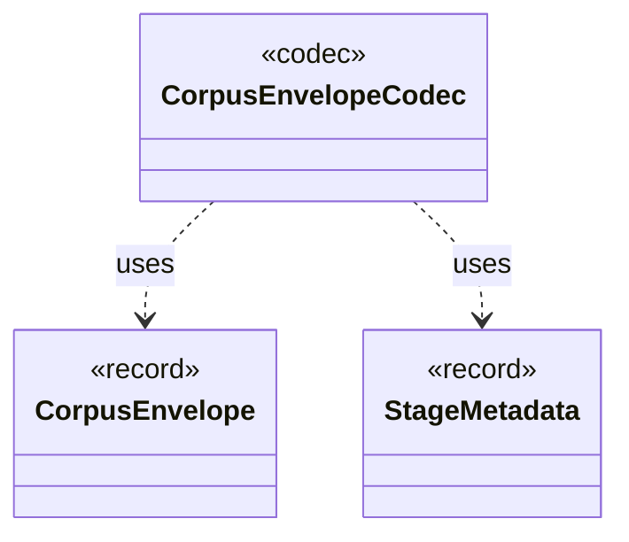

# `CorpusEnvelopeCodec`

`io.github.tlaplus.hardening.corpus` · class · codec · key · [source](https://github.com/tlaplus/model-checker-hardening/blob/5b16596dd480095d323ac67ff0f85eb85227b4b5/src/main/java/io/github/tlaplus/hardening/corpus/CorpusEnvelopeCodec.java#L33) · module [corpus](../modules/corpus.md)

Reads and rewrites the `stages` metadata of a corpus envelope.

The diagram draws 2 of 24 relations; the table lists them all.

| Direction | Relation | Type | Summary |
|---|---|---|---|
| → | uses | [CorpusEnvelope](io.github.tlaplus.hardening.corpus.CorpusEnvelope.md) | Supported fields decoded from one corpus input envelope. |
| → | uses | [StageMetadata](io.github.tlaplus.hardening.corpus.StageMetadata.md) | Metadata recorded when one workflow stage finishes processing an input. |
| → | depends | [CheckerFailure](io.github.tlaplus.hardening.checker.CheckerFailure.md) | A stable checker failure code with optional bounded diagnostic context. |
| → | depends | [CheckerFailureCode](io.github.tlaplus.hardening.checker.CheckerFailureCode.md) | Stable failure codes shared by model-checker stages. |
| → | depends | [ExplorationCount](io.github.tlaplus.hardening.checker.ExplorationCount.md) | A counted exploration metric. |
| → | depends | [ExplorationMetrics](io.github.tlaplus.hardening.checker.ExplorationMetrics.md) | What a model checker explored to reach its verdict, as ADR 0008 defines it. |
| → | depends | [ExplorationPhase](io.github.tlaplus.hardening.checker.ExplorationPhase.md) | How far a model checker got before its verdict was fixed. |
| → | depends | [Diagnostics](io.github.tlaplus.hardening.common.Diagnostics.md) | Human-readable diagnostic formatting for failures. |
| → | depends | [CborMapWriter](io.github.tlaplus.hardening.corpus.CborMapWriter.md) | Collects the fields of one CBOR map so that its definite length is derived from what is written rather than maintained beside it. |
| → | depends | [CborReader](io.github.tlaplus.hardening.corpus.CborReader.md) | Reads one CBOR document of a corpus, checking its shape as it goes. |
| → | depends | [CorpusCbor](io.github.tlaplus.hardening.corpus.CorpusCbor.md) | The Jackson wiring shared by every codec of the corpus CBOR formats. |
| → | depends | [CorpusFormatException](io.github.tlaplus.hardening.corpus.CorpusFormatException.md) | Reports stored corpus data that does not follow the documented CBOR format. |
| → | depends | [CorpusInput](io.github.tlaplus.hardening.corpus.CorpusInput.md) | The required fields of one encoded corpus input. |
| → | depends | [CorpusInputCodec](io.github.tlaplus.hardening.corpus.CorpusInputCodec.md) | Encodes and decodes an input's kind, generator payload, and admission metadata. |
| → | depends | [CorpusVerdict](io.github.tlaplus.hardening.corpus.CorpusVerdict.md) | A verdict supported by the implemented corpus stages. |
| → | depends | [StageRecord](io.github.tlaplus.hardening.corpus.StageRecord.md) | What a stage records about one input: its verdict, when it worked on the input, its failure classification when it classifies failures, and what it explored when it measures exploration. |
| ← | depends | [PrintCommand](io.github.tlaplus.hardening.cli.PrintCommand.md) | `fuzztla print`: decodes a payload or corpus envelope and renders it, with the known defects it matches. |
| ← | depends | [AggregationTransition](io.github.tlaplus.hardening.corpus.AggregationTransition.md) | Joins the checker copies of one logical input into one durable aggregator result. |
| ← | depends | [CorpusEntries](io.github.tlaplus.hardening.corpus.CorpusEntries.md) | Reads corpus entries and states what makes one valid: a decodable CBOR envelope holding an expression, a name that matches its payload digest, a payload the caller's validator accepts, and stage metadata consistent with the directory the entry sits in. |
| ← | depends | [CorpusEntryStore](io.github.tlaplus.hardening.corpus.CorpusEntryStore.md) | Admits generated payloads to the input stage and preserves the ones that broke the generator. |
| ← | depends | [StageTransition](io.github.tlaplus.hardening.corpus.StageTransition.md) | Moves one entry from a stage's input directory to the directory its verdict names. |
| ← | depends | [EntryBatchExporter](io.github.tlaplus.hardening.database.EntryBatchExporter.md) | Exports listed entry files in chunks. |
| ← | depends | [ParentPool](io.github.tlaplus.hardening.workflow.input.ParentPool.md) | The entries of `04quality-pass` that a generation mutates or adopts: those of the kind the run generates, read once when the generation starts. |
| ← | depends | [QualityGate](io.github.tlaplus.hardening.workflow.quality.QualityGate.md) | Selects the parents of the next generation from one settled generation (ADR 0010, ADR 0013). |
