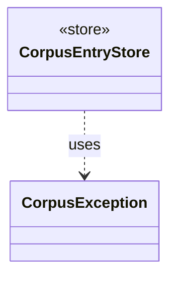

# `CorpusException`

`io.github.tlaplus.hardening.corpus` · class · other · [source](https://github.com/tlaplus/model-checker-hardening/blob/918f7db91890f302587d25c76dc7ac189db3d023/src/main/java/io/github/tlaplus/hardening/corpus/CorpusException.java#L4) · module [corpus](../modules/corpus.md)

Reports an invalid corpus layout or corpus entry.

The diagram draws 1 of 38 relations; the table lists them all.

| Direction | Relation | Type | Summary |
|---|---|---|---|
| ← | uses | [CorpusEntryStore](io.github.tlaplus.hardening.corpus.CorpusEntryStore.md) | Admits generated payloads to the input stage and preserves the ones that broke the generator. |
| ← | depends | [ExportDbCommand](io.github.tlaplus.hardening.cli.ExportDbCommand.md) | `fuzztla export-db`: exports a corpus with `CorpusExport` (ADR 0009). |
| ← | depends | [InitCommand](io.github.tlaplus.hardening.cli.InitCommand.md) | `fuzztla init`: writes the default configuration of a new corpus and installs its libraries. |
| ← | depends | [PrintCommand](io.github.tlaplus.hardening.cli.PrintCommand.md) | `fuzztla print`: decodes a payload or corpus envelope and renders it, with the known defects it matches. |
| ← | depends | [RunCommand](io.github.tlaplus.hardening.cli.RunCommand.md) | `fuzztla run`: reads a corpus configuration and runs `WorkflowRunner` with live progress output. |
| ← | depends | [RunOutput](io.github.tlaplus.hardening.cli.RunOutput.md) | The output of one run: the command's configured writer and an optional live display in front of it. |
| ← | depends | [ShrinkCommand](io.github.tlaplus.hardening.cli.ShrinkCommand.md) | `fuzztla shrink`: reduces a metamorphic counterexample with `MetamorphicShrinker` (ADR 0016). |
| ← | depends | [AggregationRecovery](io.github.tlaplus.hardening.corpus.AggregationRecovery.md) | Recovers aggregate commits and inventories the aggregator's result directories. |
| ← | depends | [AggregationTransition](io.github.tlaplus.hardening.corpus.AggregationTransition.md) | Joins the checker copies of one logical input into one durable aggregator result. |
| ← | depends | [CorpusDirectory](io.github.tlaplus.hardening.corpus.CorpusDirectory.md) | Owns the on-disk layout and integrity checks for one FuzzTLA corpus. |
| ← | depends | [CorpusEntries](io.github.tlaplus.hardening.corpus.CorpusEntries.md) | Reads corpus entries and states what makes one valid: a decodable CBOR envelope holding an expression, a name that matches its payload digest, a payload the caller's validator accepts, and stage metadata consistent with the directory the entry sits in. |
| ← | depends | [CorpusEntryValidator](io.github.tlaplus.hardening.corpus.CorpusEntryValidator.md) | Checks that a stored input is still one this FuzzTLA build can use. |
| ← | depends | [CorpusLayout](io.github.tlaplus.hardening.corpus.CorpusLayout.md) | Where one corpus keeps its files, how an entry is named, and how a file is written into it. |
| ← | depends | [CorpusLock](io.github.tlaplus.hardening.corpus.CorpusLock.md) | An exclusive corpus lock and its backing file channel, released together. |
| ← | depends | [CorpusStage](io.github.tlaplus.hardening.corpus.CorpusStage.md) | One implemented stage of the fuzzing pipeline, and the corpus directories it owns. |
| ← | depends | [InventoryScan](io.github.tlaplus.hardening.corpus.InventoryScan.md) | The second pass of startup recovery: validates every entry of a corpus in which no transition is half-finished, and reports what it holds. |
| ← | depends | [StageScratchSet](io.github.tlaplus.hardening.corpus.StageScratchSet.md) | The transient scratch directories of every stage that needs one, created and removed together. |
| ← | depends | [StageTransition](io.github.tlaplus.hardening.corpus.StageTransition.md) | Moves one entry from a stage's input directory to the directory its verdict names. |
| ← | depends | [StoredEntry](io.github.tlaplus.hardening.corpus.StoredEntry.md) | An entry file in one of the corpus's entry directories, listed but not read. |
| ← | depends | [TransitionRecovery](io.github.tlaplus.hardening.corpus.TransitionRecovery.md) | The first pass of startup recovery: finishes the durable transitions an interrupted run left behind. |
| ← | depends | [CorpusExport](io.github.tlaplus.hardening.database.CorpusExport.md) | Exports a corpus to a new SQLite database, as ADR 0009 defines it. |
| ← | depends | [EntryBatchExporter](io.github.tlaplus.hardening.database.EntryBatchExporter.md) | Exports listed entry files in chunks. |
| ← | depends | [AdoptableBase](io.github.tlaplus.hardening.workflow.AdoptableBase.md) | The base corpus of a metamorphic run (ADR 0016 §6). |
| ← | depends | [CorpusReplay](io.github.tlaplus.hardening.workflow.CorpusReplay.md) | Decodes a corpus's entries as they were admitted: with the decoders of the technique the corpus records, and only while the libraries they load match the corpus's manifests. |
| ← | depends | [GenerationLoop](io.github.tlaplus.hardening.workflow.GenerationLoop.md) | Runs the generations of one workflow invocation over a single stage graph (ADR 0010). |
| ← | depends | [MetamorphicShrinker](io.github.tlaplus.hardening.workflow.MetamorphicShrinker.md) | Reduces a metamorphic counterexample for triage (ADR 0016 §8). |
| ← | depends | [ReplayRecord](io.github.tlaplus.hardening.workflow.ReplayRecord.md) | Replay policy for one corpus record: a run may proceed only when the record says what the run would write. |
| ← | depends | [StageGraph](io.github.tlaplus.hardening.workflow.StageGraph.md) | The stages that run one workflow invocation, wired to their queues, result capacities, and shared collaborators, and the order in which they start and stop. |
| ← | depends | [WorkflowRunner](io.github.tlaplus.hardening.workflow.WorkflowRunner.md) | Runs generation, parsing, TLC, Apalache, conformance aggregation and the quality gate under one CPU budget. |
| ← | depends | [CheckerRouting](io.github.tlaplus.hardening.workflow.checker.CheckerRouting.md) | Routes a model checker's results. |
| ← | depends | [InputAdmission](io.github.tlaplus.hardening.workflow.input.InputAdmission.md) | Decides whether a decoded candidate enters `00-inputs`, and where a known defect goes. |
| ← | depends | [InputStage](io.github.tlaplus.hardening.workflow.input.InputStage.md) | Concurrent input stage: admits reserved target ranges from adjacent generations. |
| ← | depends | [KnownDefectQuarantine](io.github.tlaplus.hardening.workflow.input.KnownDefectQuarantine.md) | Keeps at most a fixed number of quarantined candidates per primary known-defect signature in `00-known-defects`; past the cap, a match is counted by the caller and discarded here. |
| ← | depends | [ParentPool](io.github.tlaplus.hardening.workflow.input.ParentPool.md) | The entries of `04quality-pass` that a generation mutates or adopts: those of the kind the run generates, read once when the generation starts. |
| ← | depends | [LibraryManifest](io.github.tlaplus.hardening.workflow.library.LibraryManifest.md) | Replay policy for external source snapshots. |
| ← | depends | [ParserRouting](io.github.tlaplus.hardening.workflow.parser.ParserRouting.md) | Routes parser results. |
| ← | depends | [QualityGate](io.github.tlaplus.hardening.workflow.quality.QualityGate.md) | Selects the parents of the next generation from one settled generation (ADR 0010, ADR 0013). |
| ← | depends | [StageRouting](io.github.tlaplus.hardening.workflow.tool.StageRouting.md) | Where a `ToolStage` takes its inputs from, how it bounds its result directories, and where a recorded result goes next. |
