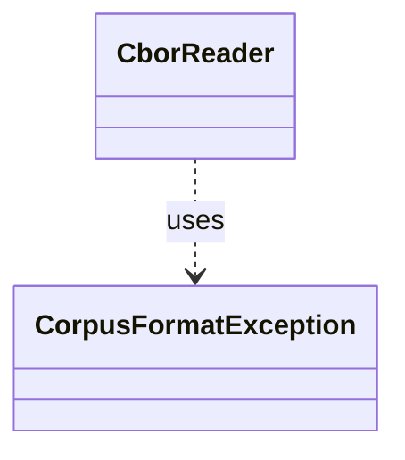

# `CorpusFormatException`

`io.github.tlaplus.hardening.corpus` · class · other · [source](https://github.com/tlaplus/model-checker-hardening/blob/e180a3892e661e5d7ba7636c4f24a6fca66ded14/src/main/java/io/github/tlaplus/hardening/corpus/CorpusFormatException.java#L11) · module [corpus](../modules/corpus.md)

Reports stored corpus data that does not follow the documented CBOR format.

The diagram draws 1 of 14 relations; the table lists them all.

| Direction | Relation | Type | Summary |
|---|---|---|---|
| ← | uses | [CborReader](io.github.tlaplus.hardening.corpus.CborReader.md) | Reads one CBOR document of a corpus, checking its shape as it goes. |
| ← | depends | [PrintCommand](io.github.tlaplus.hardening.cli.PrintCommand.md) | `fuzztla print`: decodes a payload or corpus envelope and renders it, with the known defects it matches. |
| ← | depends | [AggregationTransition](io.github.tlaplus.hardening.corpus.AggregationTransition.md) | Joins the checker copies of one logical input into one durable aggregator result. |
| ← | depends | [CorpusDirectory](io.github.tlaplus.hardening.corpus.CorpusDirectory.md) | Owns the on-disk layout and integrity checks for one FuzzTLA corpus. |
| ← | depends | [CorpusEntries](io.github.tlaplus.hardening.corpus.CorpusEntries.md) | Reads corpus entries and states what makes one valid: a decodable CBOR envelope holding an expression, a name that matches its payload digest, a payload the caller's validator accepts, and stage metadata consistent with the directory the entry sits in. |
| ← | depends | [CorpusEntryStore](io.github.tlaplus.hardening.corpus.CorpusEntryStore.md) | Admits generated payloads to the input stage and preserves the ones that broke the generator. |
| ← | depends | [CorpusEnvelopeCodec](io.github.tlaplus.hardening.corpus.CorpusEnvelopeCodec.md) | Reads and rewrites the `stages` metadata of a corpus envelope. |
| ← | depends | [CorpusInput](io.github.tlaplus.hardening.corpus.CorpusInput.md) | The required fields of one encoded corpus input. |
| ← | depends | [CorpusInputCodec](io.github.tlaplus.hardening.corpus.CorpusInputCodec.md) | Encodes and decodes an input's kind, generator payload, and admission metadata. |
| ← | depends | [CorpusRunStatisticsCodec](io.github.tlaplus.hardening.corpus.CorpusRunStatisticsCodec.md) | Encodes and decodes the aggregate workflow-statistics CBOR document. |
| ← | depends | [StageTransition](io.github.tlaplus.hardening.corpus.StageTransition.md) | Moves one entry from a stage's input directory to the directory its verdict names. |
| ← | depends | [EntryBatchExporter](io.github.tlaplus.hardening.database.EntryBatchExporter.md) | Exports listed entry files in chunks. |
| ← | depends | [ParentPool](io.github.tlaplus.hardening.workflow.input.ParentPool.md) | The entries of `04quality-pass` that a generation mutates or adopts: those of the kind the run generates, read once when the generation starts. |
| ← | depends | [QualityGate](io.github.tlaplus.hardening.workflow.quality.QualityGate.md) | Selects the parents of the next generation from one settled generation (ADR 0010, ADR 0013). |
