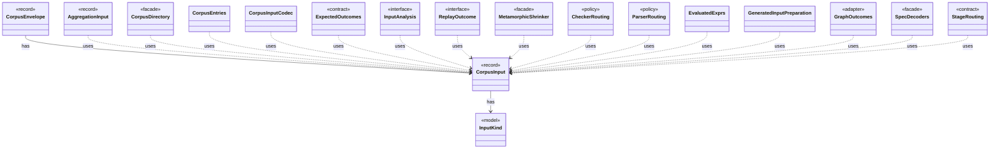

# `CorpusInput`

`io.github.tlaplus.hardening.corpus` · record · other · [source](https://github.com/tlaplus/model-checker-hardening/blob/5b16596dd480095d323ac67ff0f85eb85227b4b5/src/main/java/io/github/tlaplus/hardening/corpus/CorpusInput.java#L8) · module [corpus](../modules/corpus.md)

The required fields of one encoded corpus input.

The diagram draws 17 of 33 relations; the table lists them all.

| Direction | Relation | Type | Summary |
|---|---|---|---|
| → | has | [InputKind](io.github.tlaplus.hardening.gen.InputKind.md) | What a generator payload decodes to. |
| ← | has | [CorpusEnvelope](io.github.tlaplus.hardening.corpus.CorpusEnvelope.md) | Supported fields decoded from one corpus input envelope. |
| ← | uses | [AggregationInput](io.github.tlaplus.hardening.corpus.AggregationInput.md) | A logical corpus entry whose non-crash checker results are ready for aggregation. |
| ← | uses | [CorpusDirectory](io.github.tlaplus.hardening.corpus.CorpusDirectory.md) | Owns the on-disk layout and integrity checks for one FuzzTLA corpus. |
| ← | uses | [CorpusEntries](io.github.tlaplus.hardening.corpus.CorpusEntries.md) | Reads corpus entries and states what makes one valid: a decodable CBOR envelope holding an expression, a name that matches its payload digest, a payload the caller's validator accepts, and stage metadata consistent with the directory the entry sits in. |
| ← | uses | [CorpusInputCodec](io.github.tlaplus.hardening.corpus.CorpusInputCodec.md) | Encodes and decodes an input's kind, generator payload, and admission metadata. |
| ← | uses | [ExpectedOutcomes](io.github.tlaplus.hardening.corpus.ExpectedOutcomes.md) | Predicts the outcome of one stored input, typically by replaying it through the generator (ADR 0023 §5). |
| ← | uses | [InputAnalysis](io.github.tlaplus.hardening.corpus.InputAnalysis.md) | Counts the evaluated nodes, expression constructs and construct edges of one stored input, and names the rewrite rules it applied, typically by replaying it through the generator. |
| ← | uses | [ReplayOutcome](io.github.tlaplus.hardening.database.ReplayOutcome.md) | The result of analysing one input: what its replay shows, or why it could not be replayed. |
| ← | uses | [MetamorphicShrinker](io.github.tlaplus.hardening.workflow.MetamorphicShrinker.md) | Reduces a metamorphic counterexample for triage (ADR 0016 §8). |
| ← | uses | [CheckerRouting](io.github.tlaplus.hardening.workflow.checker.CheckerRouting.md) | Routes a model checker's results. |
| ← | uses | [ParserRouting](io.github.tlaplus.hardening.workflow.parser.ParserRouting.md) | Routes parser results. |
| ← | uses | [EvaluatedExprs](io.github.tlaplus.hardening.workflow.spec.EvaluatedExprs.md) | Replays a stored input and counts the expression constructs of the code the checkers evaluate: the definitions reachable from `SpecArtifact.entryPoints`. |
| ← | uses | [GeneratedInputPreparation](io.github.tlaplus.hardening.workflow.spec.GeneratedInputPreparation.md) | Regenerates and renders one tool input while preserving generator-crash artifacts. |
| ← | uses | [GraphOutcomes](io.github.tlaplus.hardening.workflow.spec.GraphOutcomes.md) | Predicts the outcome of a graph entry by replaying it through the decoders (ADR 0023 §4): a counterexample of the target's distance when a behaviour reaches the target within the step bound, and a pass otherwise. |
| ← | uses | [SpecDecoders](io.github.tlaplus.hardening.workflow.spec.SpecDecoders.md) | Immutable registry of the decoders that turn stored payloads into checkable modules. |
| ← | uses | [StageRouting](io.github.tlaplus.hardening.workflow.tool.StageRouting.md) | Where a `ToolStage` takes its inputs from, how it bounds its result directories, and where a recorded result goes next. |
| → | depends | [CorpusFormatException](io.github.tlaplus.hardening.corpus.CorpusFormatException.md) | Reports stored corpus data that does not follow the documented CBOR format. |
| ← | depends | [EnvelopeReport](io.github.tlaplus.hardening.cli.EnvelopeReport.md) | Renders a decoded corpus envelope and its expression as plain text. |
| ← | depends | [ExportDbCommand](io.github.tlaplus.hardening.cli.ExportDbCommand.md) | `fuzztla export-db`: exports a corpus with `CorpusExport` (ADR 0009). |
| ← | depends | [PrintCommand](io.github.tlaplus.hardening.cli.PrintCommand.md) | `fuzztla print`: decodes a payload or corpus envelope and renders it, with the known defects it matches. |
| ← | depends | [ShrinkCommand](io.github.tlaplus.hardening.cli.ShrinkCommand.md) | `fuzztla shrink`: reduces a metamorphic counterexample with `MetamorphicShrinker` (ADR 0016). |
| ← | depends | [AggregationRecovery](io.github.tlaplus.hardening.corpus.AggregationRecovery.md) | Recovers aggregate commits and inventories the aggregator's result directories. |
| ← | depends | [AggregationTransition](io.github.tlaplus.hardening.corpus.AggregationTransition.md) | Joins the checker copies of one logical input into one durable aggregator result. |
| ← | depends | [CorpusEntryStore](io.github.tlaplus.hardening.corpus.CorpusEntryStore.md) | Admits generated payloads to the input stage and preserves the ones that broke the generator. |
| ← | depends | [CorpusEnvelopeCodec](io.github.tlaplus.hardening.corpus.CorpusEnvelopeCodec.md) | Reads and rewrites the `stages` metadata of a corpus envelope. |
| ← | depends | [EntryBatchExporter](io.github.tlaplus.hardening.database.EntryBatchExporter.md) | Exports listed entry files in chunks. |
| ← | depends | [EntryRows](io.github.tlaplus.hardening.database.EntryRows.md) | The rows that one decoded corpus entry contributes: its `entry` row, followed by the rows that reference it: one `knownDefect` row per signature, one `mutationOperator` row per operator, one `stage` row per stage record, one `expr` row per expression construct of its replayed input and one `exprEdge` row per edge between constructs. |
| ← | depends | [GenerationLoop](io.github.tlaplus.hardening.workflow.GenerationLoop.md) | Runs the generations of one workflow invocation over a single stage graph (ADR 0010). |
| ← | depends | [WorkflowRunner](io.github.tlaplus.hardening.workflow.WorkflowRunner.md) | Runs generation, parsing, TLC, Apalache, conformance aggregation and the quality gate under one CPU budget. |
| ← | depends | [ParentPool](io.github.tlaplus.hardening.workflow.input.ParentPool.md) | The entries of `04quality-pass` that a generation mutates or adopts: those of the kind the run generates, read once when the generation starts. |
| ← | depends | [QualityGate](io.github.tlaplus.hardening.workflow.quality.QualityGate.md) | Selects the parents of the next generation from one settled generation (ADR 0010, ADR 0013). |
| ← | depends | [ToolStage](io.github.tlaplus.hardening.workflow.tool.ToolStage.md) | One stage that runs an external tool over corpus entries: the parser, TLC, or Apalache. |
