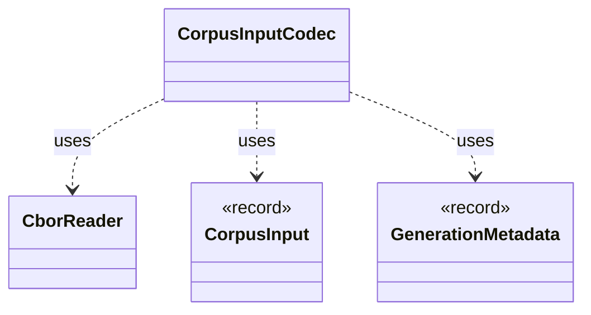

# `CorpusInputCodec`

`io.github.tlaplus.hardening.corpus` · class · other · [source](https://github.com/tlaplus/model-checker-hardening/blob/4f182776ab66c4f93ff45cb83dfcd11e34fa32d1/src/main/java/io/github/tlaplus/hardening/corpus/CorpusInputCodec.java#L23) · module [corpus](../modules/corpus.md)

Encodes and decodes an input's kind, generator payload, and admission metadata.

The diagram draws 3 of 13 relations; the table lists them all.

| Direction | Relation | Type | Summary |
|---|---|---|---|
| → | uses | [CborReader](io.github.tlaplus.hardening.corpus.CborReader.md) | Reads one CBOR document of a corpus, checking its shape as it goes. |
| → | uses | [CorpusInput](io.github.tlaplus.hardening.corpus.CorpusInput.md) | The required fields of one encoded corpus input. |
| → | uses | [GenerationMetadata](io.github.tlaplus.hardening.corpus.GenerationMetadata.md) | Admission-time facts about one corpus input: the generation that admitted it, its PBT cohort and collection-richness score, and, for a mutant, the parent and operators it was derived from. |
| → | depends | [Diagnostics](io.github.tlaplus.hardening.common.Diagnostics.md) | Human-readable diagnostic formatting for failures. |
| → | depends | [CborMapWriter](io.github.tlaplus.hardening.corpus.CborMapWriter.md) | Collects the fields of one CBOR map so that its definite length is derived from what is written rather than maintained beside it. |
| → | depends | [CorpusFormatException](io.github.tlaplus.hardening.corpus.CorpusFormatException.md) | Reports stored corpus data that does not follow the documented CBOR format. |
| → | depends | [Mutation](io.github.tlaplus.hardening.corpus.Mutation.md) | How a mutated input was derived: the digest of the parent it was mutated from and the operators applied to the parent, in order. |
| → | depends | [InputKind](io.github.tlaplus.hardening.gen.InputKind.md) | What a generator payload decodes to. |
| → | depends | [MutationOperator](io.github.tlaplus.hardening.mutation.MutationOperator.md) | One byte-level edit of a generator input, as ADR 0010 defines it. |
| ← | depends | [PrintCommand](io.github.tlaplus.hardening.cli.PrintCommand.md) | `fuzztla print`: decodes a payload or corpus envelope and renders it, with the known defects it matches. |
| ← | depends | [ShrinkCommand](io.github.tlaplus.hardening.cli.ShrinkCommand.md) | `fuzztla shrink`: reduces a metamorphic counterexample with `MetamorphicShrinker` (ADR 0016). |
| ← | depends | [CorpusEntryStore](io.github.tlaplus.hardening.corpus.CorpusEntryStore.md) | Admits generated payloads to the input stage and preserves the ones that broke the generator. |
| ← | depends | [CorpusEnvelopeCodec](io.github.tlaplus.hardening.corpus.CorpusEnvelopeCodec.md) | Reads and rewrites the `stages` metadata of a corpus envelope. |
