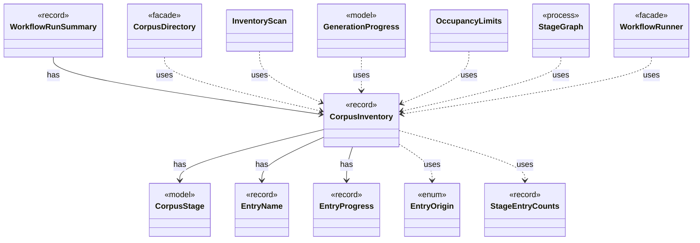

# `CorpusInventory`

`io.github.tlaplus.hardening.corpus` · record · other · [source](https://github.com/tlaplus/model-checker-hardening/blob/ad025d7ad6f7113910ce3a79cf6e18839b06eb5a/src/main/java/io/github/tlaplus/hardening/corpus/CorpusInventory.java#L24) · module [corpus](../modules/corpus.md)

Immutable startup inventory used to seed stage queues and capacities.

The diagram draws 12 of 17 relations; the table lists them all.

| Direction | Relation | Type | Summary |
|---|---|---|---|
| → | has | [CorpusStage](io.github.tlaplus.hardening.corpus.CorpusStage.md) | One implemented stage of the fuzzing pipeline, and the corpus directories it owns. |
| → | has | [EntryName](io.github.tlaplus.hardening.corpus.EntryName.md) | The identity of one logical corpus entry: the file name it keeps in every stage directory it passes through. |
| → | has | [EntryProgress](io.github.tlaplus.hardening.corpus.EntryProgress.md) | How far one logical entry has moved through the pipeline, and the single definition of the two questions generation scheduling asks of it (ADR 0010). |
| ← | has | [WorkflowRunSummary](io.github.tlaplus.hardening.workflow.WorkflowRunSummary.md) | Cumulative corpus statistics and stopping reason after one complete workflow invocation. |
| → | uses | [EntryOrigin](io.github.tlaplus.hardening.corpus.EntryOrigin.md) | Which candidate source admitted an entry, as its generation metadata records it (ADR 0010, ADR 0016 §6). |
| → | uses | [StageEntryCounts](io.github.tlaplus.hardening.corpus.StageEntryCounts.md) | How many entries one stage has produced under each verdict. |
| ← | uses | [CorpusDirectory](io.github.tlaplus.hardening.corpus.CorpusDirectory.md) | Owns the on-disk layout and integrity checks for one FuzzTLA corpus. |
| ← | uses | [InventoryScan](io.github.tlaplus.hardening.corpus.InventoryScan.md) | The second pass of startup recovery: validates every entry of a corpus in which no transition is half-finished, and reports what it holds. |
| ← | uses | [GenerationProgress](io.github.tlaplus.hardening.workflow.GenerationProgress.md) | Where every generation of a run stands, tracked from stage events instead of a corpus rescan (ADR 0010). |
| ← | uses | [OccupancyLimits](io.github.tlaplus.hardening.workflow.OccupancyLimits.md) | Checks an invocation and a recovered corpus against the configured capacity limits. |
| ← | uses | [StageGraph](io.github.tlaplus.hardening.workflow.StageGraph.md) | The stages that run one workflow invocation, wired to their queues, result capacities, and shared collaborators, and the order in which they start and stop. |
| ← | uses | [WorkflowRunner](io.github.tlaplus.hardening.workflow.WorkflowRunner.md) | Runs generation, parsing, TLC, Apalache, conformance aggregation and the quality gate under one CPU budget. |
| → | depends | [EnumMaps](io.github.tlaplus.hardening.common.EnumMaps.md) | Validated immutable copies of maps keyed by an enum, iterated in declaration order. |
| → | depends | [Preconditions](io.github.tlaplus.hardening.common.Preconditions.md) | Shared validation of method and constructor arguments. |
| → | depends | [CorpusVerdict](io.github.tlaplus.hardening.corpus.CorpusVerdict.md) | A verdict supported by the implemented corpus stages. |
| ← | depends | [RunView](io.github.tlaplus.hardening.cli.RunView.md) | The statistics shared by live and final reports, without layout or terminal state. |
| ← | depends | [GenerationLoop](io.github.tlaplus.hardening.workflow.GenerationLoop.md) | Runs the generations of one workflow invocation over a single stage graph (ADR 0010). |
