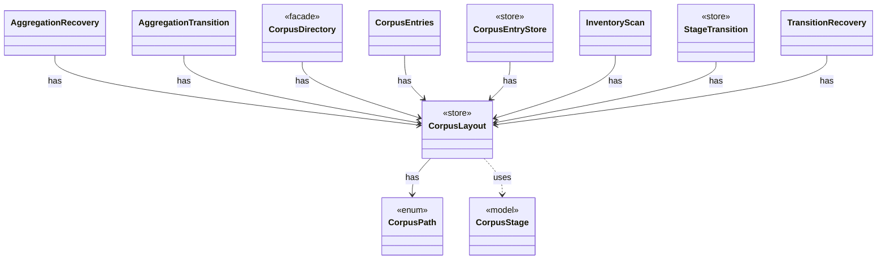

# `CorpusLayout`

`io.github.tlaplus.hardening.corpus` · class · store · key · [source](https://github.com/tlaplus/model-checker-hardening/blob/b96eff75a5bbf8a60b15ad020d6e84735c75a47c/src/main/java/io/github/tlaplus/hardening/corpus/CorpusLayout.java#L33) · module [corpus](../modules/corpus.md)

Where one corpus keeps its files, how an entry is named, and how a file is written into it.

The diagram draws 10 of 14 relations; the table lists them all.

| Direction | Relation | Type | Summary |
|---|---|---|---|
| → | has | [CorpusPath](io.github.tlaplus.hardening.corpus.CorpusPath.md) | A fixed path in the on-disk corpus layout. |
| ← | has | [AggregationRecovery](io.github.tlaplus.hardening.corpus.AggregationRecovery.md) | Recovers aggregate commits and inventories the aggregator's result directories. |
| ← | has | [AggregationTransition](io.github.tlaplus.hardening.corpus.AggregationTransition.md) | Joins the checker copies of one logical input into one durable aggregator result. |
| ← | has | [CorpusDirectory](io.github.tlaplus.hardening.corpus.CorpusDirectory.md) | Owns the on-disk layout and integrity checks for one FuzzTLA corpus. |
| ← | has | [CorpusEntries](io.github.tlaplus.hardening.corpus.CorpusEntries.md) | Reads corpus entries and states what makes one valid: a decodable CBOR envelope holding an expression, a name that matches its payload digest, a payload the caller's validator accepts, and stage metadata consistent with the directory the entry sits in. |
| ← | has | [CorpusEntryStore](io.github.tlaplus.hardening.corpus.CorpusEntryStore.md) | Admits generated payloads to the input stage and preserves the ones that broke the generator. |
| ← | has | [InventoryScan](io.github.tlaplus.hardening.corpus.InventoryScan.md) | The second pass of startup recovery: validates every entry of a corpus in which no transition is half-finished, and reports what it holds. |
| ← | has | [StageTransition](io.github.tlaplus.hardening.corpus.StageTransition.md) | Moves one entry from a stage's input directory to the directory its verdict names. |
| ← | has | [TransitionRecovery](io.github.tlaplus.hardening.corpus.TransitionRecovery.md) | The first pass of startup recovery: finishes the durable transitions an interrupted run left behind. |
| → | uses | [CorpusStage](io.github.tlaplus.hardening.corpus.CorpusStage.md) | One implemented stage of the fuzzing pipeline, and the corpus directories it owns. |
| → | depends | [Digests](io.github.tlaplus.hardening.common.Digests.md) | SHA-256 identities for corpus payloads and external replay dependencies. |
| → | depends | [CorpusException](io.github.tlaplus.hardening.corpus.CorpusException.md) | Reports an invalid corpus layout or corpus entry. |
| ← | depends | [Mutation](io.github.tlaplus.hardening.corpus.Mutation.md) | How a mutated input was derived: the digest of the parent it was mutated from and the operators applied to the parent, in order. |
| ← | depends | [StoredEntry](io.github.tlaplus.hardening.corpus.StoredEntry.md) | An entry file in one of the corpus's entry directories, listed but not read. |
