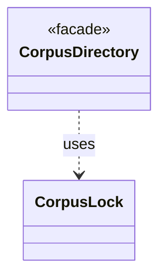

# `CorpusLock`

`io.github.tlaplus.hardening.corpus` · class · other · [source](https://github.com/tlaplus/model-checker-hardening/blob/b96eff75a5bbf8a60b15ad020d6e84735c75a47c/src/main/java/io/github/tlaplus/hardening/corpus/CorpusLock.java#L11) · module [corpus](../modules/corpus.md)

An exclusive corpus lock and its backing file channel, released together.

The diagram draws 1 of 5 relations; the table lists them all.

| Direction | Relation | Type | Summary |
|---|---|---|---|
| ← | uses | [CorpusDirectory](io.github.tlaplus.hardening.corpus.CorpusDirectory.md) | Owns the on-disk layout and integrity checks for one FuzzTLA corpus. |
| → | depends | [CorpusException](io.github.tlaplus.hardening.corpus.CorpusException.md) | Reports an invalid corpus layout or corpus entry. |
| ← | depends | [CorpusExport](io.github.tlaplus.hardening.database.CorpusExport.md) | Exports a corpus to a new SQLite database, as ADR 0009 defines it. |
| ← | depends | [MetamorphicShrinker](io.github.tlaplus.hardening.workflow.MetamorphicShrinker.md) | Reduces a metamorphic counterexample for triage (ADR 0016 §8). |
| ← | depends | [WorkflowRunner](io.github.tlaplus.hardening.workflow.WorkflowRunner.md) | Runs generation, parsing, TLC, Apalache, conformance aggregation and the quality gate under one CPU budget. |
