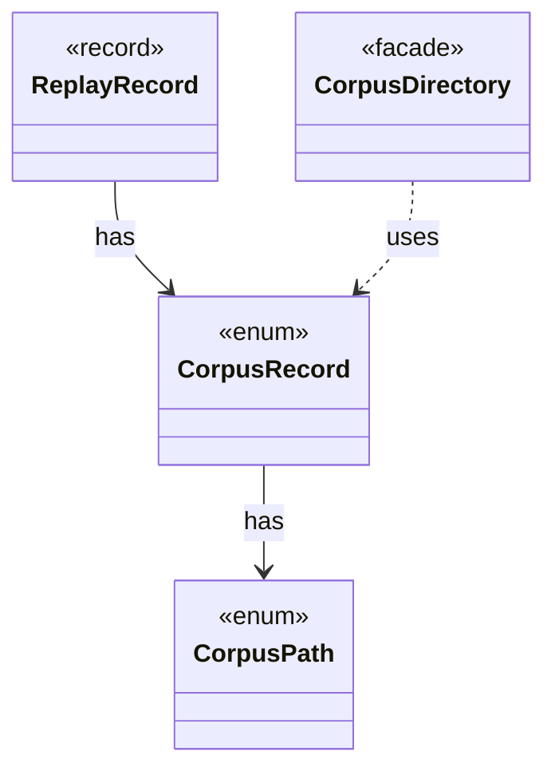

# `CorpusRecord`

`io.github.tlaplus.hardening.corpus` · enum · other · [source](https://github.com/tlaplus/model-checker-hardening/blob/4c5cb469fa5cdcada2cd5740bce130b825b35343/src/main/java/io/github/tlaplus/hardening/corpus/CorpusRecord.java#L7) · module [corpus](../modules/corpus.md)

A small corpus file that pins how the corpus's entries replay.

The diagram draws 3 of 4 relations; the table lists them all.

| Direction | Relation | Type | Summary |
|---|---|---|---|
| → | has | [CorpusPath](io.github.tlaplus.hardening.corpus.CorpusPath.md) | A fixed path in the on-disk corpus layout. |
| ← | has | [ReplayRecord](io.github.tlaplus.hardening.workflow.ReplayRecord.md) | A corpus record written before ADR 0025, which no run writes any more: a run may proceed only when the configuration repeats what the record says. |
| ← | uses | [CorpusDirectory](io.github.tlaplus.hardening.corpus.CorpusDirectory.md) | Owns the on-disk layout and integrity checks for one FuzzTLA corpus. |
| ← | depends | [CorpusRecords](io.github.tlaplus.hardening.workflow.CorpusRecords.md) | The one corpus record still read: the technique of a corpus from before ADR 0025, whose configuration must now repeat it. |
